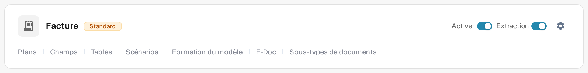

# Commande d'achat

La section **Bon de commande** des **Plus de paramètres** d'un type de document détermine comment les documents de ce type sont appariés aux bons de commande. Les paramètres s'appliquent à un seul type de document à la fois : ouvrez donc d'abord, sous **Paramètres → Types de documents**, le type de document que vous souhaitez modifier.

Pour trouver les paramètres d'une facture :

1. Ouvrez **Paramètres → Types de documents**.
2. Recherchez la carte **Facture** et sélectionnez son icône en forme d'engrenage (**Plus de paramètres**).
3. Ouvrez la section **Bon de commande** pour consulter ses options d'appariement et de validation.

<figure><figcaption>
La carte Facture dans l'environnement de test actuel, en français. Utilisez l'icône en forme d'engrenage pour ouvrir les plus de paramètres ; les autres commandes concernent le type de document.
</figcaption></figure>

Sur la carte, le badge **Standard**, **Activer**, **Extraction**, l'engrenage des plus de paramètres et les liens vers les réglages du type de document ont chacun leur fonction. Leur rôle est décrit dans [Types de documents](../../README.md), sections « Aperçu » et « Contrôles sur une carte de type de document » ; les liens affichés dépendent du type de document, des autorisations et des modules activés.

<figure><figcaption>
La section Bon de commande dans les plus de paramètres, affichée fermée. Dépliez son en-tête pour voir les options ; aucun paramètre n'a été modifié pour cette capture.
</figcaption></figure>

Commencez par les règles d'appariement et les tolérances, puis ajustez le comportement autour de l'appariement et de l'exportation :

* [Règles de Correspondance des Bons de Commande](purchase-order-matching-rules.md) et [Paramètres de tolérance de commande d'achat / Tolérance de commande d'achat supplémentaire](purchase-order-tolerance-settings-additional-purchase-order-tolerance.md) définissent comment les lignes de facture et de bon de commande sont comparées.
* [Options de correspondance automatique et d'exportation](auto-match-and-export-options.md), [Export des lignes de commande non appariées](export-not-matched-po-lines.md) et [Exportation alternative](alternate-export.md) couvrent ce qui se passe après un appariement.
* [Table PO dans le Constructeur de Mise en Page](po-table-in-layout-builder.md), [Statut de la ligne de commande PO consommée](consumed-po-line-status.md) et [Calculer le prix unitaire de la commande](calculate-po-unit-price.md) modifient ce que les utilisateurs voient dans la vue d'appariement.
* [Vérification automatique des mises à jour de CA](auto-check-for-po-updates.md), [Statuts de commande exclus du rapprochement](purchase-order-disable-statuses.md) et [Mettre à jour le statut du bon de commande du document](update-document-purchase-order-status.md) contrôlent la manière dont les données et les statuts des bons de commande restent à jour.
* [Carte des Numéros d'Article Fournisseur - Documentation Administrateur](supplier-item-number-map-admin-documentation.md) et la page générale [Bon de commande](purchase-order.md) apportent un complément de contexte.

Les paramètres peuvent affecter des documents en cours. Vérifiez les modifications avec un document de test avant de les enregistrer en production.

Cette vue d'ensemble montre où trouver les paramètres. Elle ne vérifie pas un appariement de bon de commande ni une exportation effectués.
