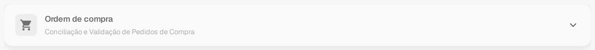

# Ordem de compra

A secção **Ordem de compra** em **Mais Configurações** de um tipo de documento controla a forma como os documentos desse tipo são conciliados com as ordens de compra. As configurações aplicam-se a um tipo de documento de cada vez, por isso abra primeiro o tipo de documento que pretende alterar em **Configurações → Tipos de documentos**.

Para encontrar as configurações de uma fatura:

1. Abra **Configurações → Tipos de documentos**.
2. Localize o cartão **Fatura** e selecione o ícone de engrenagem (**Mais Configurações**).
3. Abra a secção **Ordem de compra** para rever as opções de conciliação e de validação.

<figure><figcaption>
O cartão <strong>Fatura</strong> na versão atual da sandbox em português. O ícone de engrenagem abre as Mais Configurações; os restantes controlos dizem respeito ao tipo de documento.
</figcaption></figure>

No cartão aparecem também **Ativar**, **Extração** e as ligações sob o nome do documento: **Layouts**, **Campos**, **Tabelas**, **Roteiros**, **Treinamento de modelo**, **E-Doc** e **Subtipos de documentos**. Estes controlos dizem respeito ao próprio tipo de documento e estão explicados em [Tipos de documento](../../README.md), na secção «Controlos de cada cartão». As secções recolhíveis das Mais Configurações estão explicadas em [Mais Configurações](../README.md).

<figure><figcaption>
A secção <strong>Ordem de compra</strong> nas Mais Configurações, recolhida. Abra o cabeçalho para ver as opções; para esta captura não foi alterada qualquer configuração.
</figcaption></figure>

Comece pelas regras de conciliação e pelas tolerâncias e, em seguida, ajuste o comportamento após uma conciliação e na exportação:

* [Regras de Correspondência de Pedido de Compra](purchase-order-matching-rules.md) e [Configurações de tolerância de pedido de compra / Tolerância adicional de pedido de compra](purchase-order-tolerance-settings-additional-purchase-order-tolerance.md) definem como as linhas da fatura e da ordem de compra são comparadas.
* [Opções de Auto Match & Export](auto-match-and-export-options.md), [Exportar linhas de PO não correspondidas](export-not-matched-po-lines.md) e [Exportação Alternativa](alternate-export.md) descrevem o que acontece depois de uma conciliação.
* [Tabela de PO no Construtor de Layout](po-table-in-layout-builder.md), [Status da linha de PO consumida](consumed-po-line-status.md) e [Calcular preço unitário do PO](calculate-po-unit-price.md) alteram o que os utilizadores veem na vista de conciliação.
* [Verificação automática de atualizações de PO](auto-check-for-po-updates.md), [Estados de desativação de pedidos de compra](purchase-order-disable-statuses.md) e [Atualizar o Status do Pedido de Compra do Documento](update-document-purchase-order-status.md) controlam a forma como os dados e os estados das ordens de compra se mantêm atualizados.
* [Mapa de Números de Itens do Fornecedor - Documentação do Administrador](supplier-item-number-map-admin-documentation.md) e a página geral [Ordem de compra](purchase-order.md) dão contexto adicional.

As configurações podem afetar documentos em processamento. Confirme as alterações com um documento de teste antes de as guardar em produção.

Esta visão geral mostra onde se encontram as configurações. Não confirma uma conciliação de PO nem uma exportação já realizadas.
