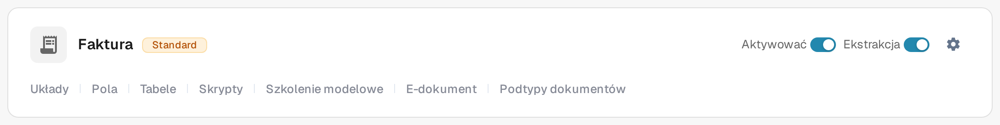
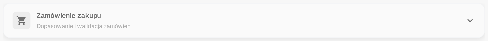

# Zamówienie zakupu

Karta **Zamówienie zakupu** w **Więcej ustawieniach** typu dokumentu określa, jak dokumenty tego typu są dopasowywane do zamówień zakupu. Ustawienia dotyczą zawsze jednego typu dokumentu, dlatego najpierw otwórz w **Ustawienia → Typy dokumentów** ten typ, który chcesz zmienić.

Aby znaleźć ustawienia dla faktury:

1. Otwórz **Ustawienia → Typy dokumentów**.
2. Znajdź kartę **Faktura** i wybierz jej ikonę koła zębatego (**Więcej ustawień**).
3. Otwórz kartę **Zamówienie zakupu**, aby przejrzeć opcje dopasowania i walidacji.

<figure><figcaption>
Karta <strong>Faktura</strong> w aktualnym polskim środowisku sandbox. Ikona koła zębatego otwiera Więcej ustawień; pozostałe elementy sterujące dotyczą samego typu dokumentu.
</figcaption></figure>

Na karcie znajdują się również **Aktywować**, **Ekstrakcja** oraz odnośniki pod nazwą dokumentu. Te elementy sterujące dotyczą samego typu dokumentu i są opisane na stronie [Typy dokumentów](../../README.md) w sekcji „Kontrolki na karcie typu dokumentu”. Jakie karty zawiera Więcej ustawień, opisuje strona [Więcej ustawień](../README.md).

<figure><figcaption>
Karta <strong>Zamówienie zakupu</strong> w Więcej ustawieniach, zwinięta. Otwórz nagłówek, aby zobaczyć opcje; na potrzeby tego zrzutu nie zmieniono żadnego ustawienia.
</figcaption></figure>

Zacznij od reguł dopasowania i tolerancji, a następnie dostosuj zachowanie po dopasowaniu i podczas eksportu:

* [Zasady Dopasowywania Zamówień Zakupu](purchase-order-matching-rules.md) i [Ustawienia tolerancji zamówienia zakupu / Dodatkowa tolerancja zamówienia zakupu](purchase-order-tolerance-settings-additional-purchase-order-tolerance.md) określają, jak porównywane są linie faktury i zamówienia zakupu.
* [Opcje automatycznego dopasowania i eksportu](auto-match-and-export-options.md), [Eksport niepasujących linii PO](export-not-matched-po-lines.md) i [Alternatywny eksport](alternate-export.md) opisują, co dzieje się po dopasowaniu.
* [Tabela PO w Kreatorze Układów](po-table-in-layout-builder.md), [Status linii zamówienia PO](consumed-po-line-status.md) i [Obliczanie ceny jednostkowej zamówienia zakupu](calculate-po-unit-price.md) zmieniają to, co użytkownicy widzą w widoku dopasowywania.
* [Automatyczne sprawdzanie aktualizacji PO](auto-check-for-po-updates.md), [Statusy wyłączenia zamówienia zakupu](purchase-order-disable-statuses.md) i [Aktualizuj status zamówienia zakupu](update-document-purchase-order-status.md) określają, jak dane i statusy zamówienia zakupu pozostają aktualne.
* [Mapa numerów przedmiotów dostawcy - dokumentacja administracyjna](supplier-item-number-map-admin-documentation.md) oraz ogólna strona [Zamówienie zakupu](purchase-order.md) zawierają dodatkowe informacje.

Ustawienia mogą wpływać na dokumenty w trakcie przetwarzania. Sprawdź zmiany na dokumencie testowym, zanim zapiszesz je w środowisku produkcyjnym.

Ten przegląd pokazuje, gdzie znaleźć ustawienia. Nie potwierdza zakończonego dopasowania PO ani eksportu.
