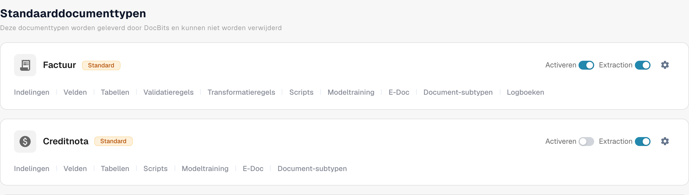
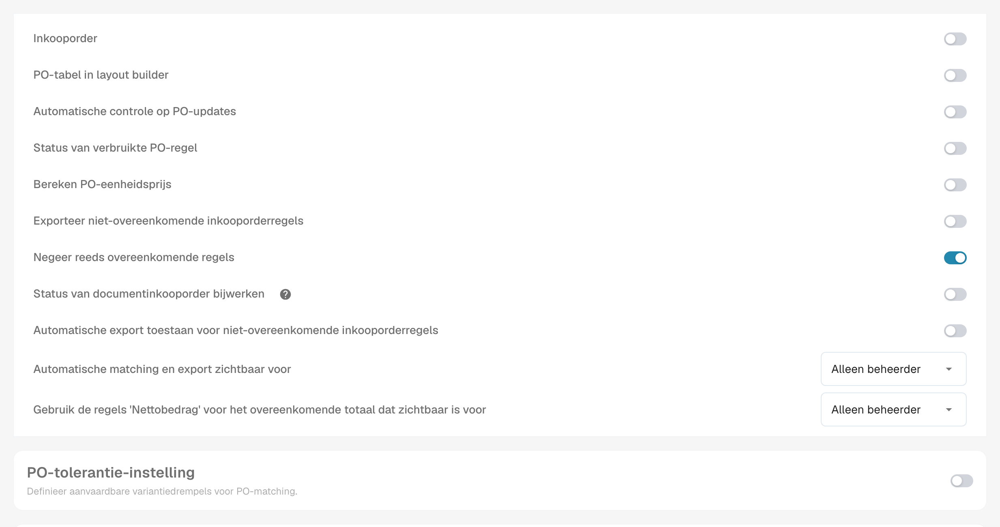

# Bereken PO-eenheidsprijs

## **Overzicht**

Je kunt ervoor kiezen om de **eenheidsprijs** van elke inkooporderregel automatisch te berekenen op basis van het **bedrag** en de **hoeveelheid** van de regel, in plaats van de eenheidsprijs te gebruiken die bij de inkooporder hoort. Dit is vooral handig wanneer de eenheidsprijs in de inkooporder (in Infor ERP / SAP) afwijkt van de prijs op het document. Dergelijke verschillen kunnen ontstaan als er een korting wordt toegepast op de eenheidsprijs in de inkooporder, terwijl het document de korting alleen op het nettobedrag toepast.

## **Activeringsstappen**

1.  Navigeer naar **Settings** -> **Document Processing** -> **Document Types**.

2.  Selecteer het gewenste documenttype en klik op **More Settings**.

    <figure><figcaption>
Toegang tot de aanvullende instellingen van het documenttype Factuur.
</figcaption></figure>
3.  Schakel in de sectie **Purchase Order** de optie **Calculate PO Unit Price** in.

    <figure><figcaption>
Instellingen voor al gebruikte inkooporderregels.
</figcaption></figure>

## Hoe de prijs wordt berekend

Zodra de instelling is geactiveerd, wordt de eenheidsprijs van een inkooporderregel als volgt berekend:

**`Unit Price = Line Amount ÷ Quantity × Unit Price Per`**

waarbij het **regelbedrag** als volgt wordt gekozen:

| De inkooporderregel bevat                                                                      | Gebruikt regelbedrag                   |
| ---------------------------------------------------------------------------------------------- | -------------------------------------- |
| een **nettobedrag** (`extended_amount`) dat groter is dan 0 en niet boven het regeltotaal ligt  | het nettobedrag                        |
| geen nettobedrag, of een nettobedrag boven het regeltotaal                                      | het **totaal** van de regel (`total_amount`) |
| geen positief bedrag, of geen positieve hoeveelheid                                             | er wordt niets berekend, de PO-prijs blijft |

Waarom het nettobedrag voorrang heeft: ERP-feeds (Infor BODs) sturen het netto regelbedrag als `extended_amount` en zetten **belastingen en kosten er bovenop** in `total_amount`. Een belast totaal door de hoeveelheid delen geeft een bruto eenheidsprijs, en elke factuur die netto is geprijsd verschijnt dan als _eenheidsprijs te laag gematcht_ terwijl hij correct is. Voorbeeld uit een echte inkooporderregel: hoeveelheid 9, nettobedrag 879,84, totaal 954,63 (8,5 % belasting) — de netto-gebaseerde prijs is 97,76 en komt overeen met de factuur; de totaal-gebaseerde prijs zou 106,07 zijn.

Een nettobedrag dat **groter** is dan het regeltotaal kan geen nettobedrag zijn, dus in dat geval wordt het totaal gebruikt. Een `Unit Price Per` van 0 of leeg telt als 1.


De berekende prijs wordt geschreven naar de inkooporder-snapshot die bij het document wordt opgeslagen, en hij wordt **opnieuw berekend telkens wanneer het document wordt gematcht** (Auto PO Match, handmatige match, matchen bij opslaan). Een document dat is gematcht voordat de instelling werd gewijzigd, neemt de nieuwe prijs dus over bij de volgende match — de inkooporder hoeft niet opnieuw te worden geladen.


## Rekenvoorbeeld

Voor een hoeveelheid van 9 en Unit Price Per = 1:

| Basis van het bedrag | Berekening | Eenheidsprijs |
| --- | --- | --- |
| Netto regelbedrag | 879,84 ÷ 9 × 1 | 97,76 |
| Totaal inclusief 8,5 % belasting | 954,63 ÷ 9 × 1 | 106,07 |

Vergelijking met een netto geprijsde factuur vraagt in dit voorbeeld de netto eenheidsprijs van 97,76.

## Gerelateerde instellingen

* [Regels voor het matchen van inkooporders](purchase-order-matching-rules.md) — de regels vergelijken de **effectieve** eenheidsprijs, wat deze berekende prijs is wanneer de instelling aan staat.
* [Instellingen voor inkoopordertolerantie](purchase-order-tolerance-settings-additional-purchase-order-tolerance.md) — hoeveel de factuurprijs mag afwijken van de berekende prijs.
