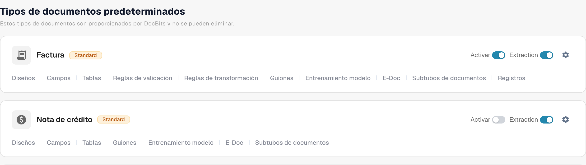
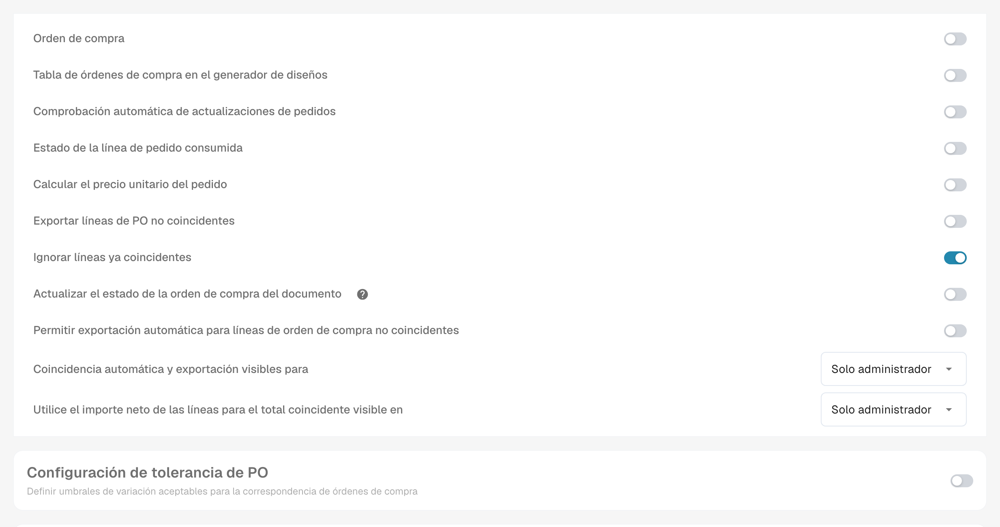

# Calcular el precio unitario del pedido

## **Resumen**

Puede elegir calcular automáticamente el **precio unitario** de cada línea de orden de compra a partir del **importe** y la **cantidad** de la línea, en lugar de usar el precio unitario que viene con la orden de compra. Esto es especialmente útil cuando el precio unitario en la orden de compra (en Infor ERP / SAP) difiere del precio en el documento. Tales discrepancias pueden surgir si se aplica un descuento al precio unitario en la orden de compra, mientras que el documento solo aplica el descuento al importe neto.

## **Pasos de activación**

1.  Vaya a **Settings** -> **Document Processing** -> **Document Types**.

2.  Seleccione el tipo de documento deseado y haga clic en **More Settings**.

    <figure><figcaption>
Acceso a los ajustes adicionales del tipo de documento Factura.
</figcaption></figure>
3.  En la sección **Purchase Order**, active la opción **Calculate PO Unit Price**.

    <figure><figcaption>
Ajustes de las líneas de pedido ya consumidas.
</figcaption></figure>

## Cómo se calcula el precio

Una vez activada la configuración, el precio unitario de una línea de orden de compra se calcula como:

**`Unit Price = Line Amount ÷ Quantity × Unit Price Per`**

donde el **importe de línea** se elige así:

| La línea de orden de compra contiene                                                           | Importe de línea usado                 |
| ---------------------------------------------------------------------------------------------- | ------------------------------------ |
| un **importe neto** (`extended_amount`) que es mayor que 0 y no supera el total de la línea    | el importe neto                       |
| no hay importe neto, o el importe neto supera el total de la línea                             | el **total** de la línea (`total_amount`) |
| no hay importe positivo, o no hay cantidad positiva                                            | no se calcula nada, el precio de OC se mantiene |

Por qué el importe neto viene primero: las fuentes ERP (Infor BODs) envían el importe neto de la línea como `extended_amount` y llevan **impuestos y cargos adicionales** en `total_amount`. Dividir un total con impuestos por la cantidad da un precio unitario bruto, y cada factura que se valora neta entonces aparece como _precio unitario subestimado_ aunque sea correcto. Ejemplo de una línea real de orden de compra: cantidad 9, importe neto 879,84, total 954,63 (8,5 % de impuesto) — el precio basado en neto es 97,76 y coincide con la factura; el precio basado en total sería 106,07.

Un importe neto **mayor** que el total de la línea no puede ser un importe neto, por lo que en ese caso se usa el total. Un `Unit Price Per` de 0 o vacío cuenta como 1.


El precio calculado se escribe en la instantánea de la orden de compra que se almacena en el documento, y se **recalcula cada vez que el documento se concilia** (Auto PO Match, conciliación manual, conciliación al guardar). Un documento que fue conciliado antes de cambiar la configuración, por lo tanto, toma el nuevo precio en su próxima conciliación — no es necesario recargar la orden de compra.


## Ejemplo práctico

Para una cantidad de 9 y Unit Price Per = 1:

| Base del importe | Cálculo | Precio unitario |
| --- | --- | --- |
| Importe neto de la línea | 879,84 ÷ 9 × 1 | 97,76 |
| Total con el 8,5 % de impuesto | 954,63 ÷ 9 × 1 | 106,07 |

La comparación con una factura con precios netos requiere en este ejemplo el precio unitario neto de 97,76.

## Configuraciones relacionadas

* [Reglas de conciliación de órdenes de compra](purchase-order-matching-rules.md) — las reglas comparan el precio unitario **efectivo**, que es este precio calculado cuando la configuración está activada.
* [Configuración de tolerancia de órdenes de compra](purchase-order-tolerance-settings-additional-purchase-order-tolerance.md) — cuánto puede desviarse el precio de la factura del precio calculado.
