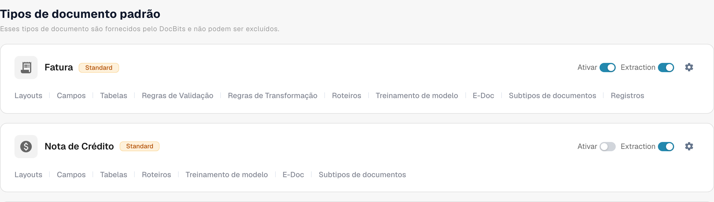
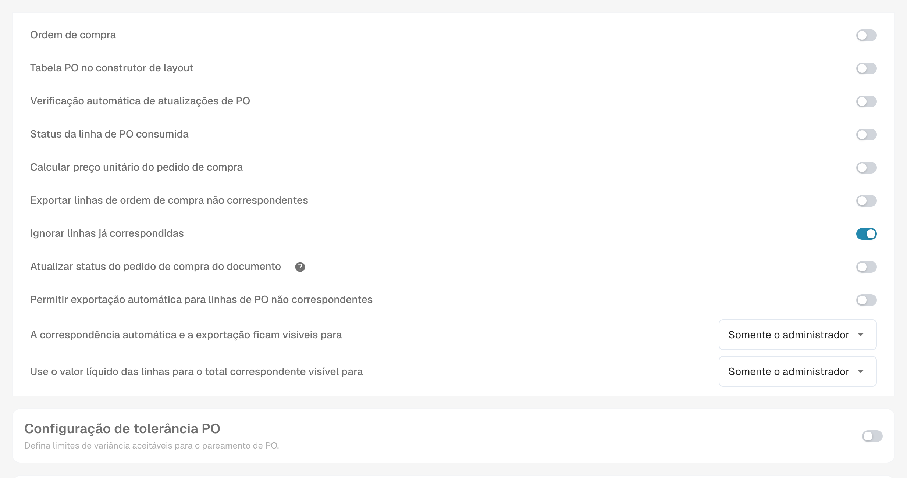

# Calcular preço unitário do PO

## **Visão geral**

Você pode optar por calcular automaticamente o **preço unitário** de cada linha do pedido de compra a partir do **valor** e da **quantidade** da linha, em vez de usar o preço unitário que veio com o pedido de compra. Isso é particularmente útil quando o preço unitário no pedido de compra (no Infor ERP / SAP) difere do preço no documento. Tais discrepâncias podem ocorrer se um desconto for aplicado ao preço unitário no pedido de compra, enquanto o documento aplica o desconto apenas ao valor líquido.

## **Passos para ativação**

1.  Navegue até **Settings** -> **Document Processing** -> **Document Types**.

2.  Selecione o tipo de documento desejado e clique em **More Settings**.

    <figure><figcaption>
Acesso às definições adicionais do tipo de documento Fatura.
</figcaption></figure>
3.  Na seção **Purchase Order**, ative a opção **Calculate PO Unit Price**.

    <figure><figcaption>
Definições das linhas de pedido de compra já utilizadas.
</figcaption></figure>

## Como o preço é calculado

Uma vez que a configuração esteja ativada, o preço unitário de uma linha do pedido de compra é calculado como:

**`Unit Price = Line Amount ÷ Quantity × Unit Price Per`**

onde o **valor da linha** é escolhido da seguinte forma:

| A linha do pedido de compra contém                                                             | Valor da linha usado                   |
| ----------------------------------------------------------------------------------------------- | -------------------------------------- |
| um **valor líquido** (`extended_amount`) maior que 0 e não acima do total da linha              | o valor líquido                        |
| nenhum valor líquido, ou um valor líquido acima do total da linha                               | o **total** da linha (`total_amount`)  |
| nenhum valor positivo, ou nenhuma quantidade positiva                                           | nada é calculado, o preço do PO permanece |

Por que o valor líquido vem primeiro: os feeds de ERP (Infor BODs) enviam o valor líquido da linha como `extended_amount` e levam **impostos e encargos por cima** em `total_amount`. Dividir um total com impostos pela quantidade resulta em um preço unitário bruto, e toda fatura com preço líquido aparece então como _preço unitário subestimado_, embora esteja correta. Exemplo de uma linha real de pedido de compra: quantidade 9, valor líquido 879,84, total 954,63 (8,5% de imposto) — o preço baseado no líquido é 97,76 e corresponde à fatura; o preço baseado no total seria 106,07.

Um valor líquido **maior** que o total da linha não pode ser um valor líquido, portanto nesse caso o total é usado. Um `Unit Price Per` de 0 ou vazio conta como 1.


O preço calculado é gravado no snapshot do pedido de compra armazenado no documento e é **recalculado a cada conciliação do documento** (Auto PO Match, conciliação manual, conciliação ao salvar). Um documento conciliado antes da alteração da configuração assume o novo preço na próxima conciliação — não é necessário recarregar o pedido de compra.


## Exemplo prático

Para uma quantidade de 9 e Unit Price Per = 1:

| Base do valor | Cálculo | Preço unitário |
| --- | --- | --- |
| Valor líquido da linha | 879,84 ÷ 9 × 1 | 97,76 |
| Total com 8,5% de imposto | 954,63 ÷ 9 × 1 | 106,07 |

A comparação com uma fatura com preços líquidos exige neste exemplo o preço unitário líquido de 97,76.

## Configurações relacionadas

* [Regras de Conciliação de Pedido de Compra](purchase-order-matching-rules.md) — as regras comparam o preço unitário **efetivo**, que é este preço calculado quando a configuração está ativada.
* [Configurações de Tolerância de Pedido de Compra](purchase-order-tolerance-settings-additional-purchase-order-tolerance.md) — o quanto o preço da fatura pode divergir do preço calculado.
