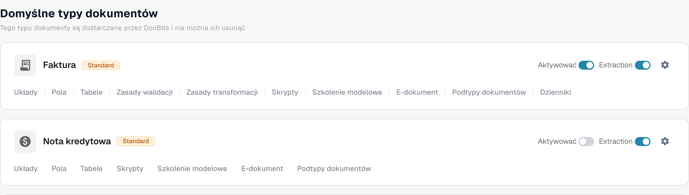
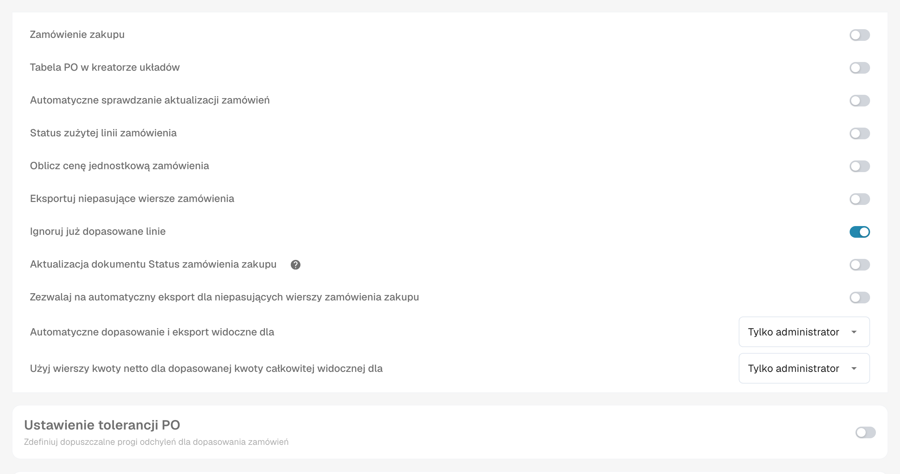

# Oblicz cenę jednostkową zamówienia

## **Przegląd**

Możesz wybrać automatyczne obliczanie **ceny jednostkowej** każdej pozycji zamówienia zakupu na podstawie **kwoty** i **ilości** z tej pozycji, zamiast używać ceny jednostkowej podanej w zamówieniu zakupu. Jest to szczególnie przydatne, gdy cena jednostkowa w zamówieniu zakupu (w Infor ERP / SAP) różni się od ceny na dokumencie. Takie rozbieżności mogą wystąpić, jeśli do ceny jednostkowej w zamówieniu zakupu zastosowano rabat, podczas gdy na dokumencie rabat jest stosowany tylko do kwoty netto.

## **Kroki aktywacji**

1.  Przejdź do **Settings** -> **Document Processing** -> **Document Types**.

2.  Wybierz żądany typ dokumentu i kliknij **More Settings**.

    <figure><figcaption>
Dostęp do dodatkowych ustawień typu dokumentu Faktura.
</figcaption></figure>
3.  W sekcji **Purchase Order** włącz opcję **Calculate PO Unit Price**.

    <figure><figcaption>
Ustawienia pozycji zamówienia zakupu już wykorzystanych.
</figcaption></figure>

## Jak obliczana jest cena

Po aktywowaniu ustawienia cena jednostkowa pozycji zamówienia zakupu jest obliczana jako:

**`Unit Price = Line Amount ÷ Quantity × Unit Price Per`**

gdzie **kwota pozycji** jest wybierana w następujący sposób:

| Pozycja zamówienia zakupu zawiera                                                             | Użyta kwota pozycji                    |
| ---------------------------------------------------------------------------------------------- | -------------------------------------- |
| **kwotę netto** (`extended_amount`) większą od 0 i nieprzekraczającą sumy pozycji              | kwota netto                            |
| brak kwoty netto albo kwotę netto większą od sumy pozycji                                      | **suma** pozycji (`total_amount`)      |
| brak kwoty dodatniej albo brak dodatniej ilości                                                | nic nie jest obliczane, cena PO pozostaje |

Dlaczego kwota netto ma pierwszeństwo: źródła ERP (Infor BODs) przesyłają kwotę netto pozycji jako `extended_amount` i dodają **podatki oraz opłaty** w `total_amount`. Podzielenie sumy z podatkiem przez ilość daje cenę jednostkową brutto, a każda faktura wyceniona netto pojawia się wtedy jako _cena jednostkowa poniżej dopasowania_, mimo że jest poprawna. Przykład z rzeczywistej pozycji zamówienia zakupu: ilość 9, kwota netto 879,84, suma 954,63 (8,5% podatku) — cena oparta na kwocie netto to 97,76 i zgadza się z fakturą; cena oparta na sumie wyniosłaby 106,07.

Kwota netto **większa** od sumy pozycji nie może być kwotą netto, dlatego w tym przypadku używana jest suma. `Unit Price Per` równe 0 lub puste liczy się jako 1.


Obliczona cena jest zapisywana w migawce zamówienia zakupu przechowywanej w dokumencie i jest **przeliczana przy każdym dopasowaniu dokumentu** (Auto PO Match, dopasowanie ręczne, dopasowanie przy zapisie). Dokument dopasowany przed zmianą ustawienia przejmie więc nową cenę przy następnym dopasowaniu — ponowne wczytanie zamówienia zakupu nie jest potrzebne.


## Przykład obliczenia

Dla ilości 9 i Unit Price Per = 1:

| Podstawa kwoty | Obliczenie | Cena jednostkowa |
| --- | --- | --- |
| Kwota netto pozycji | 879,84 ÷ 9 × 1 | 97,76 |
| Suma z podatkiem 8,5% | 954,63 ÷ 9 × 1 | 106,07 |

Porównanie z fakturą wycenioną netto wymaga w tym przykładzie ceny jednostkowej netto 97,76.

## Powiązane ustawienia

* [Reguły dopasowywania zamówień zakupu](purchase-order-matching-rules.md) — reguły porównują **efektywną** cenę jednostkową, która jest tą obliczoną ceną, gdy ustawienie jest włączone.
* [Ustawienia tolerancji zamówienia zakupu](purchase-order-tolerance-settings-additional-purchase-order-tolerance.md) — o ile cena faktury może różnić się od ceny obliczonej.
