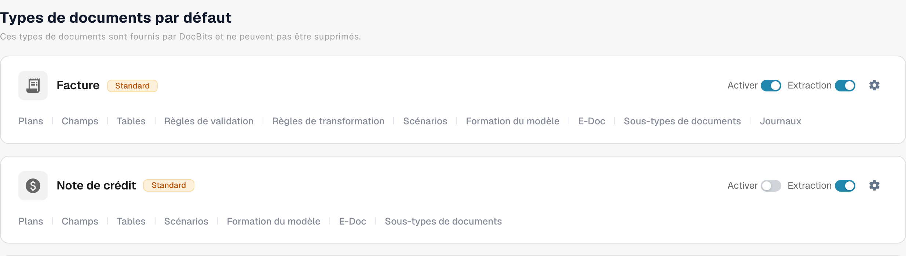

# Calculer le prix unitaire de la commande

## **Présentation**

Vous pouvez choisir de calculer automatiquement le **prix unitaire** de chaque ligne de bon de commande à partir du **montant** et de la **quantité** de la ligne, au lieu d’utiliser le prix unitaire fourni avec le bon de commande. Cela est particulièrement utile lorsque le prix unitaire dans le bon de commande (dans Infor ERP / SAP) diffère du prix figurant sur le document. De telles divergences peuvent survenir si une remise est appliquée au prix unitaire dans le bon de commande, alors que le document n’applique la remise qu’au montant net.

## **Étapes d’activation**

1.  Accédez à **Settings** -> **Document Processing** -> **Document Types**.

2.  Sélectionnez le type de document souhaité et cliquez sur **More Settings**.

    <figure><figcaption>
Accès aux réglages supplémentaires du type de document Facture.
</figcaption></figure>
3.  Dans la section **Purchase Order**, activez l’option **Calculate PO Unit Price**.

    <figure><figcaption>
Réglages des lignes de bon de commande déjà consommées.
</figcaption></figure>

## Comment le prix est calculé

Une fois le paramètre activé, le prix unitaire d’une ligne de bon de commande est calculé comme suit :

**`Unit Price = Line Amount ÷ Quantity × Unit Price Per`**

où le **montant de la ligne** est choisi ainsi :

| La ligne de bon de commande contient                                                          | Montant de la ligne utilisé             |
| -------------------------------------------------------------------------------------------- | -------------------------------------- |
| un **montant net** (`extended_amount`) supérieur à 0 et ne dépassant pas le total de la ligne | le montant net                         |
| aucun montant net, ou un montant net supérieur au total de la ligne                           | le **total** de la ligne (`total_amount`) |
| aucun montant positif, ou aucune quantité positive                                            | rien n’est calculé, le prix du BC reste |

Pourquoi le montant net est prioritaire : les flux ERP (Infor BODs) envoient le montant net de la ligne sous `extended_amount` et incluent **les taxes et charges en supplément** dans `total_amount`. Diviser un total taxé par la quantité donne un prix unitaire brut, et toute facture dont le prix est net apparaît alors comme un _prix unitaire sous-évalué_ bien que correct. Exemple d’une ligne de bon de commande réelle : quantité 9, montant net 879,84, total 954,63 (8,5 % de taxe) — le prix basé sur le net est 97,76 et correspond à la facture ; le prix basé sur le total serait 106,07.

Un montant net **supérieur** au total de la ligne ne peut pas être un montant net : dans ce cas, le total est utilisé. Un `Unit Price Per` de 0 ou vide compte comme 1.


Le prix calculé est écrit dans la copie des données du bon de commande associée au document, et il est **recalculé à chaque fois que le document est apparié** (Auto PO Match, appariement manuel, appariement à l’enregistrement). Un document apparié avant la modification du paramètre adopte donc le nouveau prix lors de son prochain appariement — aucun rechargement du bon de commande n’est nécessaire.


## Exemple concret

Pour une quantité de 9 et Unit Price Per = 1 :

| Base du montant | Calcul | Prix unitaire |
| --- | --- | --- |
| Montant net de la ligne | 879,84 ÷ 9 × 1 | 97,76 |
| Total incluant 8,5 % de taxe | 954,63 ÷ 9 × 1 | 106,07 |

La comparaison avec une facture à prix net exige dans cet exemple le prix unitaire net de 97,76.

## Paramètres associés

* [Règles d’appariement des bons de commande](purchase-order-matching-rules.md) — les règles comparent le prix unitaire **effectif**, qui est ce prix calculé lorsque le paramètre est activé.
* [Paramètres de tolérance des bons de commande](purchase-order-tolerance-settings-additional-purchase-order-tolerance.md) — la marge dont le prix de la facture peut s’écarter du prix calculé.
