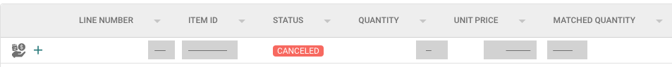

# Stati di disabilitazione dell'OP

## **Panoramica**

L'impostazione **PO disable statuses** stabilisce quali stati delle righe di Purchase Order (PO) sono bloccati nella schermata di matching. Una riga con uno stato disabilitato configurato viene mostrata barrata e non può essere trascinata in un abbinamento. Usare l'impostazione per controllare l'idoneità al matching per il tipo di documento interessato.

## **Passaggi di attivazione**

1. Aprire **Settings → Document Types**.
2. Individuare il tipo di documento da configurare. L'esempio seguente usa **Invoice**. Aprire il relativo pulsante a ingranaggio (**More settings**).

<figure><figcaption>
La scheda Invoice esistente e il relativo ingranaggio More settings. I controlli Activate ed Extraction sono separati dalla selezione degli stati PO.
</figcaption></figure>

3. Aprire la sezione **Purchase Order** e individuare **PO disable statuses**.

<figure><figcaption>
Il campo PO disable statuses e il relativo pulsante Apply. La selezione vuota mostrata qui è un esempio della configurazione di test esistente.
</figcaption></figure>

### **Come riconoscere un Purchase Order disabilitato**

Nella [Purchase Order Matching Screen](https://docs.docbits.com/end-user-and-partner-section/end-user-section/purchase-order-matching) una riga il cui stato è disabilitato è contrassegnata da una barratura e non può essere trascinata in un abbinamento. Quando si verifica perché la riga non è disponibile, controllare lo stato della riga e l'elenco degli stati disabilitati del tipo di documento.

<figure><figcaption>
Una riga storica conservata di un PO annullato. Blocchi grigi nascondono identificatori e valori numerici, compresa la quantità abbinata. I brevi tratti orizzontali mantengono la barratura originale.
</figcaption></figure>

### **Come configurarla**

1. Fare clic sul campo **PO disable statuses** per aprire gli stati disponibili.
2. Selezionare le caselle di controllo degli stati che il processo esclude dal matching. Deselezionare una casella per rimuovere quello stato dalla selezione.

<figure><figcaption>
Le opzioni di stato attuali con il loro stato non selezionato esistente. Il contenuto circostante della pagina è mascherato; il menu a discesa e il pulsante Apply sono invariati.
</figcaption></figure>

3. Fare clic su **Apply** per salvare la selezione per questo tipo di documento. Aprire il menu a discesa da solo non salva alcuna modifica.

**Available Statuses**

* Canceled
* Deleted
* Invoiced
* Open
* Partially Invoiced
* Partially Received
* Received
* Rejected
* Unapproved
* Hold
* Closed
