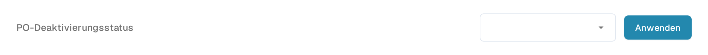
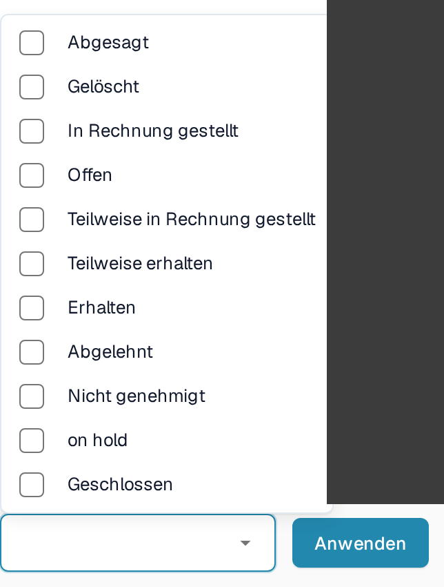

# PO-Deaktivierungsstatus

## **Überblick**

Die Einstellung **PO-Deaktivierungsstatus** legt fest, welche Status von Bestellpositionen (PO) im Abgleichbildschirm gesperrt sind. Eine Position mit einem gesperrten Status wird durchgestrichen dargestellt und lässt sich nicht in einen Abgleich ziehen. Mit der Einstellung steuern Sie, welche Positionen für den jeweiligen Dokumenttyp abgeglichen werden dürfen.

## **Aktivierungsschritte**

1. Öffnen Sie **Einstellungen → Dokumenttypen**.
2. Suchen Sie den Dokumenttyp, den Sie einrichten möchten. Das folgende Beispiel verwendet **Rechnung**. Öffnen Sie über die Zahnrad-Schaltfläche (**Weitere Einstellungen**) seine Einstellungen.

<figure><figcaption>
Die vorhandene Rechnung-Karte mit ihrem Zahnrad für die weiteren Einstellungen. Die Schalter Aktivieren und Extraktion sind unabhängig von der PO-Statusauswahl.
</figcaption></figure>

3. Öffnen Sie den Bereich **Bestellung** mit dem Untertitel **PO-Abgleich & Validierung** und suchen Sie **PO-Deaktivierungsstatus**.

<figure><figcaption>
Das Feld PO-Deaktivierungsstatus mit seiner Schaltfläche Anwenden. Die hier leere Auswahl ist ein Beispiel aus der vorhandenen Testkonfiguration.
</figcaption></figure>

### **Woran Sie eine gesperrte Bestellposition erkennen**

Im [Bildschirm für den Bestellabgleich](https://docs.docbits.com/deutsch/end-user-and-partner-section/end-user-section/purchase-order-matching) wird eine Position, deren Status gesperrt ist, durchgestrichen dargestellt und lässt sich nicht in einen Abgleich ziehen. Prüfen Sie den Status der Position und die Liste der gesperrten Status des Dokumenttyps, wenn Sie wissen möchten, warum eine Position nicht verfügbar ist.

### **So richten Sie es ein**

1. Klicken Sie auf das Feld **PO-Deaktivierungsstatus**, um die verfügbaren Status zu öffnen.
2. Aktivieren Sie die Kästchen der Status, die Ihr Prozess vom Abgleich ausschließt. Entfernen Sie das Häkchen, um einen Status wieder aus der Auswahl zu nehmen.

<figure><figcaption>
Die aktuellen Statusoptionen im vorhandenen nicht ausgewählten Zustand. Der Seitenhintergrund rechts ist maskiert; die Liste und die Schaltfläche Anwenden sind unverändert.
</figcaption></figure>

3. Klicken Sie auf **Anwenden**, um die Auswahl für diesen Dokumenttyp zu speichern. Das bloße Öffnen der Liste speichert keine Änderung.

**Verfügbare Status**

* Abgesagt
* Gelöscht
* In Rechnung gestellt
* Offen
* Teilweise in Rechnung gestellt
* Teilweise erhalten
* Erhalten
* Abgelehnt
* Nicht genehmigt
* on hold
* Geschlossen

Der Status **on hold** ist im Produkt noch nicht übersetzt und erscheint deshalb in der Liste englisch. Wählen Sie ihn anhand seiner Position zwischen **Nicht genehmigt** und **Geschlossen**, wenn Sie ihn sperren möchten.
