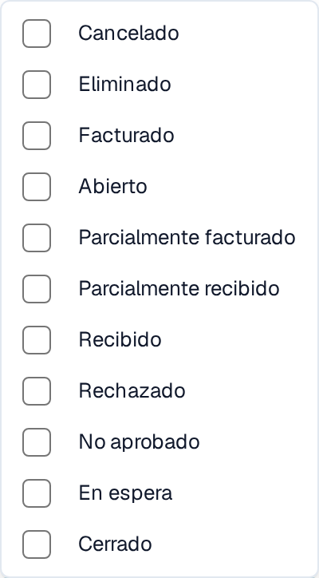

# Estados de pedido desactivados para la conciliación

## Descripción general

El ajuste **PO desactivar estados** determina qué estados de línea de pedido (PO) quedan restringidos en la pantalla de conciliación. Una línea con un estado desactivado configurado se muestra tachada y no se puede arrastrar para conciliarla. Utilice el ajuste para controlar qué líneas puede conciliar en el tipo de documento correspondiente.

## Pasos de activación

1. Abra **Ajustes → Tipos de documento**.
2. Busque el tipo de documento que desea configurar. El ejemplo siguiente utiliza **Factura**. Abra su engranaje de configuración, que abre la página **Más ajustes**.

<figure><figcaption>
La tarjeta Factura existente y su engranaje de configuración. Los interruptores Activar y Extracción son independientes de la selección de estados de pedido.
</figcaption></figure>

3. Despliegue la sección **Orden de compra** y localice **PO desactivar estados**.

<figure><figcaption>
El campo PO desactivar estados y su botón Aplicar. La selección vacía que aparece aquí es un ejemplo de la configuración de prueba existente.
</figcaption></figure>

### Cómo reconocer un pedido desactivado

En la [Pantalla de coincidencia de órdenes de compra](https://docs.docbits.com/espanol/end-user-and-partner-section/end-user-section/purchase-order-matching), una línea cuyo estado está desactivado aparece tachada y no se puede arrastrar a una conciliación. Si una línea no está disponible para conciliar, compruebe su estado y la lista de estados desactivados del tipo de documento.

### Cómo configurarlo

1. Pulse el campo **PO desactivar estados** para abrir los estados disponibles.
2. Marque las casillas de los estados que su proceso excluye de la conciliación. Desmarque una casilla para quitar ese estado de la selección.

<figure><figcaption>
Los estados disponibles en español. En esta captura no hay ninguna casilla marcada; la selección solo se guarda al pulsar Aplicar.
</figcaption></figure>

3. Pulse **Aplicar** para guardar la selección en este tipo de documento. Abrir la lista por sí solo no guarda ningún cambio.

**Estados disponibles**

* Cancelado
* Eliminado
* Facturado
* Abierto
* Parcialmente facturado
* Parcialmente recibido
* Recibido
* Rechazado
* No aprobado
* En espera
* Cerrado
