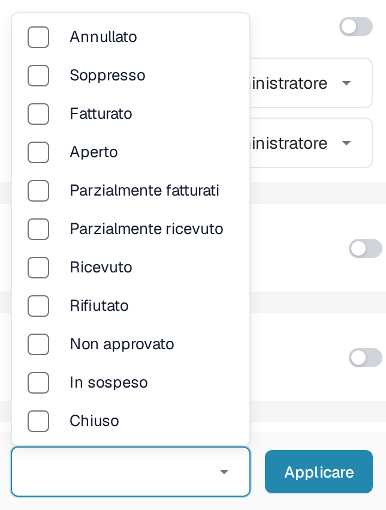

# Stati di disabilitazione dell'OP

## **Panoramica**

L'impostazione **Stati di disabilitazione dell'OP** stabilisce quali stati delle posizioni degli ordini di acquisto (OP) sono bloccati nella schermata di abbinamento. Una posizione con uno stato bloccato viene mostrata barrata e non può essere trascinata in un abbinamento. Con questa impostazione si controlla quali posizioni possono essere abbinate per il tipo di documento interessato.

## **Passaggi di attivazione**

1. Aprire **Impostazioni → Tipi Di Documento**.
2. Trovare il tipo di documento che si desidera configurare. L'esempio seguente utilizza **Fattura**. Aprire le impostazioni del tipo tramite il pulsante a ingranaggio (**Altre impostazioni**).

<figure><figcaption>
La scheda esistente di Fattura con il suo pulsante a ingranaggio per Altre impostazioni. I comandi Attivare ed Estrazione sono indipendenti dalla selezione degli stati OP.
</figcaption></figure>

3. Aprire la sezione **Ordine di acquisto** con il sottotitolo **Corrispondenza e convalida degli ordini di acquisto** e individuare **Stati di disabilitazione dell'OP**.

<figure><figcaption>
Il campo Stati di disabilitazione dell'OP con il suo pulsante Applicare. La selezione vuota mostrata qui è un esempio della configurazione di test esistente.
</figcaption></figure>

### **Come riconoscere una posizione d'ordine bloccata**

Nella [schermata di abbinamento degli ordini di acquisto](https://docs.docbits.com/italian/end-user-and-partner-section/end-user-section/purchase-order-matching), una posizione il cui stato è bloccato viene mostrata barrata e non può essere trascinata in un abbinamento. Se una posizione non è disponibile, controllare lo stato della posizione e l'elenco degli stati bloccati del tipo di documento.

### **Come configurarlo**

1. Fare clic sul campo **Stati di disabilitazione dell'OP** per aprire gli stati disponibili.
2. Selezionare le caselle degli stati che il processo esclude dall'abbinamento. Deselezionare una casella per rimuovere quello stato dalla selezione.

<figure><figcaption>
Le opzioni di stato attuali nel loro stato non selezionato. Lo sfondo della pagina a destra è mascherato; l'elenco e il pulsante Applicare sono invariati.
</figcaption></figure>

3. Fare clic su **Applicare** per salvare la selezione per questo tipo di documento. La sola apertura dell'elenco non salva alcuna modifica.

**Stati disponibili**

* Annullato
* Soppresso
* Fatturato
* Aperto
* Parzialmente fatturati
* Parzialmente ricevuto
* Ricevuto
* Rifiutato
* Non approvato
* In sospeso
* Chiuso
