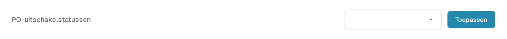
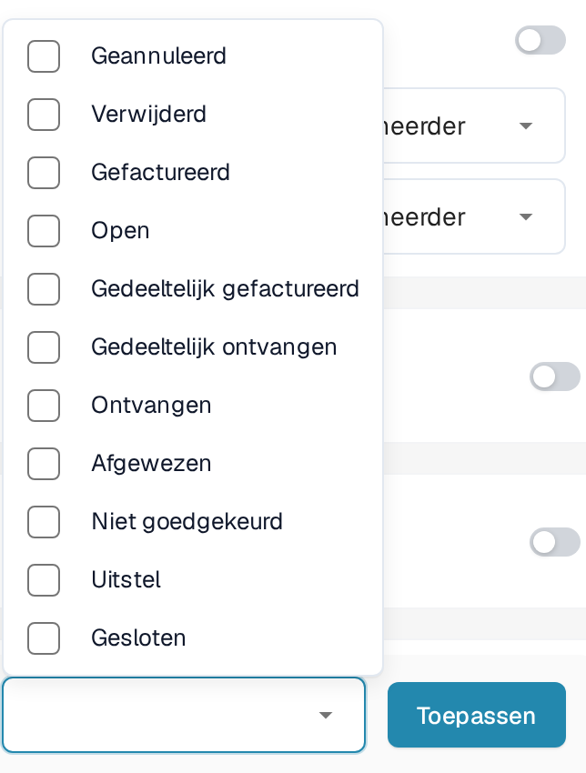

# PO-uitschakelstatussen

## **Overzicht**

De instelling **PO-uitschakelstatussen** bepaalt welke statussen van inkooporderregels (PO-regels) in het afstemmingsscherm worden uitgesloten. Een regel met een uitgeschakelde status wordt doorgehaald weergegeven en kan niet naar een match worden gesleept. Gebruik de instelling om te bepalen welke regels van het betreffende documenttype voor afstemming in aanmerking komen.

## **Activatiestappen**

1. Open **Instellingen → Documenttypen**.
2. Zoek het documenttype dat u wilt configureren. Het voorbeeld hieronder gebruikt **Factuur**. Open de instellingenknop (**Meer Instellingen**).

<figure><figcaption>
De bestaande kaart Factuur met de instellingenknop. De schakelaars Activeren en Extractie staan los van de keuze van PO-statussen.
</figcaption></figure>

3. Open het gedeelte **Inkooporder** en zoek **PO-uitschakelstatussen**.

<figure><figcaption>
Het veld PO-uitschakelstatussen en de knop Toepassen. De lege keuze hier is een voorbeeld van de bestaande testconfiguratie.
</figcaption></figure>

### **Een uitgeschakelde inkooporder herkennen**

In het [Inkooporder Matching Scherm](https://docs.docbits.com/dutch/end-user-and-partner-section/end-user-section/purchase-order-matching) wordt een regel waarvan de status is uitgeschakeld, doorgehaald weergegeven en kan deze niet in een match worden gesleept. Controleer de status van de regel en de lijst met uitgeschakelde statussen van het documenttype wanneer u wilt nagaan waarom de regel niet beschikbaar is. De schermafbeeldingen van deze pagina tonen alleen de instellingen; zij bewijzen geen uitgevoerde afstemming, goedkeuring of betaling.

### **Zo stelt u het in**

1. Klik op het veld **PO-uitschakelstatussen** om de beschikbare statussen te openen.
2. Vink de statussen aan die uw proces van afstemming uitsluit. Schakel een vinkje uit om die status uit de selectie te verwijderen.

<figure><figcaption>
De beschikbare statussen in de bestaande niet-aangevinkte toestand, met de knop Toepassen. In deze opname is geen status gekozen en is niets opgeslagen.
</figcaption></figure>

3. Klik op **Toepassen** om de selectie voor dit documenttype op te slaan. Alleen de keuzelijst openen slaat geen wijziging op.

**Beschikbare statussen**

* Geannuleerd
* Verwijderd
* Gefactureerd
* Open
* Gedeeltelijk gefactureerd
* Gedeeltelijk ontvangen
* Ontvangen
* Afgewezen
* Niet goedgekeurd
* Uitstel
* Gesloten

De status **Uitstel** heet in de Engelse interface **Hold**. Gebruik de statussen die de keuzelijst van uw eigen omgeving aanbiedt.
