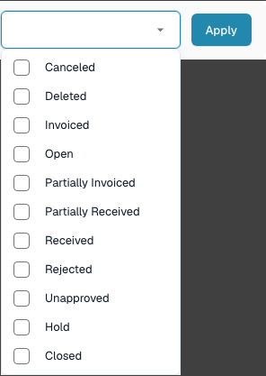

# PO-Deaktivierungsstatus

## **Überblick**

Die Einstellung **PO disable statuses** legt fest, welche Status von Purchase-Order-Zeilen (PO) im Matching-Bildschirm gesperrt sind. Eine Zeile mit einem konfigurierten deaktivierten Status wird durchgestrichen dargestellt und lässt sich nicht auf eine Zuordnung ziehen. Nutzen Sie die Einstellung, um die Matching-Berechtigung für den jeweiligen Dokumenttyp zu steuern.

## **Aktivierungsschritte**

1. Öffnen Sie **Settings → Document Types**.
2. Suchen Sie den Dokumenttyp, den Sie konfigurieren möchten. Das folgende Beispiel verwendet **Invoice**. Öffnen Sie über die Zahnrad-Schaltfläche die **More settings**.

<figure><figcaption>
Die vorhandene Invoice-Karte und ihr Zahnrad More settings. Die Steuerelemente Activate und Extraction sind von der PO-Statusauswahl getrennt.
</figcaption></figure>

3. Öffnen Sie das Accordion **Purchase Order** und suchen Sie **PO disable statuses**.

<figure><figcaption>
Das Feld PO disable statuses und seine Schaltfläche Apply. Die hier gezeigte leere Auswahl ist ein Beispiel der bestehenden Testkonfiguration.
</figcaption></figure>

### **So erkennen Sie eine deaktivierte Purchase Order**

Im [Purchase Order Matching Screen](https://docs.docbits.com/end-user-and-partner-section/end-user-section/purchase-order-matching) wird eine Zeile, deren Status deaktiviert ist, durchgestrichen markiert und kann nicht in eine Zuordnung gezogen werden. Prüfen Sie den Status der Zeile und die Liste der deaktivierten Status des Dokumenttyps, wenn Sie untersuchen, warum die Zeile nicht verfügbar ist.

<figure><figcaption>
Eine erhaltene historische Zeile einer stornierten PO. Graue Blöcke verdecken Kennungen und Zahlenwerte, einschließlich der zugeordneten Menge. Die kurzen waagerechten Striche erhalten die ursprüngliche Durchstreichung.
</figcaption></figure>

### **So richten Sie es ein**

1. Klicken Sie auf das Feld **PO disable statuses**, um die verfügbaren Status zu öffnen.
2. Wählen Sie die Kontrollkästchen der Status aus, die Ihr Prozess vom Matching ausschließt. Entfernen Sie ein Kontrollkästchen, um diesen Status aus der Auswahl zu nehmen.

<figure><figcaption>
Die aktuellen Statusoptionen mit ihrem bestehenden, nicht angehakten Zustand. Der umgebende Seiteninhalt ist maskiert; das Dropdown und die Schaltfläche Apply sind unverändert.
</figcaption></figure>

3. Klicken Sie auf **Apply**, um die Auswahl für diesen Dokumenttyp zu speichern. Allein das Öffnen des Dropdowns speichert keine Änderung.

**Available Statuses**

* Canceled
* Deleted
* Invoiced
* Open
* Partially Invoiced
* Partially Received
* Received
* Rejected
* Unapproved
* Hold
* Closed
