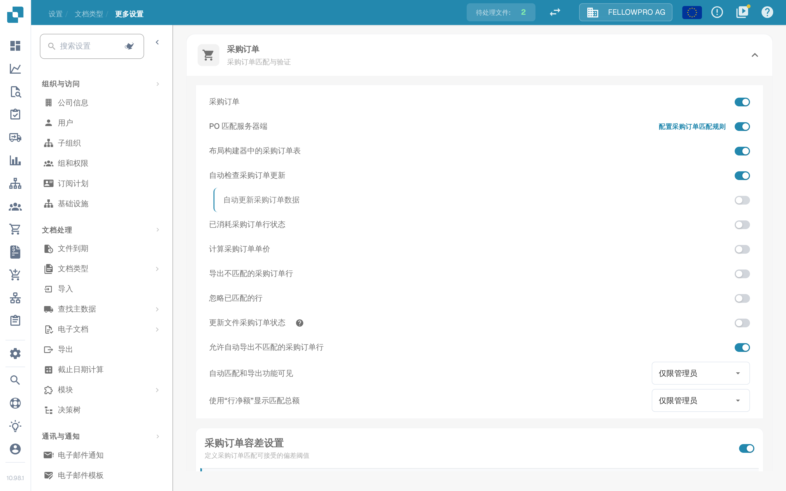

# 采购订单

## 概述

此设置会启用 [**Purchase Order Matching**](../../../../../../end-user-and-partner-section/end-user-section/purchase-order-matching/) 部分，该部分在文档验证后即可访问。

<mark style="color:red;">**注意**</mark>：对于 **Invoice** 文档类型，还必须满足以下要求：

* 必须启用 **Purchase Order** 设置（如本页所述）
* 发票类型必须为 **Purchase Invoice**
* 必须存在 **Extracted Table**

## 激活步骤 

1. 前往 **Settings → Document Types**。
2. 找到文档类型卡片，点击齿轮图标（**More Settings**）。
3. 打开 **Purchase Order** 部分并启用 **Purchase Order**。

<figure><figcaption>
<strong>More Settings</strong> 中的 <strong>Purchase Order</strong> 部分。第一个开关为该文档类型启用采购订单匹配，下面的开关进一步细化匹配行为。
</figcaption></figure>

## **功能**

启用设置后，[**Purchase Order Matching**](../../../../../../end-user-and-partner-section/end-user-section/purchase-order-matching/) 部分在文档验证后即可使用。

### 匹配时会比较哪个数量

匹配时比较采购订单中的哪个数量取决于 **PO match server side**：

* **PO match server side off** – **Purchase Order** 开关旁会出现 **Match quantity** 下拉列表。可选择 **Quantity**、**Received Quantity** 或 **Received Delivery Open Quantity**。此时 DocBits 使用内置匹配器比较所选数量。
* **PO match server side on** – 匹配按文档类型的规则集执行，**Match quantity** 属于这些规则。该部分的标题行会显示 **Configure PO matching rules** 链接，点击即可打开规则。参见 [Purchase Order Matching Rules](purchase-order-matching-rules.md)。


上图是在 **PO match server side** 开启的状态下截取的，因此该界面没有 **Match quantity** 下拉列表，数量在匹配规则中设置。


### 收货前预付款

有些发票在货物到达之前就已收到。要将这类发票与订购数量而不是已收货数量进行匹配，请在同一部分中启用 **Allow pre-payment before goods receipt**。

只有在以下三个条件全部满足时才会显示该开关：

* 文档类型为 **Invoice**，
* **Purchase Order** 已启用，
* 且匹配的数量为 **Received Quantity**。

如果将匹配数量改为其他值，该开关就会从设置中消失。此时在 [PO matching screen](../../../../../../end-user-and-partner-section/end-user-section/purchase-order-matching/) 上，**Match as pre-payment** 会出现在 **Use Lines Net Amount for Matched Total** 下方，并带有提示 *Match on ordered quantity instead of received quantity*。如果在 ERP 中不允许在收货前向供应商开票，该开关会置灰并附有说明。

开关开启期间，界面在手动关联和匹配总计中读取的是订购数量，而不是已收货数量。该选择会保存在文档上，并重新运行 **Auto Match**；如果该匹配失败，选择会恢复到之前的值。
