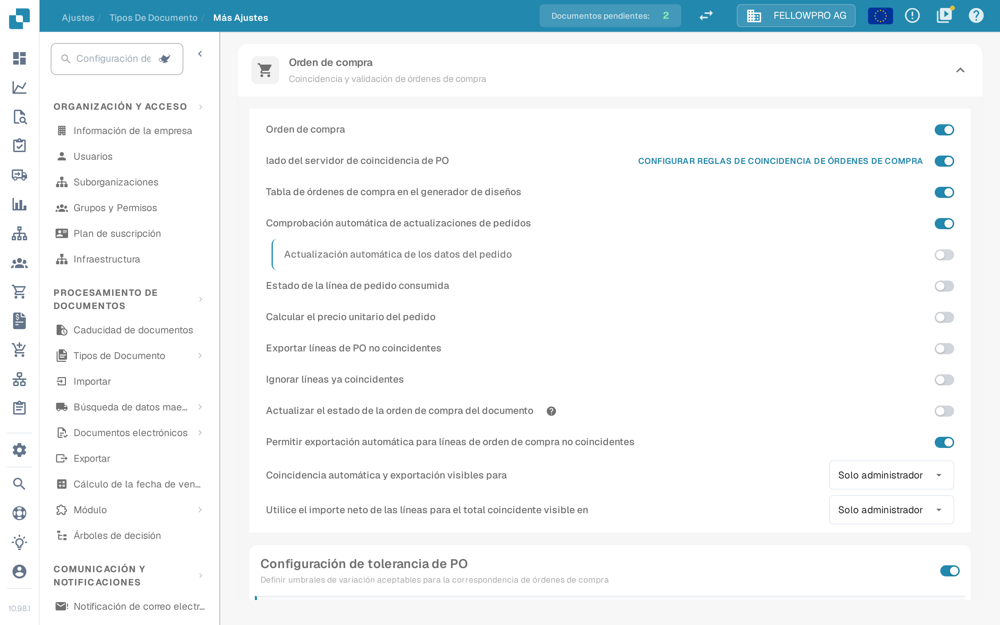

# Orden de compra

## Resumen

Este ajuste habilita la sección de [**Purchase Order Matching**](../../../../../../end-user-and-partner-section/end-user-section/purchase-order-matching/), que se vuelve accesible después de la validación del documento.

<mark style="color:red;">**Nota**</mark>: Para el tipo de documento **Invoice** se deben cumplir los siguientes requisitos adicionales:

* El ajuste **Purchase Order** debe estar habilitado (como se describe en esta página)
* La factura debe ser del tipo **Purchase Invoice**
* Debe estar presente una **Extracted Table**

## Pasos de Activación 

1. Ve a **Settings → Document Types**.
2. Busca la tarjeta del tipo de documento y haz clic en el engranaje (**More Settings**).
3. Abre la sección **Purchase Order** y activa **Purchase Order**.

<figure><figcaption>
La sección <strong>Purchase Order</strong> en <strong>More Settings</strong>. El primer interruptor activa la coincidencia de órdenes de compra para el tipo de documento; los siguientes la afinan.
</figcaption></figure>

## **Funcionalidad**

Una vez activado el ajuste, la sección de [**Purchase Order Matching**](../../../../../../end-user-and-partner-section/end-user-section/purchase-order-matching/) está disponible después de la validación del documento.

### Qué cantidad se compara

La cantidad del pedido que compara la coincidencia depende de **PO match server side**:

* **PO match server side off** – junto al interruptor **Purchase Order** aparece una lista **Match quantity**. Elige **Quantity**, **Received Quantity** o **Received Delivery Open Quantity**. DocBits compara la cantidad elegida con su propio motor de coincidencia.
* **PO match server side on** – la coincidencia sigue el conjunto de reglas del tipo de documento y **Match quantity** forma parte de esas reglas. La fila de cabecera de la sección muestra entonces el enlace **Configure PO matching rules**, que abre las reglas. Consulta [Purchase Order Matching Rules](purchase-order-matching-rules.md).


La captura se tomó con **PO match server side** activado, por lo que la lista **Match quantity** no aparece en esa pantalla: se define en las reglas de coincidencia.


### Pago anticipado antes de la recepción de mercancía

Algunas facturas llegan antes que la mercancía. Para comparar una factura así con la cantidad pedida en lugar de la recibida, activa **Allow pre-payment before goods receipt** en la misma sección.

El interruptor aparece solo cuando se cumplen las tres condiciones:

* el tipo de documento es **Invoice**,
* **Purchase Order** está activado,
* y la cantidad comparada es **Received Quantity**.

Si cambias la cantidad comparada a otro valor, el interruptor desaparece de los ajustes. En la [PO matching screen](../../../../../../end-user-and-partner-section/end-user-section/purchase-order-matching/) aparece entonces **Match as pre-payment** debajo de **Use Lines Net Amount for Matched Total**, con la indicación *Match on ordered quantity instead of received quantity*. El interruptor está atenuado y con una nota cuando el proveedor no puede ser facturado antes de la recepción de mercancía en el ERP.

Mientras el interruptor está activo, la pantalla lee la cantidad pedida, no la recibida, para los vínculos manuales y para el total comparado. La elección se guarda en el documento y **Auto Match** se ejecuta de nuevo; si esa comparación falla, la elección vuelve a su valor anterior.
