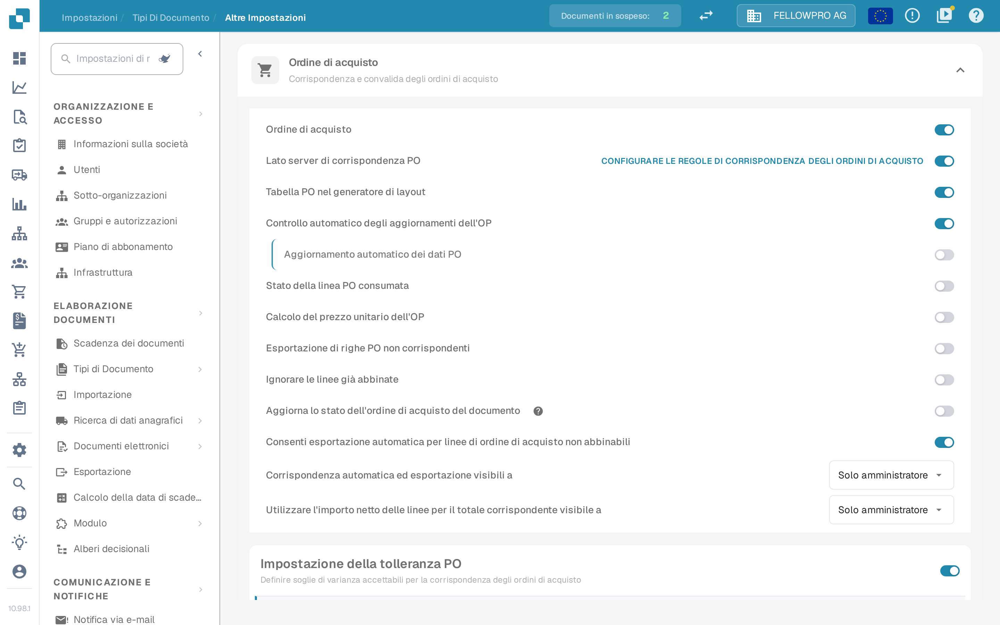

# Ordine di acquisto

## Panoramica

Questa impostazione abilita la sezione [**Purchase Order Matching**](../../../../../../end-user-and-partner-section/end-user-section/purchase-order-matching/), che diventa accessibile dopo la validazione del documento.

<mark style="color:red;">**Nota**</mark>: Per il tipo di documento **Invoice** devono essere soddisfatti i seguenti requisiti aggiuntivi:

* L'impostazione **Purchase Order** deve essere abilitata (come descritto in questa pagina)
* La fattura deve essere di tipo **Purchase Invoice**
* Deve essere presente una **Extracted Table**

## Passaggi di attivazione 

1. Vai su **Settings → Document Types**.
2. Individua la scheda del tipo di documento e fai clic sull'ingranaggio (**More Settings**).
3. Apri la sezione **Purchase Order** e attiva **Purchase Order**.

<figure><figcaption>
La sezione <strong>Purchase Order</strong> in <strong>More Settings</strong>. Il primo interruttore attiva l'abbinamento degli ordini di acquisto per il tipo di documento, quelli successivi lo rifiniscono.
</figcaption></figure>

## **Funzionalità**

Una volta attivata l'impostazione, la sezione [**Purchase Order Matching**](../../../../../../end-user-and-partner-section/end-user-section/purchase-order-matching/) è disponibile dopo la validazione del documento.

### Quale quantità viene confrontata

La quantità dell'ordine che l'abbinamento confronta dipende da **PO match server side**:

* **PO match server side off** – accanto all'interruttore **Purchase Order** compare un elenco **Match quantity**. Scegli **Quantity**, **Received Quantity** o **Received Delivery Open Quantity**. DocBits confronta la quantità scelta con il proprio motore di abbinamento.
* **PO match server side on** – l'abbinamento segue il set di regole del tipo di documento e **Match quantity** fa parte di queste regole. La riga di intestazione della sezione mostra allora il link **Configure PO matching rules**, che apre le regole. Vedi [Purchase Order Matching Rules](purchase-order-matching-rules.md).


La cattura qui sopra è stata realizzata con **PO match server side** attivo: l'elenco **Match quantity** non compare quindi su quella schermata, si imposta nelle regole di abbinamento.


### Pagamento anticipato prima del ricevimento merci

Alcune fatture arrivano prima della merce. Per abbinare una fattura di questo tipo alla quantità ordinata invece che a quella ricevuta, attiva **Allow pre-payment before goods receipt** nella stessa sezione.

L'interruttore compare solo quando valgono tutte e tre le condizioni:

* il tipo di documento è **Invoice**,
* **Purchase Order** è attivo,
* e la quantità abbinata è **Received Quantity**.

Se cambi la quantità abbinata con un altro valore, l'interruttore scompare dalle impostazioni. Sulla [PO matching screen](../../../../../../end-user-and-partner-section/end-user-section/purchase-order-matching/) compare allora **Match as pre-payment** sotto **Use Lines Net Amount for Matched Total**, con l'indicazione *Match on ordered quantity instead of received quantity*. L'interruttore è disattivato e accompagnato da una nota quando il fornitore non può essere fatturato prima del ricevimento merci nell'ERP.

Finché l'interruttore è attivo, la schermata legge la quantità ordinata, non quella ricevuta, per i collegamenti manuali e per il totale abbinato. La scelta viene salvata sul documento e **Auto Match** viene eseguito di nuovo; se questo abbinamento fallisce, la scelta torna al valore precedente.
