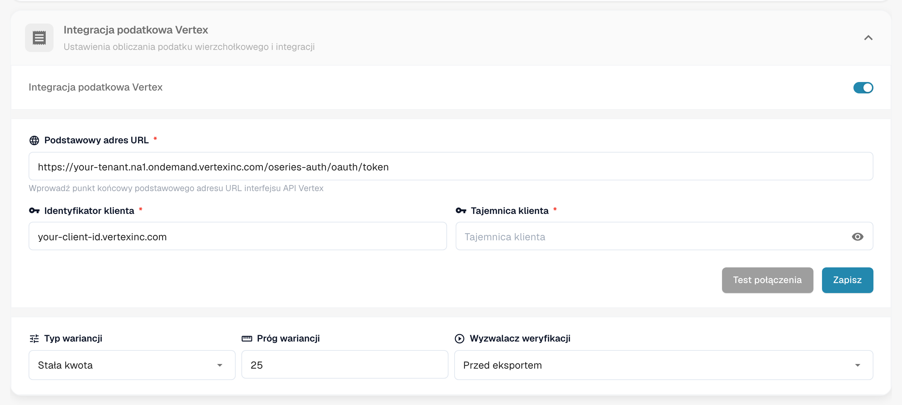
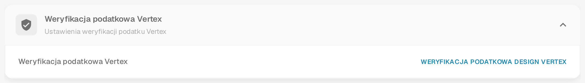
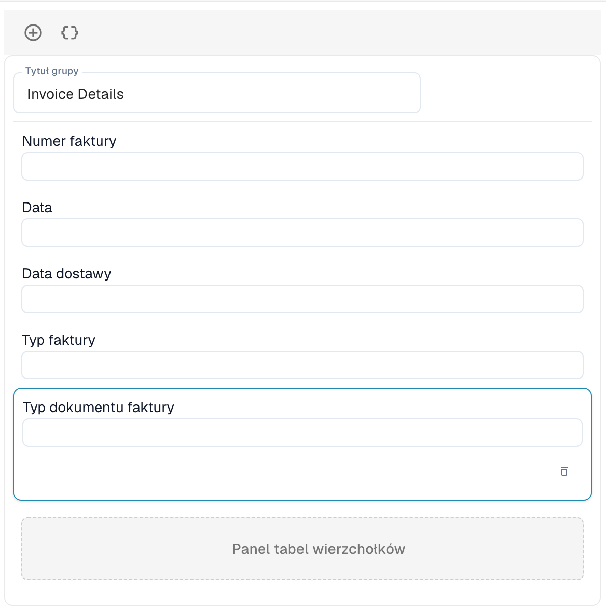

# Weryfikacja podatkowa Vertex

Weryfikacja podatkowa Vertex porównuje podatek naliczony przez dostawcę na fakturze z podatkiem, który Vertex oblicza dla tych samych pozycji. DocBits prosi Vertex o obliczenie, pokazuje użytkownikowi obie kwoty i zatrzymuje dokument, gdy podatek dostawcy jest zbyt wysoki.

## Jak to działa

1. Dokument dociera do punktu wyzwolenia. Wybierasz go w ustawieniach modułu: **Przed eksportem** (domyślnie) lub **Przed zatwierdzeniem**.
2. DocBits wysyła pozycje faktury do Vertex i otrzymuje obliczony podatek.
3. DocBits zapisuje wynik w dokumencie: pola **Vertex Tax Amount** i **Vertex Tax Rate** dla każdej pozycji oraz sumy nagłówka **Vendor Tax** (podatek naliczony na fakturze), **Vertex Tax**, sumę częściową i **Variance**.
4. DocBits porównuje podatek dostawcy z podatkiem Vertex:

| Sytuacja | Wynik |
| -------- | ----- |
| Podatek dostawcy jest wyższy niż podatek Vertex **o więcej niż próg wariancji** | Dokument jest odrzucany. Jego status zmienia się na **Vertex Tax Rejected**. |
| Podatek dostawcy jest wyższy, ale **w granicach progu** | Dokument jest akceptowany. |
| Podatek dostawcy jest równy podatkowi Vertex | Dokument jest akceptowany. |
| Podatek dostawcy jest **niższy** niż podatek Vertex | Dokument jest akceptowany, a brakująca kwota jest naliczana jako rezerwa. |

Komunikat o wyniku podaje kwoty, na przykład: *Rejected: vendor tax $380.00 exceeds Vertex calculated tax $140.00 by $240.00 (171.4%), above configured threshold of $25.00.*

Użytkownicy otwierają wynik za pomocą ikony Vertex w wierszu dokumentu na tablicy rozdzielczej. Ekran weryfikacji pokazuje baner z wynikiem (komunikat o niepowodzeniu wraz z jego treścią albo potwierdzenie powodzenia), pola zaprojektowanego przez Ciebie układu oraz tabele Vertex z podatkiem dla każdej pozycji.

Ekran obsługuje także dwa przyciski układu, które kontynuują lub zawracają dokument:

* Przycisk **Approve** rozpoczyna normalne zwolnienie dokumentu: dokument przechodzi do zatwierdzenia, jeśli zatwierdzanie jest włączone dla tego typu dokumentu, w przeciwnym razie zostaje wyeksportowany.
* Przycisk **Restart workflow** odsyła dokument z powrotem do walidacji. Otwarte zadania zatwierdzenia dla dokumentu są odrzucane i otwiera się ekran walidacji pól, dzięki czemu użytkownik może poprawić fakturę przed ponowną kontrolą.

To, który z dwóch przycisków zobaczy użytkownik, zależy od układu zaprojektowanego dla typu dokumentu.


Weryfikacja jest uruchamiana tylko dla typów dokumentów, które mają konfigurację eksportu typu **Vertex**. Bez niej dokument jest przetwarzany dalej bez weryfikacji.


## Konfiguracja integracji

Otwórz **Ustawienia** → **Moduł** → **Zamówienia i finanse** i przejdź do karty **Integracja podatkowa Vertex**. Strona zawiera także ustawienia dopasowania PO i automatycznej księgowości.

<figure><figcaption>
Karta Integracja podatkowa Vertex. Wartości dzierżawy i klienta są na tym zrzucie ekranu zastąpione symbolami zastępczymi.
</figcaption></figure>

1. Włącz **Integracja podatkowa Vertex**. Funkcja wymaga subskrypcji podatkowej Vertex.
2. Wprowadź **Podstawowy adres URL** punktu końcowego tokenów Vertex, swój **Identyfikator klienta** i swoją **Tajemnica klienta**.
3. Kliknij **Test połączenia**, a następnie **Zapisz**.
4. Ustaw tolerancję i wyzwalacz:
   * **Typ wariancji:** **Stała kwota** lub **Procent**.
   * **Próg wariancji:** odchylenie, które jest nadal akceptowane. Domyślnie jest to stała kwota 25. W trybie procentowym wprowadź wartość jako liczbę dziesiętną, na przykład 0.05 dla 5 %.
   * **Wyzwalacz weryfikacji:** **Przed eksportem** lub **Przed zatwierdzeniem**. Przy opcji **Przed zatwierdzeniem** kontrola jest uruchamiana podczas przetwarzania dokumentu, przed jego przejściem do zatwierdzenia. Jeśli sama kontrola się nie powiedzie, dokument otrzymuje status **Export Error**.

Następnie dodaj dla typu dokumentu konfigurację eksportu typu **Vertex** (**Ustawienia** → **Eksport**). Używa ona pliku mapowania TOML.

## Projektowanie formularza weryfikacji

Pola, które użytkownicy widzą na ekranie weryfikacji, są projektowane osobno dla każdego typu dokumentu.

1. Otwórz **Ustawienia** → **Typy dokumentów**, wybierz typ dokumentu i kliknij **Więcej ustawień**.
2. Otwórz kartę **Weryfikacja podatkowa Vertex** i kliknij **Weryfikacja podatkowa Design Vertex**.

<figure><figcaption>
Karta Weryfikacja podatkowa Vertex na stronie Więcej ustawień typu dokumentu Faktura.
</figcaption></figure>

Kreator układów otwiera się z typem układu **Weryfikacja podatkowa Vertex**. Przeciągnij grupy i pola do formularza, na przykład **Invoice Details** z numerem faktury, datą i datą dostawy. **Panel tabel wierzchołków** pokazuje porównanie podatku oraz pozycje faktury z podatkiem Vertex dla każdej pozycji. Jest częścią układu.

<figure><figcaption>
Układ Weryfikacja podatkowa Vertex z grupą Invoice Details i panelem tabel wierzchołków.
</figcaption></figure>

Informacje o działaniu Kreatora układów znajdziesz w [Layout Manager](../layout-manager/README.md).
