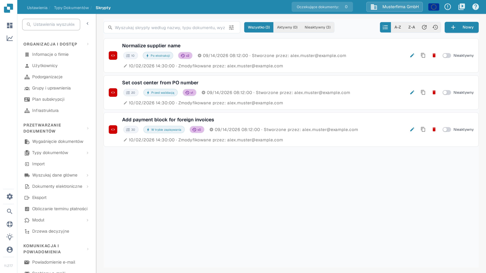
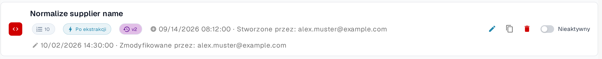
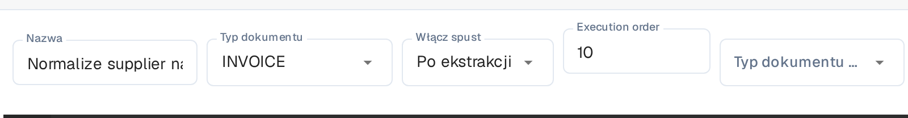
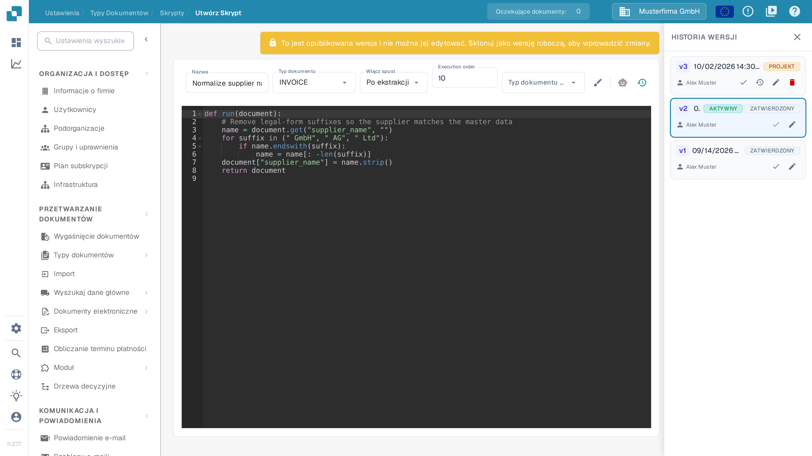
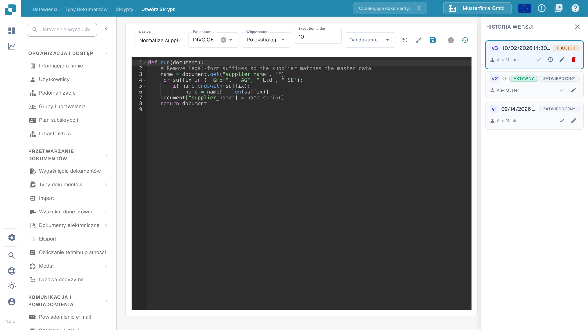

# Aktywowanie skryptów i zarządzanie nimi

Administratorzy mogą używać **Skryptów** do zarządzania regułami przetwarzania dla typu dokumentu. Ten przewodnik pokazuje, gdzie znaleźć skrypty, jak je włączać lub wyłączać oraz jak bezpiecznie zmienić opublikowany skrypt.

## Przewodnik wideo: zarządzanie skryptami


Zarządzanie skryptami typu dokumentu


Film pokazuje listę skryptów z filtrowaniem i sortowaniem, włączanie i wyłączanie skryptów, kopiowanie, historię wersji oraz usuwanie z potwierdzeniem.

## Znajdź skrypt

1. Otwórz **Ustawienia → Typy dokumentów**.
2. Dla typu dokumentu, którym chcesz zarządzać, wybierz **Skrypty**. Strona wyświetla listę skryptów tego typu dokumentu.
3. Szukaj według nazwy lub zawęź listę, używając opcji **Wszystko**, **Aktywny** i **Nieaktywny**. Lista jest domyślnie posortowana według kolejności wykonania; przełącznik sortowania pozwala wybrać kolejność wykonania, nazwę (**A-Z** / **Z-A**) lub datę ostatniej zmiany.

Każda karta pokazuje nazwę skryptu, jego kolejność wykonania jako numerowaną etykietę, wyzwalacz, wersję i status. Ikona ołówka otwiera edytor; ikona kopiowania duplikuje skrypt. **Nowy** otwiera edytor dla nowego skryptu.

<figure><figcaption>
Lista skryptów z filtrami i przełącznikiem sortowania. Numerowana etykieta na każdej karcie to kolejność wykonania skryptu.
</figcaption></figure>

<figure><figcaption>
Etykieta z numerem to kolejność wykonania; obok niej wyzwalacz, wersja i przełącznik Aktywny/Nieaktywny.
</figcaption></figure>

## Ustawianie kolejności wykonania

Pole **Execution order** określa kolejność uruchamiania skryptów: niższe liczby są uruchamiane jako pierwsze. Etykieta pola pozostaje angielska również w polskim interfejsie.

1. Otwórz skrypt w edytorze.
2. Wpisz liczbę całkowitą od 0 w polu **Execution order**. Pozostaw pole puste, aby zachować 0.
3. Zapisz skrypt. Litery, liczby dziesiętne i liczby ujemne są odrzucane z komunikatem błędu przy polu i nic nie zostaje zapisane.

Jeśli zmienisz kolejność wykonania, a następnie aktywujesz wersję, DocBits najpierw zapisuje skrypt i aktywuje wersję dopiero wtedy, gdy ten zapis się powiedzie.

<figure><figcaption>
Kolejność wykonania w edytorze skryptu.
</figcaption></figure>

## Włączanie lub wyłączanie skryptu

Użyj przełącznika **Aktywny/Nieaktywny** na karcie skryptu. Zmiana jest zapisywana natychmiast; liczniki listy aktualizują się, aby pokazać wynik. Skrypt nieaktywny nadal można przeglądać i edytować, ale nie jest uruchamiany podczas przetwarzania dokumentów.

**Sprawdź status po utworzeniu skryptu.** W aktualnym interfejsie Sandbox zapisanie nowego skryptu tworzy wersję aktywną i ustawia kartę na **Aktywny**. Przełącz ją na **Nieaktywny**, jeśli to tylko szkic lub przykład testowy.

## Zmiana istniejącego skryptu

1. Wybierz kartę skryptu lub jej ikonę ołówka. Opublikowana wersja jest tylko do odczytu, więc nie można jej bezpośrednio nadpisywać.
2. W **Historii wersji** wybierz ikonę ołówka przy wersji, którą chcesz zmienić. Spowoduje to utworzenie **Projektu** na podstawie tej wersji.
3. Edytuj projekt i wybierz ikonę zapisu. Przed zapisaniem sprawdź nazwę, typ dokumentu, wyzwalacz i kod.
4. Przetestuj zmieniony skrypt na reprezentatywnych dokumentach w środowisku testowym. Gdy będzie gotowy, wybierz ikonę znacznika przy projekcie w **Historii wersji**, aby uczynić tę wersję aktywną.
5. Wróć do listy Skrypty i sprawdź przełącznik **Aktywny/Nieaktywny** na karcie. Wersja oznaczona w Historii wersji jako **AKTYWNY** wskazuje wybraną wersję; przełącznik na karcie steruje tym, czy skrypt jest uruchamiany.

<figure><figcaption>
Opublikowanej wersji nie można edytować bezpośrednio. Użyj ołówka w Historii wersji, aby utworzyć projekt.
</figcaption></figure>

<figure><figcaption>
Zapisz i sprawdź projekt, zanim stanie się wersją aktywną.
</figcaption></figure>

Przykłady skryptów i dostępne funkcje opisuje strona [Skrypty w DocBits](scripting-in-docbits/README.md).

Jak utworzyć skrypt, obsługiwać edytor (formatowanie, cofnięcie projektu, asystent AI) i wprowadzić kod, opisuje strona [Tworzenie i edytowanie skryptów](creating-and-editing-scripts.md).

Ikona kosza na liście skryptów trwale usuwa skrypt; ikona strzałki w wierszu wersji Historii wersji wczytuje starszą wersję jako projekt do edytora.
