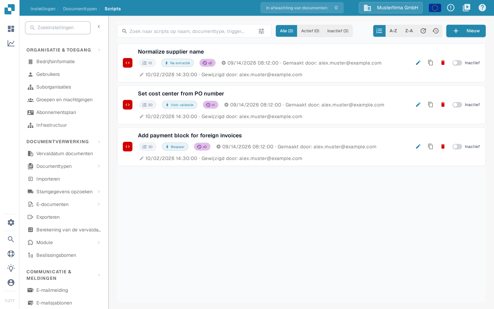
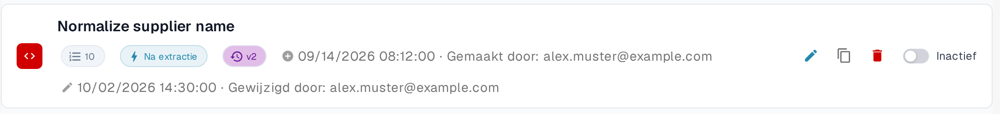
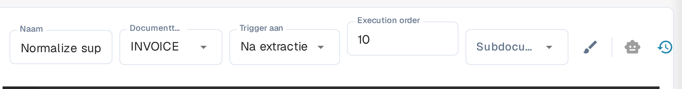
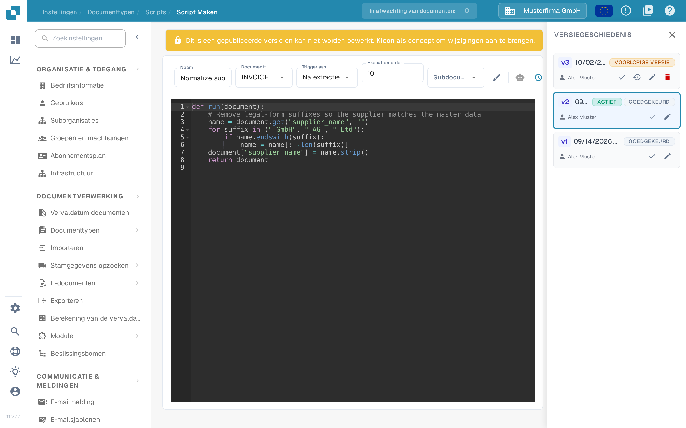
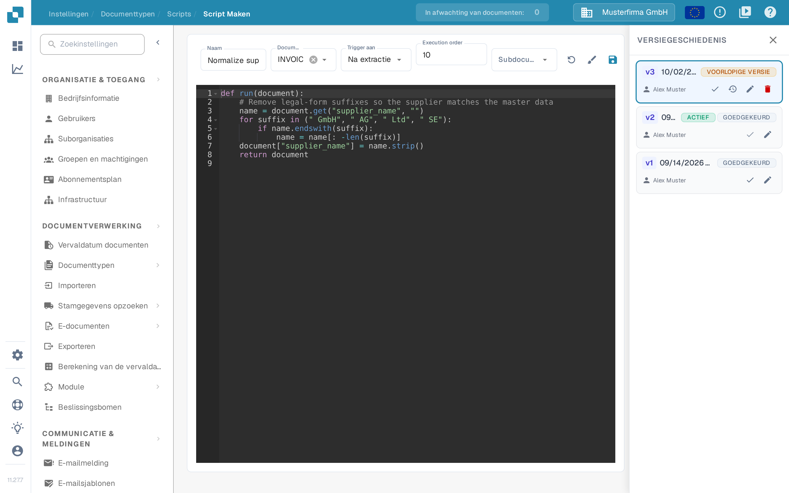

# Scripts activeren en beheren

Beheerders kunnen met **Scripts** verwerkingsregels voor een documenttype beheren. Deze handleiding laat zien waar u scripts vindt, hoe u ze in- of uitschakelt en hoe u een gepubliceerd script veilig wijzigt.

## Videohandleiding: scripts beheren


De scripts van een documenttype beheren


De video toont de scriptlijst met filter en sortering, activeren en deactiveren, kopiëren, de versiegeschiedenis en verwijderen met bevestiging.

## Een script vinden

1. Open **Instellingen → Documenttypen**.
2. Kies bij het documenttype dat u wilt beheren **Scripts**. De pagina toont de scripts van dat documenttype.
3. Zoek op naam of beperk de lijst met **Alle**, **Actief** en **Inactief**. Standaard sorteert de lijst op uitvoeringsvolgorde; de sorteerknoppen sorteren ook op naam (**A-Z**, **Z-A**) of op laatste wijziging (nieuwste of oudste eerst).

Elke kaart toont de naam van het script, de uitvoeringsvolgorde als genummerd label, de trigger, de versie en de status. Het potlood opent de editor; het kopieerpictogram dupliceert het script. **Nieuw** opent de editor voor een nieuw script.

De trigger op de kaart geeft aan op welk moment het script tijdens de verwerking loopt. U kiest hem in de editor in het veld **Trigger aan**.

<figure><figcaption>
De drie voorbeeldscripts zijn inactief; rechts op elke kaart ziet u de schakelaar.
</figcaption></figure>

<figure><figcaption>
Controleer de status rechts op de kaart voordat u iets wijzigt.
</figcaption></figure>

## Uitvoeringsvolgorde instellen

Met het veld **Execution order** bepaalt u in welke volgorde scripts lopen: lagere nummers lopen eerst. Het veld blijft ook in de Nederlandse interface Engels gelabeld.

1. Open het script in de editor.
2. Vul in het veld **Execution order** een heel getal vanaf 0 in. Laat het veld leeg om 0 te behouden.
3. Sla het script op. Letters, decimalen en negatieve getallen worden met een foutmelding bij het veld geweigerd en er wordt niets opgeslagen.

Als u de uitvoeringsvolgorde wijzigt en daarna een versie activeert, slaat DocBits eerst het script op en activeert de versie pas als dat opslaan is gelukt.

<figure><figcaption>
De uitvoeringsvolgorde in de scripteditor.
</figcaption></figure>

## Een script activeren of deactiveren

Gebruik de schakelaar **Actief/Inactief** op de scriptkaart. De wijziging wordt direct opgeslagen; de tellers in de lijst worden bijgewerkt. Een inactief script blijft beschikbaar om te bekijken of te bewerken, maar wordt niet uitgevoerd tijdens de documentverwerking.

**Controleer de status na het aanmaken van een script.** In de huidige Sandbox-interface werd bij het opslaan van een nieuw script een actieve versie aangemaakt en kwam de kaart op **Actief** te staan. Zet de schakelaar op **Inactief** als het script alleen een concept of een testvoorbeeld is.

## Een bestaand script wijzigen

1. Kies de scriptkaart of het potloodpictogram. Een gepubliceerde versie is alleen-lezen; u kunt deze niet direct overschrijven.
2. Kies in **VERSIEGESCHIEDENIS** het potloodpictogram bij de versie die u wilt wijzigen. Zo ontstaat een **concept** op basis van die versie.
3. Bewerk het concept en kies het opslagpictogram. Controleer naam, documenttype, trigger en code voordat u opslaat.
4. Test het gewijzigde script met representatieve documenten in een testomgeving. Kies daarna in **VERSIEGESCHIEDENIS** het vinkje bij het concept om die versie actief te maken.
5. Ga terug naar de scriptlijst en controleer de schakelaar **Actief/Inactief** op de kaart. De versie met de markering **ACTIEF** in de versiegeschiedenis is de gekozen versie; de schakelaar op de kaart bepaalt of het script wordt uitgevoerd.

<figure><figcaption>
Een gepubliceerde versie kunt u niet direct bewerken. Gebruik het potlood in de versiegeschiedenis om een concept te maken.
</figcaption></figure>

<figure><figcaption>
Sla het concept op en controleer het voordat u het de actieve versie maakt.
</figcaption></figure>

Het prullenbakpictogram op de scriptkaart verwijdert het script definitief. In de **VERSIEGESCHIEDENIS** maakt het vinkje een versie actief, laadt het pijlpictogram een versie in de editor en verwijdert het prullenbakpictogram een concept.

Voorbeelden van scripts en beschikbare functies vindt u op de pagina [Scripts in DocBits](scripting-in-docbits/README.md).

Hoe u een script aanmaakt, de editor gebruikt (opmaak, concept herstellen, AI-assistent) en de code invoert, staat op de pagina [Scripts maken en bewerken](creating-and-editing-scripts.md).
