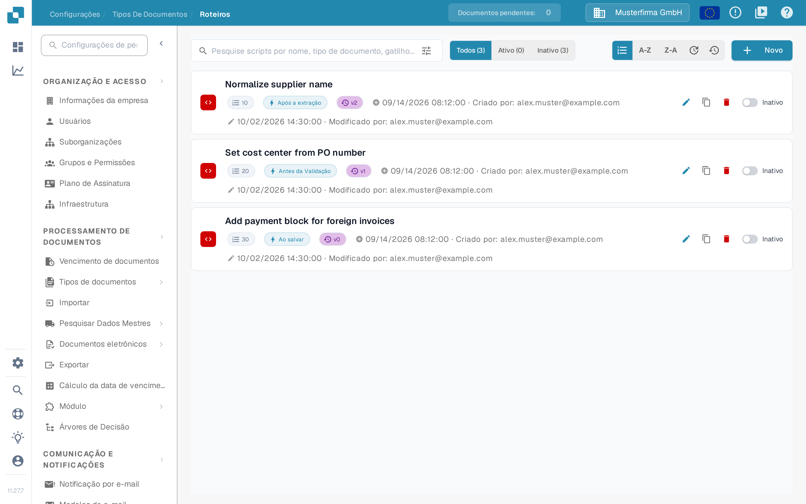
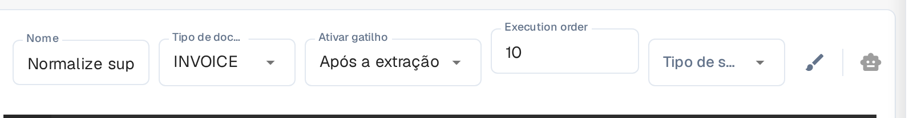
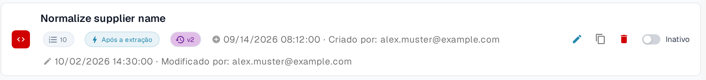
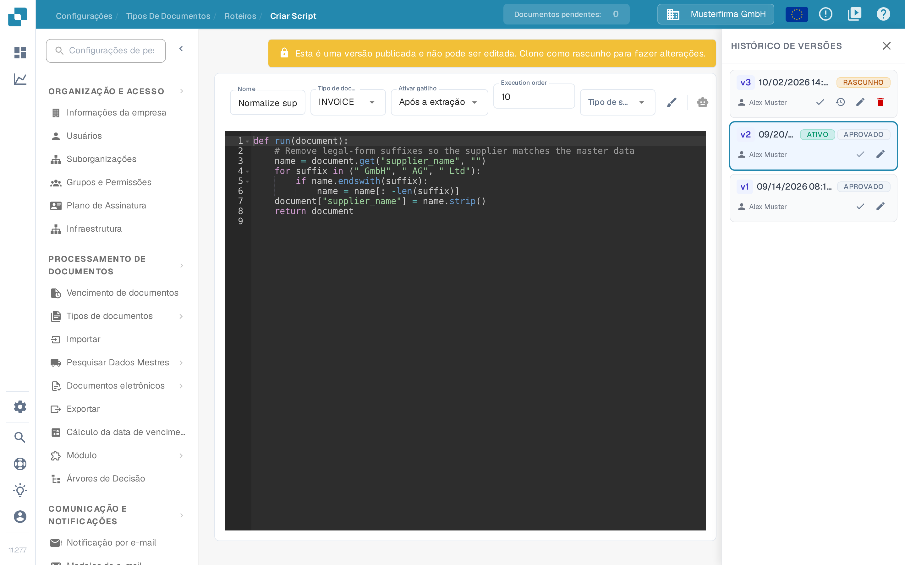

# Ativação e Gestão de Scripts

Os administradores podem usar **Scripts** para gerir regras de processamento de um tipo de documento. Este guia mostra onde encontrar scripts, como os ativar ou desativar e como alterar um script publicado com segurança.

## Guia em vídeo: gerir scripts


Gerir os scripts de um tipo de documento


O vídeo mostra a lista de scripts com filtro e ordenação, como ativar e desativar scripts, como copiar, o histórico de versões e a eliminação com confirmação.

## Encontrar um script

1. Abra **Configurações → Tipos de Documentos**.
2. No tipo de documento que pretende gerir, selecione **Roteiros**. A página lista os scripts desse tipo de documento.
3. Pesquise pelo nome ou limite a lista com **Todos**, **Ativo** e **Inativo**. A lista é apresentada por ordem de execução; o controlo de ordenação alterna entre a ordem de execução, o nome (**A-Z** / **Z-A**) e a data de modificação.

Cada cartão mostra o nome do script, a sua ordem de execução como uma etiqueta numerada, o gatilho, a versão e o estado. O ícone de lápis abre o editor; o ícone de cópia duplica o script. **Novo** abre o editor para um novo script.

<figure><figcaption>
A etiqueta numerada em cada cartão é a ordem de execução do script.
</figcaption></figure>

## Definir a ordem de execução

O campo **Execution order** controla a ordem em que os scripts são executados: os números mais baixos são executados primeiro. O campo mantém a etiqueta em inglês também na interface em português.

1. Abra o script no editor.
2. Introduza um número inteiro a partir de 0 no campo **Execution order**. Deixe o campo vazio para manter 0.
3. Guarde o script. Letras, decimais e números negativos são rejeitados com uma mensagem de erro no campo e nada é guardado.

Se alterar a ordem de execução e depois ativar uma versão, o DocBits guarda primeiro o script e só ativa a versão quando esse registo é bem-sucedido.

<figure><figcaption>
A ordem de execução está no campo <strong>Execution order</strong>.
</figcaption></figure>

## Ativar ou desativar um script

Use o interruptor **Ativo/Inativo** no cartão do script. A alteração é guardada imediatamente; os contadores da lista atualizam-se para mostrar o resultado. Um script inativo continua disponível para consulta ou edição, mas não é executado durante o processamento de documentos.

<figure><figcaption>
À direita do cartão: o lápis para editar, a cópia, o caixote do lixo para eliminar e o interruptor <strong>Ativo/Inativo</strong>.
</figcaption></figure>

**Verifique o estado depois de criar um script.** Na interface atual do Sandbox, ao guardar um novo script foi criada uma versão ativa e o cartão foi definido como **Ativo**. Coloque o interruptor em **Inativo** se for apenas um rascunho ou um exemplo de teste.

## Alterar um script existente

1. Selecione o cartão do script ou o seu ícone de lápis. Uma versão publicada é somente leitura, pelo que não pode escrever diretamente sobre ela.
2. Em **Histórico de Versões**, selecione o ícone de lápis da versão que pretende alterar. Isto cria um **Rascunho** com base nessa versão.
3. Edite o rascunho e selecione o ícone de guardar. Reveja o nome, o tipo de documento, o gatilho e o código antes de guardar.
4. Teste o script alterado com documentos representativos num ambiente de teste. Quando estiver pronto, selecione o ícone de verificação do rascunho no **Histórico de Versões** para tornar essa versão ativa.
5. Regresse à lista de scripts e verifique o interruptor **Ativo/Inativo** do cartão. A versão marcada como **ATIVO** no Histórico de Versões identifica a versão selecionada; o interruptor do cartão controla se o script é executado.

<figure><figcaption>
Uma versão publicada não pode ser editada diretamente. Use o lápis no Histórico de Versões para criar um rascunho.
</figcaption></figure>

<figure><figcaption>
Guarde e verifique o rascunho antes de o tornar a versão ativa.
</figcaption></figure>

Para exemplos de scripts e funções disponíveis, consulte [Scripting no DocBits](scripting-in-docbits/README.md).
