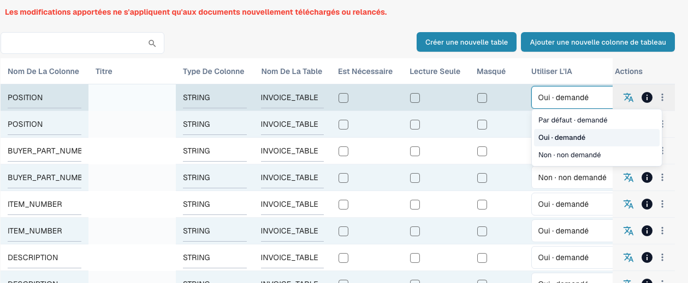

# Colonnes de tableau

Les Table Columns définissent les colonnes du tableau des lignes d'un type de document : ce que DocBits extrait dans chaque colonne, ce que l'utilisateur voit sur l'écran de validation et ce qui est envoyé à l'ERP lors de l'export.

**Où :** Paramètres → Paramètres globaux → Types de documents → Colonnes du tableau

<figure><figcaption>
Liste Use AI actuelle avec Par défaut, Oui et Non. Aucune option n&#x27;a été modifiée. Les cellules de titre sont masquées pour protéger les données.
</figcaption></figure>

## Ce que vous voyez

Chaque ligne correspond à une colonne d'une table. La liste affiche :

| Colonne | Signification |
|---|---|
| **Column name** | Nom technique, généré à partir du titre (majuscules, tirets bas). Utilisé dans les scripts, les mappings d'export et l'API. Ne peut pas être modifié par la suite. |
| **Title** | Libellé affiché sur l'écran de validation. Modifiez-le avec l'icône de traduction dans la colonne *Actions* (*Update translation key*). |
| **Column Type** | `AMOUNT`, `STRING`, `DATE`, `NUMBER`, `BOOLEAN` ou `CURRENCY`. Détermine la validation et le formatage. |
| **Table name** | La table à laquelle appartient la colonne, par exemple `INVOICE_TABLE`. |
| **Is Required** | Le document ne peut pas être approuvé tant que cette colonne est vide dans une ligne quelconque. |
| **Read Only** | Les utilisateurs voient la valeur mais ne peuvent pas la modifier. |
| **Hidden** | La colonne n'est ni affichée ni exportée. Sert à désactiver les colonnes par défaut dont vous n'avez pas besoin. |
| **Use AI** | Sélection à trois états : Par défaut reprend la sélection IA du type de document, Oui demande explicitement la colonne et Non l'exclut du schéma de base. Ce choix est distinct de Obligatoire, Lecture seule et Masqué. |
| **Actions** | Icône de traduction : renommer le titre. Icône d'information : origine du libellé affiché (votre traduction, la valeur par défaut, la clé). Menu à trois points : *Delete*, uniquement pour les colonnes créées par votre organisation ; les colonnes par défaut peuvent seulement être masquées. |

Deux boutons au-dessus de la liste :

* **Create new table** : un second tableau de lignes pour le type de document (par exemple un tableau de frais à côté du tableau des articles).
* **Add new table column** : ouvre la boîte de dialogue décrite dans [Ajouter une nouvelle colonne](adding-a-new-column.md).

## Colonnes par défaut et colonnes personnalisées

Chaque type de document est fourni avec un ensemble de colonnes par défaut (pour les factures : numéro d'article, description, quantité, prix unitaire, montant total, taxe, …). Elles appartiennent à DocBits et non à votre organisation ; elles ne peuvent donc pas être supprimées, masquez-les plutôt. Les colonnes que vous ajoutez vous-même appartiennent à votre organisation et peuvent être supprimées.


**Les modifications ne s'appliquent qu'aux nouveaux documents.** Une colonne que vous ajoutez, masquez ou supprimez apparaît sur les documents téléversés ou redémarrés après la modification. Les documents déjà présents dans le tableau de bord conservent leur tableau tel qu'il a été extrait. Redémarrez un document pour prendre en compte la nouvelle configuration.


## Pages associées

* [Objectif et utilisation](purpose-and-use.md) : où apparaissent les colonnes de tableau
* [Ajouter une nouvelle colonne](adding-a-new-column.md)
* [Modifier et supprimer des colonnes](editing-and-deleting-columns.md)
* [Bonnes pratiques](best-practices-2.md)
* [Dépannage](troubleshooting-1.md)
* [Training Line Fields / Table Training](../../../../setup/document-training/training-line-fields-table-training/README.md) : indiquez à DocBits où se trouve le tableau d'un fournisseur
* [AI Table](../../../../../end-user-and-partner-section/end-user-section/ai-table/README.md) : ce que l'utilisateur voit sur l'écran de validation

## Use AI : Par défaut, Oui ou Non

Ouvrez les [colonnes de tableau](README.md) du bon type de document et du bon tableau. **Utiliser l'IA (Use AI)** est une liste à trois états, pas une case à cocher. Le choix est enregistré immédiatement.

| Choix actuel | Effet sur le schéma de base |
| --- | --- |
| **Par défaut · demandé** ou **Par défaut · non demandé** | Applique la sélection DocBits pour ce type et ce nom de colonne. Par défaut ne signifie ni toujours activé ni toujours désactivé. |
| **Oui · demandé** | Demande explicitement cette colonne configurée à l'IA. |
| **Non · non demandé** | L'exclut du schéma de base, même si elle est normalement demandée. |

Revenir à **Par défaut** supprime le choix explicite. Une nouvelle colonne personnalisée n'appartient normalement pas à la sélection IA par défaut : choisissez **Oui** pour la demander. Les colonnes IA par défaut ne correspondent pas à toutes les colonnes fournies. Vérifiez l'effet affiché et l'aperçu.

**Obligatoire**, **Lecture seule** et **Masqué** concernent les contrôles de complétude, la modification et la visibilité ; ils ne remplacent pas le choix IA. **Non** ne supprime ni la colonne ni ses valeurs et n'empêche pas des règles, scripts ou autres sources de la renseigner. L'apprentissage fournisseur et les tags IA peuvent étendre la demande effective : résolvez aussi leurs contradictions. Le commutateur ne remplace pas automatiquement un résultat purement issu de règles.

[Structured Output pour les tableaux](../../../../../end-user-and-partner-section/end-user-section/ai-table/structured-output.md).
