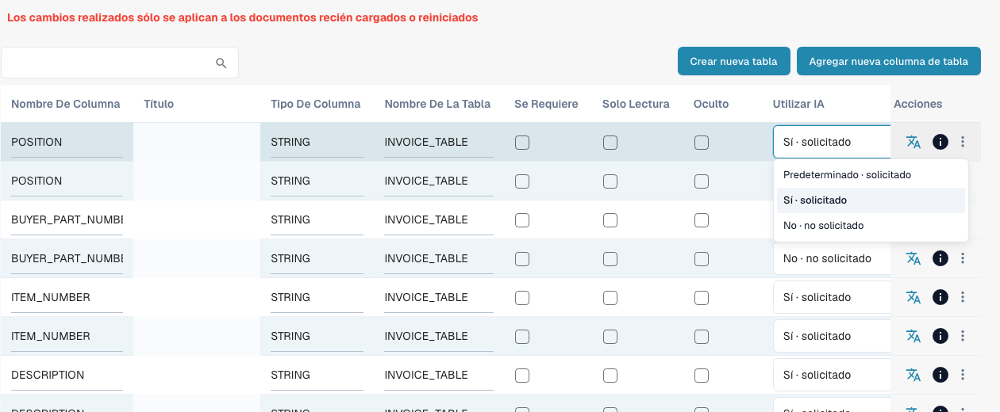

# Columnas de tabla

Table Columns define qué columnas tiene la tabla de líneas de un tipo de documento: qué extrae DocBits en cada columna, qué ve el usuario en la pantalla de validación y qué se envía al ERP en la exportación.

**Dónde:** Configuración → Procesamiento de Documentos → Tipos de documento → Columnas de tabla

<figure><figcaption>
Desplegable actual Use AI con Predeterminado, Sí y No. No se cambió ninguna opción. Las celdas de título están ocultas por privacidad.
</figcaption></figure>

## Qué se ve

Cada fila es una columna de una tabla. La lista muestra:

| Columna | Significado |
|---|---|
| **Column name** | Nombre técnico, generado a partir del título (mayúsculas, guiones bajos). Se utiliza en scripts, mapeos de exportación y en la API. No se puede cambiar después. |
| **Title** | Etiqueta que se muestra en la pantalla de validación. Se cambia con el icono de traducción en la columna *Actions* (*Update translation key*). |
| **Column Type** | `AMOUNT`, `STRING`, `DATE`, `NUMBER`, `BOOLEAN` o `CURRENCY`. Determina la validación y el formato. |
| **Table name** | La tabla a la que pertenece la columna, por ejemplo `INVOICE_TABLE`. |
| **Is Required** | El documento no se puede aprobar mientras esta columna esté vacía en alguna fila. |
| **Read Only** | Los usuarios ven el valor, pero no pueden editarlo. |
| **Hidden** | La columna no se muestra ni se exporta. Sirve para desactivar las columnas predeterminadas que no necesita. |
| **Use AI** | Selección de tres estados: Predeterminado hereda la selección de IA del tipo de documento, Sí solicita expresamente la columna y No la excluye del esquema base. Es independiente de Obligatoria, Solo lectura y Oculta. |
| **Actions** | Icono de traducción: cambiar el título. Icono de información: de dónde procede la etiqueta mostrada (su traducción, la predeterminada, la clave). Menú de tres puntos: *Delete*, solo para columnas creadas por su organización; las columnas predeterminadas solo se pueden ocultar. |

Dos botones sobre la lista:

* **Create new table**: una segunda tabla de líneas para el tipo de documento (por ejemplo, una tabla de cargos junto a la tabla de artículos).
* **Add new table column**: abre el cuadro de diálogo descrito en [Añadir una nueva columna](adding-a-new-column.md).

## Columnas predeterminadas y columnas propias

Cada tipo de documento incluye un conjunto de columnas predeterminadas (para facturas: número de artículo, descripción, cantidad, precio unitario, importe total, impuesto, …). Pertenecen a DocBits, no a su organización, por lo que no se pueden eliminar; oculte las que no necesite. Las columnas que usted añade pertenecen a su organización y se pueden eliminar.


**Los cambios se aplican solo a los documentos nuevos.** Una columna que añada, oculte o elimine aparece en los documentos que se carguen o se reinicien después del cambio. Los documentos que ya están en el dashboard conservan su tabla tal como se extrajo. Reinicie un documento para que adopte la nueva configuración.


## Páginas relacionadas

* [Propósito y uso](purpose-and-use.md): dónde aparecen las columnas de tabla
* [Añadir una nueva columna](adding-a-new-column.md)
* [Editar y eliminar columnas](editing-and-deleting-columns.md)
* [Buenas prácticas](best-practices-2.md)
* [Solución de problemas](troubleshooting-1.md)
* [Training Line Fields / Table Training](../../../../setup/document-training/training-line-fields-table-training/README.md): enseñe a DocBits dónde está la tabla de un proveedor
* [AI Table](../../../../../end-user-and-partner-section/end-user-section/ai-table/README.md): lo que ve el usuario en la pantalla de validación

## Use AI: Predeterminado, Sí o No

Abra las [columnas de tabla](README.md) del tipo de documento y tabla correctos. **Utilizar IA (Use AI)** es un desplegable de tres estados, no una casilla. Se guarda inmediatamente.

| Opción actual | Efecto en el esquema base |
| --- | --- |
| **Predeterminado · solicitado** o **Predeterminado · no solicitado** | Usa la selección predeterminada de DocBits para ese tipo y nombre de columna. No significa siempre activado ni siempre desactivado. |
| **Sí · solicitado** | Solicita expresamente la columna configurada. |
| **No · no solicitado** | La excluye del esquema base, incluso si normalmente se solicita. |

Volver a **Predeterminado** elimina la elección explícita. Una columna propia nueva normalmente no pertenece a la selección predeterminada de IA: seleccione **Sí** para solicitarla. Las columnas predeterminadas de IA no son todas las columnas incluidas en DocBits; compruebe el efecto indicado y la vista previa.

**Obligatoria**, **Solo lectura** y **Oculta** controlan integridad, edición y visibilidad; no sustituyen la elección de IA. **No** no elimina la columna ni borra valores, y no impide que reglas, scripts u otras fuentes la rellenen. El entrenamiento y las etiquetas adicionales pueden ampliar la solicitud del proveedor: resuelva también allí las contradicciones. Este ajuste no sustituye automáticamente un resultado obtenido solo mediante reglas.

[Structured Output para tablas](../../../../../end-user-and-partner-section/end-user-section/ai-table/structured-output.md).
