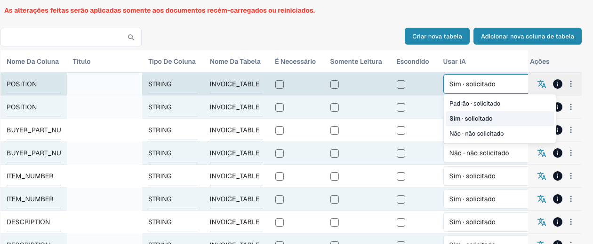

# Colunas de tabela

As colunas de tabela definem quais colunas a tabela de itens de linha de um tipo de documento possui: o que o DocBits extrai para cada coluna, o que o usuário vê na tela de validação e o que é enviado ao ERP na exportação.

**Onde:** Settings → Global Settings → Document Types → Table Columns

<figure><figcaption>
Lista Use AI atual com Padrão, Sim e Não. Nenhuma opção foi alterada. As células de título estão ocultas para proteger dados.
</figcaption></figure>

## O que você vê

Cada linha é uma coluna de uma tabela. A lista mostra:

| Coluna | Significado |
|---|---|
| **Column name** | Nome técnico, gerado a partir do título (maiúsculas, sublinhados). Usado em scripts, mapeamentos de exportação e na API. Não pode ser alterado depois. |
| **Title** | Rótulo exibido na tela de validação. Altere-o com o ícone de tradução na coluna *Actions* (*Update translation key*). |
| **Column Type** | `AMOUNT`, `STRING`, `DATE`, `NUMBER`, `BOOLEAN` ou `CURRENCY`. Determina a validação e a formatação. |
| **Table name** | A tabela à qual a coluna pertence, por exemplo `INVOICE_TABLE`. |
| **Is Required** | O documento não pode ser aprovado enquanto esta coluna estiver vazia em qualquer linha. |
| **Read Only** | Os usuários veem o valor, mas não podem editá-lo. |
| **Hidden** | A coluna não é exibida nem exportada. Usado para desativar colunas padrão de que você não precisa. |
| **Use AI** | Escolha de três estados: Padrão herda a seleção de IA do tipo de documento, Sim solicita a coluna explicitamente e Não a exclui do esquema base. É independente de Obrigatória, Somente leitura e Oculta. |
| **Actions** | Ícone de tradução: renomeia o título. Ícone de informações: de onde vem o rótulo exibido (sua tradução, o padrão, a chave). Menu de três pontos: *Delete*, somente para colunas criadas pela sua organização; as colunas padrão só podem ser ocultadas. |

Dois botões acima da lista:

* **Create new table**: uma segunda tabela de itens de linha para o tipo de documento (por exemplo, uma tabela de encargos ao lado da tabela de itens).
* **Add new table column**: abre a caixa de diálogo descrita em [Adicionando uma nova coluna](adding-a-new-column.md).

## Colunas padrão e colunas próprias

Todo tipo de documento acompanha um conjunto de colunas padrão (para faturas: número do item, descrição, quantidade, preço unitário, valor total, imposto, …). Elas pertencem ao DocBits, não à sua organização, portanto não podem ser excluídas; oculte-as em vez disso. As colunas que você mesmo adiciona pertencem à sua organização e podem ser excluídas.


**As alterações se aplicam somente a novos documentos.** Uma coluna que você adiciona, oculta ou exclui aparece nos documentos enviados ou reiniciados após a alteração. Os documentos que já estão no dashboard mantêm a tabela como foi extraída. Reinicie um documento para que ele use a nova configuração.


## Páginas relacionadas

* [Finalidade e uso](purpose-and-use.md): onde as colunas de tabela aparecem
* [Adicionando uma nova coluna](adding-a-new-column.md)
* [Editando e excluindo colunas](editing-and-deleting-columns.md)
* [Melhores práticas](best-practices-2.md)
* [Solução de problemas](troubleshooting-1.md)
* [Training Line Fields / Table Training](../../../../setup/document-training/training-line-fields-table-training/README.md): ensine ao DocBits onde fica a tabela de um fornecedor
* [AI Table](../../../../../end-user-and-partner-section/end-user-section/ai-table/README.md): o que o usuário vê na tela de validação

## Use AI: Padrão, Sim ou Não

Abra [Colunas de tabela](README.md) para o tipo de documento e a tabela corretos. **Usar IA (Use AI)** é uma lista de três estados, não uma caixa de seleção. A alteração é salva imediatamente.

| Opção atual | Efeito no esquema base |
| --- | --- |
| **Padrão · solicitado** ou **Padrão · não solicitado** | Usa a seleção DocBits para esse tipo e nome de coluna. Padrão não significa sempre ativado nem sempre desativado. |
| **Sim · solicitado** | Solicita explicitamente essa coluna configurada à IA. |
| **Não · não solicitado** | Exclui a coluna do esquema base, mesmo que normalmente seja solicitada. |

Voltar a **Padrão** remove a escolha explícita. Uma coluna própria recém-criada normalmente não pertence à seleção padrão de IA: escolha **Sim** para solicitá-la. As colunas padrão de IA não são todas as colunas fornecidas. Verifique o efeito indicado e a prévia.

**Obrigatória**, **Somente leitura** e **Oculta** controlam completude, edição e visibilidade; não substituem a escolha de IA. **Não** não exclui a coluna nem apaga valores, e não impede que regras, scripts ou outras fontes a preencham. Treinamento do fornecedor e tags de IA podem ampliar a solicitação efetiva: resolva também ali as contradições. O interruptor não substitui automaticamente um resultado obtido apenas por regras.

[Structured Output para tabelas](../../../../../end-user-and-partner-section/end-user-section/ai-table/structured-output.md).
