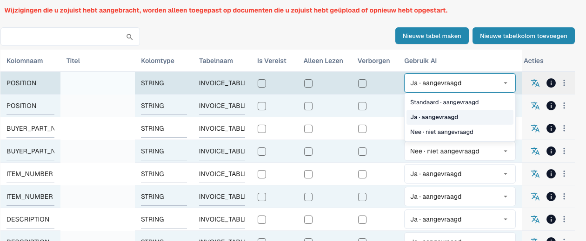

# Tabelkolommen

Tabelkolommen bepalen welke kolommen de regelitemtabel van een documenttype heeft: wat DocBits in elke kolom extraheert, wat de gebruiker op het validatiescherm ziet en wat bij het exporteren naar het ERP wordt verzonden.

**Waar:** Instellingen → Globale instellingen → Documenttypen → Tabelkolommen

<figure><figcaption>
Huidige Use AI-keuzelijst met Standaard, Ja en Nee. Er is geen optie gewijzigd. Titelcellen zijn verborgen ter bescherming van gegevens.
</figcaption></figure>

## Wat u ziet

Elke rij is één kolom van één tabel. De lijst toont:

| Kolom | Betekenis |
|---|---|
| **Kolomnaam** | Technische naam, afgeleid van de titel (hoofdletters, underscores). Wordt gebruikt in scripts, exportmappings en de API. Kan achteraf niet worden gewijzigd. |
| **Titel** | Label dat op het validatiescherm wordt getoond. Wijzig het met het vertaalpictogram in de kolom *Acties* (*Vertaalsleutel bijwerken*). |
| **Kolomtype** | `AMOUNT`, `STRING`, `DATE`, `NUMBER`, `BOOLEAN` of `CURRENCY`. Bepaalt de validatie en de opmaak. |
| **Tabelnaam** | De tabel waartoe de kolom behoort, bijvoorbeeld `INVOICE_TABLE`. |
| **Verplicht** | Het document kan niet worden goedgekeurd zolang deze kolom in een rij leeg is. |
| **Alleen-lezen** | Gebruikers zien de waarde, maar kunnen deze niet bewerken. |
| **Verborgen** | De kolom wordt niet getoond en niet geëxporteerd. Wordt gebruikt om standaardkolommen uit te schakelen die u niet nodig hebt. |
| **Use AI** | Keuze met drie toestanden: Standaard neemt de AI-selectie van het documenttype over, Ja vraagt de kolom uitdrukkelijk en Nee sluit haar uit het basisschema uit. Dit staat los van Verplicht, Alleen-lezen en Verborgen. |
| **Acties** | Vertaalpictogram: de titel hernoemen. Infopictogram: waar het getoonde label vandaan komt (uw vertaling, de standaard, de sleutel). Menu met drie puntjes: *Verwijderen*, alleen voor kolommen die uw organisatie heeft aangemaakt; standaardkolommen kunnen alleen worden verborgen. |

Twee knoppen boven de lijst:

* **Nieuwe tabel maken**: een tweede regelitemtabel voor het documenttype (bijvoorbeeld een kostentabel naast de artikeltabel).
* **Nieuwe tabelkolom toevoegen**: opent het dialoogvenster dat wordt beschreven in [Een nieuwe kolom toevoegen](adding-a-new-column.md).

## Standaardkolommen en eigen kolommen

Elk documenttype wordt geleverd met een set standaardkolommen (voor facturen: artikelnummer, omschrijving, hoeveelheid, eenheidsprijs, totaalbedrag, belasting, …). Ze horen bij DocBits, niet bij uw organisatie, en kunnen daarom niet worden verwijderd; verberg ze in plaats daarvan. Kolommen die u zelf toevoegt, horen bij uw organisatie en kunnen wel worden verwijderd.


**Wijzigingen gelden alleen voor nieuwe documenten.** Een kolom die u toevoegt, verbergt of verwijdert, verschijnt op documenten die na de wijziging worden geüpload of opnieuw gestart. Documenten die al op het dashboard staan, behouden hun tabel zoals die is geëxtraheerd. Start een document opnieuw om de nieuwe configuratie over te nemen.


## Gerelateerde pagina's

* [Doel en gebruik](purpose-and-use.md): waar tabelkolommen voorkomen
* [Een nieuwe kolom toevoegen](adding-a-new-column.md)
* [Kolommen bewerken en verwijderen](editing-and-deleting-columns.md)
* [Best practices](best-practices-2.md)
* [Probleemoplossing](troubleshooting-1.md)
* [Training Line Fields / Tabeltraining](../../../../setup/document-training/training-line-fields-table-training/README.md): leer DocBits waar de tabel van een leverancier staat
* [AI Tabel](../../../../../end-user-and-partner-section/end-user-section/ai-table/README.md): wat de gebruiker op het validatiescherm ziet

## Use AI: Standaard, Ja of Nee

Open [Tabelkolommen](README.md) voor het juiste documenttype en de juiste tabel. **Gebruik AI (Use AI)** is een keuzelijst met drie toestanden, geen selectievakje. Wijzigingen worden direct opgeslagen.

| Huidige keuze | Betekenis voor het basisschema |
| --- | --- |
| **Standaard · aangevraagd** of **Standaard · niet aangevraagd** | Neemt de DocBits-standaard voor dit documenttype en deze kolomnaam over. Standaard betekent niet altijd aan of altijd uit. |
| **Ja · aangevraagd** | Vraagt deze geconfigureerde kolom uitdrukkelijk aan de AI. |
| **Nee · niet aangevraagd** | Sluit de kolom uit het basisschema uit, ook als deze normaal wordt gevraagd. |

Terug naar **Standaard** verwijdert de uitdrukkelijke keuze. Een nieuwe eigen kolom valt normaal niet onder de AI-standaardselectie: kies **Ja** als de AI haar moet teruggeven. De AI-standaardkolommen zijn niet alle meegeleverde kolommen. Controleer de aangegeven werking en het voorbeeld.

**Verplicht**, **Alleen-lezen** en **Verborgen** regelen volledigheid, bewerkbaarheid en zichtbaarheid; ze vervangen de AI-keuze niet. **Nee** verwijdert de kolom of bestaande waarden niet en verhindert niet dat regels, scripts of andere bronnen haar vullen. Leverancierstraining en extra AI-tags kunnen de werkelijke aanvraag uitbreiden: los tegenstrijdigheden daar ook op. De schakelaar vervangt niet automatisch een resultaat dat uitsluitend uit regels komt.

[Structured Output voor tabellen](../../../../../end-user-and-partner-section/end-user-section/ai-table/structured-output.md).
