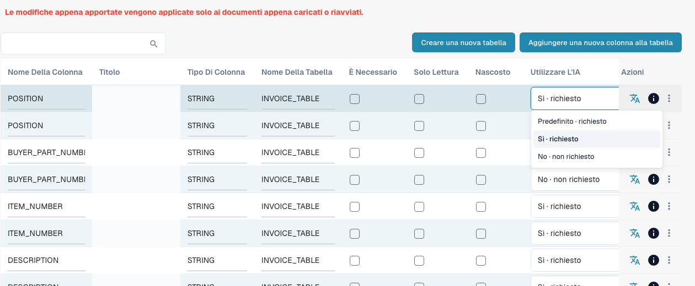

# Colonne della Tabella

Le colonne della tabella definiscono quali colonne ha la tabella delle voci di riga di un tipo di documento: cosa DocBits estrae in ogni colonna, cosa vede l'utente nella schermata di validazione e cosa viene inviato all'ERP in fase di esportazione.

**Dove:** Settings → Document Processing → Document Types → Colonne della Tabella

<figure><figcaption>
Menu Use AI attuale con Predefinito, Sì e No. Nessuna opzione è stata modificata. Le celle dei titoli sono nascoste per riservatezza.
</figcaption></figure>

## Cosa vedi

Ogni riga è una colonna di una tabella. L'elenco mostra:

| Colonna | Significato |
|---|---|
| **Nome colonna** | Nome tecnico, generato dal titolo (maiuscole, trattini bassi). Viene usato negli script, nelle mappature di esportazione e nell'API. Non può essere modificato in seguito. |
| **Titolo** | Etichetta mostrata nella schermata di validazione. Si modifica con l'icona di traduzione nella colonna *Azioni* (*Aggiorna chiave di traduzione*). |
| **Tipo di colonna** | `AMOUNT`, `STRING`, `DATE`, `NUMBER`, `BOOLEAN` o `CURRENCY`. Determina la validazione e la formattazione. |
| **Nome tabella** | La tabella a cui appartiene la colonna, ad esempio `INVOICE_TABLE`. |
| **Obbligatoria** | Il documento non può essere approvato finché questa colonna è vuota in una qualsiasi riga. |
| **Read Only** | Gli utenti vedono il valore ma non possono modificarlo. |
| **Hidden** | La colonna non viene né mostrata né esportata. Serve per disattivare le colonne predefinite che non ti servono. |
| **Use AI** | Scelta a tre stati: Predefinito eredita la selezione AI del tipo di documento, Sì richiede esplicitamente la colonna e No la esclude dallo schema base. È separata da Obbligatoria, Sola lettura e Nascosta. |
| **Azioni** | Icona di traduzione: rinomina il titolo. Icona info: da dove proviene l'etichetta mostrata (la tua traduzione, il valore predefinito, la chiave). Menu a tre punti: *Delete*, solo per le colonne create dalla tua organizzazione; le colonne predefinite possono solo essere nascoste. |

Sopra l'elenco ci sono due pulsanti:

* **Crea nuova tabella**: una seconda tabella di voci di riga per il tipo di documento (ad esempio una tabella degli oneri accanto alla tabella degli articoli).
* **Aggiungi nuova colonna della tabella**: apre la finestra di dialogo descritta in [Aggiungere una nuova colonna](adding-a-new-column.md).

## Colonne predefinite e colonne personalizzate

Ogni tipo di documento viene fornito con un set di colonne predefinite (per le fatture: numero articolo, descrizione, quantità, prezzo unitario, importo totale, imposta, …). Appartengono a DocBits, non alla tua organizzazione, quindi non possono essere eliminate: nascondile invece. Le colonne che aggiungi tu appartengono alla tua organizzazione e possono essere eliminate.


**Le modifiche valgono solo per i nuovi documenti.** Una colonna che aggiungi, nascondi o elimini compare sui documenti caricati o riavviati dopo la modifica. I documenti già presenti nella dashboard mantengono la tabella così come è stata estratta. Riavvia un documento per applicare la nuova configurazione.


## Pagine correlate

* [Scopo e utilizzo](purpose-and-use.md): dove compaiono le colonne della tabella
* [Aggiungere una nuova colonna](adding-a-new-column.md)
* [Modifica ed eliminazione delle colonne](editing-and-deleting-columns.md)
* [Buone pratiche](best-practices-2.md)
* [Risoluzione dei problemi](troubleshooting-1.md)
* [Campi di addestramento Linee/Tabella di addestramento](../../../../setup/document-training/training-line-fields-table-training/README.md): insegna a DocBits dove si trova la tabella di un fornitore
* [Tabella AI](../../../../../end-user-and-partner-section/end-user-section/ai-table/README.md): cosa vede l'utente nella schermata di validazione

## Use AI: Predefinito, Sì o No

Aprire le [colonne di tabella](README.md) del tipo di documento e della tabella corretti. **Utilizzare l'IA (Use AI)** è un menu a tre stati, non una casella. La modifica viene salvata immediatamente.

| Scelta attuale | Effetto sullo schema base |
| --- | --- |
| **Default · richiesto** oppure **Default · non richiesto** | Usa la selezione DocBits per quel tipo e nome di colonna. Predefinito non significa sempre attivo né sempre disattivo. |
| **Yes · richiesto** | Richiede esplicitamente la colonna configurata all'AI. |
| **No · non richiesto** | La esclude dallo schema base anche se normalmente viene richiesta. |

Tornare a **Default** rimuove la scelta esplicita. Una nuova colonna personalizzata normalmente non appartiene alla selezione AI predefinita: scegliere **Yes** per richiederla. Le colonne AI predefinite non coincidono con tutte le colonne fornite. Verificare effetto indicato e anteprima.

**Obbligatoria**, **Read Only** e **Hidden** controllano completezza, modificabilità e visibilità; non sostituiscono la scelta AI. **No** non elimina la colonna né cancella valori e non impedisce a regole, script o altre fonti di compilarla. Addestramento del fornitore e tag AI possono ampliare la richiesta effettiva: risolvere anche lì eventuali contraddizioni. L'interruttore non sostituisce automaticamente un risultato basato soltanto su regole.

[Structured Output per le tabelle](../../../../../end-user-and-partner-section/end-user-section/ai-table/structured-output.md).
