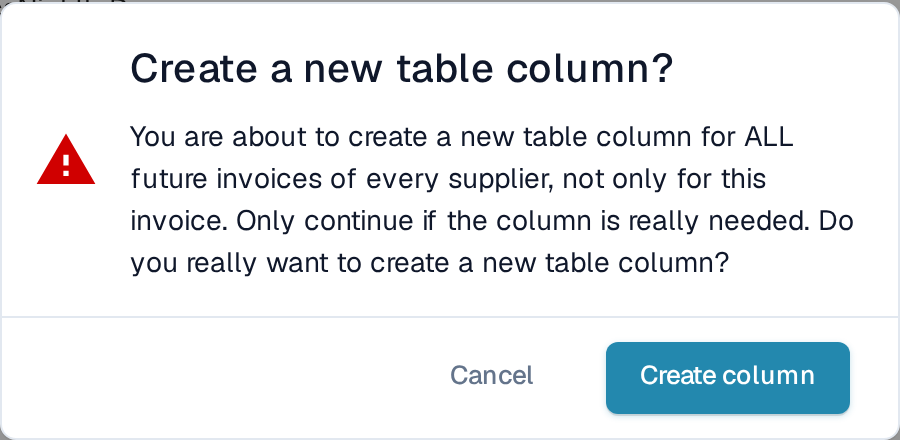

# Adding a new Column

Add a column when a value has to be captured per line item that the default columns do not cover, a cost centre, a project number, an internal article number.

## Before you start

* Decide which **table** the column belongs to. Most document types have one table (for example `INVOICE_TABLE`). If the list is empty, click **Create new table** first; the dialog asks only for a table name.
* Decide the **type**: `AMOUNT` for money, `NUMBER` for quantities, `DATE`, `BOOLEAN` for yes/no, `CURRENCY` for an ISO currency code, `STRING` for everything else. The type cannot be changed after saving.
* Check whether a **default column** with the same meaning already exists but is hidden. Hidden columns are listed with the *Hidden* flag set, unhide it instead of creating a duplicate.

## Steps

1. Open **Settings → Document Processing → Document Types → Table Columns**.
2. Click **Add new table column**.

<figure><figcaption>
Add new table column
</figcaption></figure>

3. Fill in the dialog:

| Field | What to enter |
|---|---|
| **Title** | Label the user sees on the validation screen, for example `Cost Centre`. Letters and numbers only. DocBits derives the technical *Column name* from it (`COST_CENTRE`). |
| **Is column required?** | Tick when the document must not be approved while the column is empty in any row. |
| **Select column type** | See the type list above. |
| **Select Table** | The table that gets the column. |

4. Click **Proceed**. A confirmation dialog reminds you that the new column applies to **all future documents of every supplier**, not only to the document you have open.

<figure><figcaption>
Confirm before the column is created for every supplier.
</figcaption></figure>

5. After creating the column, review its settings in the list. Read Only and Hidden are initially off. Use AI starts at Default; a custom column normally is not requested under that default. Choose Yes if structured AI extraction should request it.

## After adding

* The column is **empty on existing documents**. It is filled on documents uploaded or restarted after the change.
* For suppliers with **trained rules**, open one of their documents in table training and map the new column, or the column stays empty for that supplier. See [Defining tables and columns](../../../../setup/document-training/training-line-fields-table-training/defining-tables-and-columns.md).
* For structured AI extraction, set the custom column's Use AI choice to Yes and check the preview. Merely creating a column does not request it. Check saved supplier mappings and instructions, reprocess a test document and verify the result.
* Add the column to the **export mapping** if the ERP should receive it, see [Export](../../../document-processing/export/).

## Messages

| Message | Meaning |
|---|---|
| *Column name already exists* | A column with this technical name is already in the table. Choose a different title. |
| *Column name already exists – Please activate it in Table Column settings* | A hidden default column has this name. Unset its *Hidden* flag instead of creating a new one. |
| *No table exists. Please create table before creating columns.* | The document type has no table yet: click **Create new table** first. |

[Structured Output for Tables](../../../../../end-user-and-partner-section/end-user-section/ai-table/structured-output.md).
