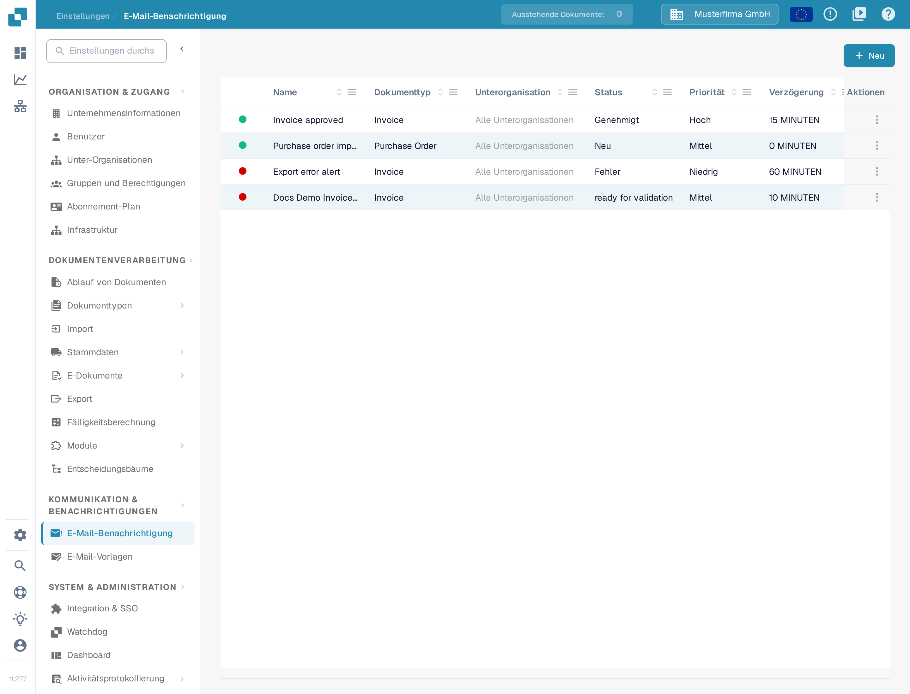
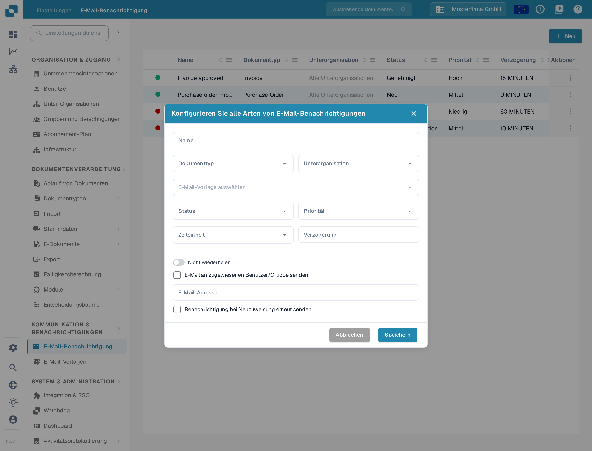
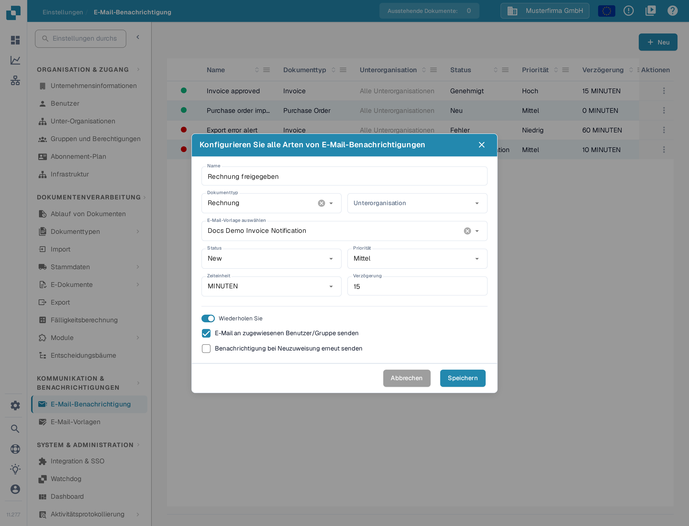

# Benachrichtigungen konfigurieren

E-Mail-Benachrichtigungen können Empfänger informieren, wenn ein Dokument einen ausgewählten Status erreicht. Bevor Sie eine Benachrichtigung erstellen, stellen Sie sicher, dass für den Belegtyp, den Sie verwenden möchten, eine [E-Mail-Vorlage](../e-mail-templates.md) existiert.

## Benachrichtigungsliste öffnen

Wählen Sie in **Einstellungen** den Bereich **KOMMUNIKATION & BENACHRICHTIGUNGEN** und dort **E-Mail-Benachrichtigung**. Die Liste zeigt bestehende Regeln mit Belegtyp, Status, Priorität, Verzögerung, Empfänger und letzter Änderung. Wählen Sie **Neu**, um eine Regel zu erstellen.

<figure><figcaption>
Wählen Sie Neu, um eine E-Mail-Benachrichtigung zu konfigurieren.
</figcaption></figure>

## Eine Regel einrichten

Der Dialog **Neu** enthält folgende Bedienelemente:

| Bedienelement | Eingabe |
| --- | --- |
| **Name** | Ein Name, den Sie in der Benachrichtigungsliste wiedererkennen. Verwenden Sie Buchstaben, Ziffern und Leerzeichen. |
| **Dokumenttyp** | Der Belegtyp, für den diese Regel gilt. Wählen Sie ihn vor der E-Mail-Vorlage. |
| **Unterorganisation** | Die Unterorganisation, für die diese Regel gilt. |
| **E-Mail-Vorlage auswählen** | Eine Vorlage für den gewählten Belegtyp. Die Auswahl ist erst verfügbar, wenn passende Vorlagen geladen sind. |
| **Status** | Der Dokumentstatus, der die Benachrichtigung auslöst. |
| **Priorität** | Der Prioritätswert für diese Benachrichtigungsregel. |
| **Zeiteinheit** und **Verzögerung** | Wie lange vor dem Versand gewartet wird. In Minuten muss die Verzögerung mindestens fünf betragen; geben Sie eine ganze Zahl ein. |
| **Nicht wiederholen / Wiederholen Sie** | Schalten Sie **Wiederholen Sie** ein, wenn die Benachrichtigung erneut gesendet werden soll, solange die Bedingung zutrifft. |
| **E-Mail an zugewiesenen Benutzer/Gruppe senden** | An den dem Dokument zugewiesenen Empfänger senden statt an eine feste Adresse. Dadurch wird **E-Mail-Adresse** ausgeblendet. |
| **E-Mail-Adresse** | Geben Sie eine gültige Adresse ein, wenn die Option für den zugewiesenen Empfänger ausgeschaltet ist. |
| **Benachrichtigung bei Neuzuweisung erneut senden** | Erneut senden, wenn das Dokument einer anderen Person zugewiesen wird. |

<figure><figcaption>
Wählen Sie einen Dokumenttyp und seine E-Mail-Vorlage und legen Sie dann Auslöser und Empfänger fest.
</figcaption></figure>

Wenn **E-Mail an zugewiesenen Benutzer/Gruppe senden** ausgewählt ist, verschwindet das feste Feld **E-Mail-Adresse**. Der Schalter ändert seine Beschriftung von **Nicht wiederholen** in **Wiederholen Sie**.

<figure><figcaption>
Nutzen Sie die Option für zugewiesene Empfänger, wenn die für das Dokument verantwortliche Person die E-Mail erhalten soll. Die gezeigten Werte sind erfundene Beispieldaten.
</figcaption></figure>

Wählen Sie **Speichern**, um die Regel zur Liste hinzuzufügen, oder **Abbrechen**, um den Entwurf zu verwerfen. Wenn **E-Mail-Vorlage auswählen** keine Auswahl anbietet, erstellen Sie zuerst eine Vorlage für den ausgewählten Belegtyp und kehren Sie dann in diesen Dialog zurück.
