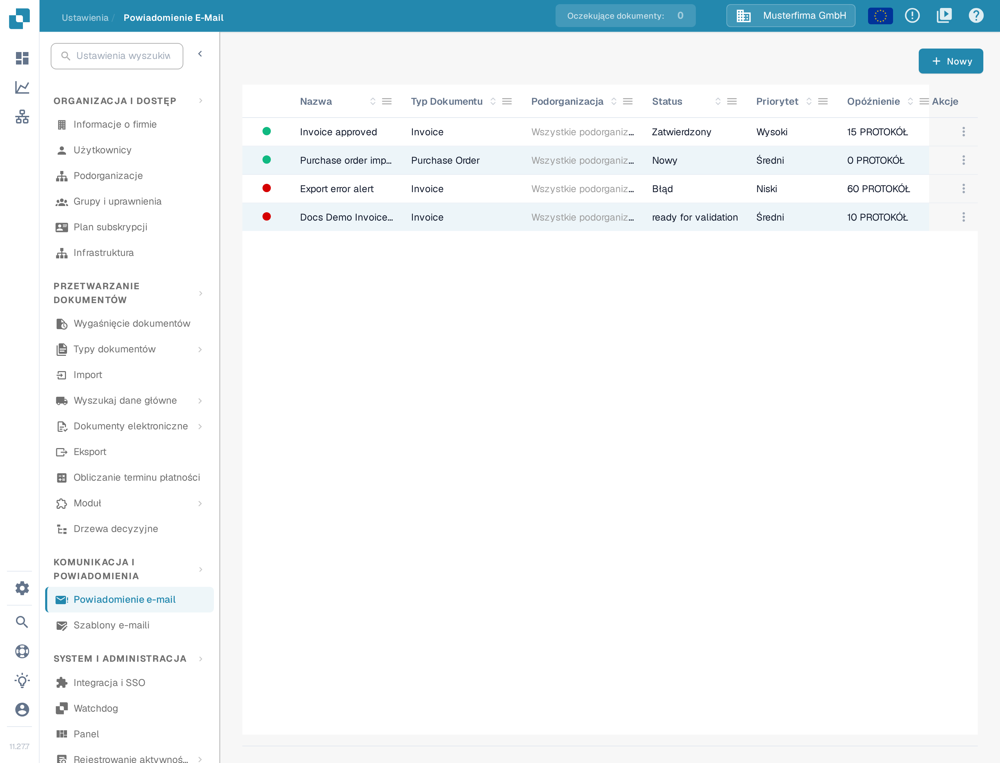
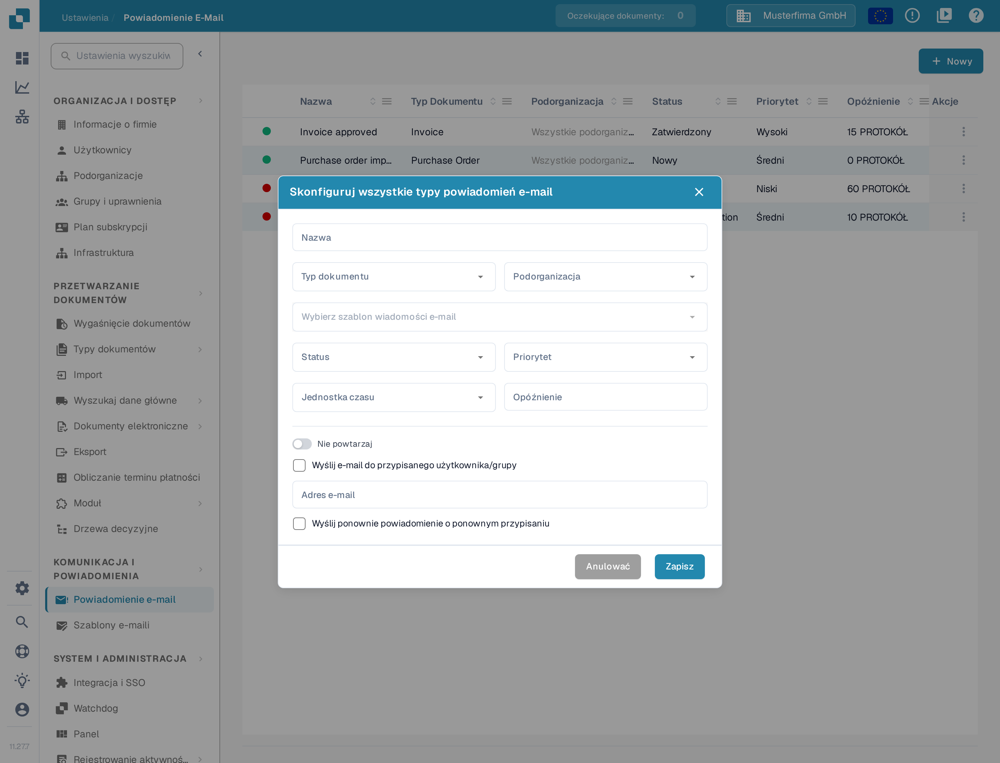
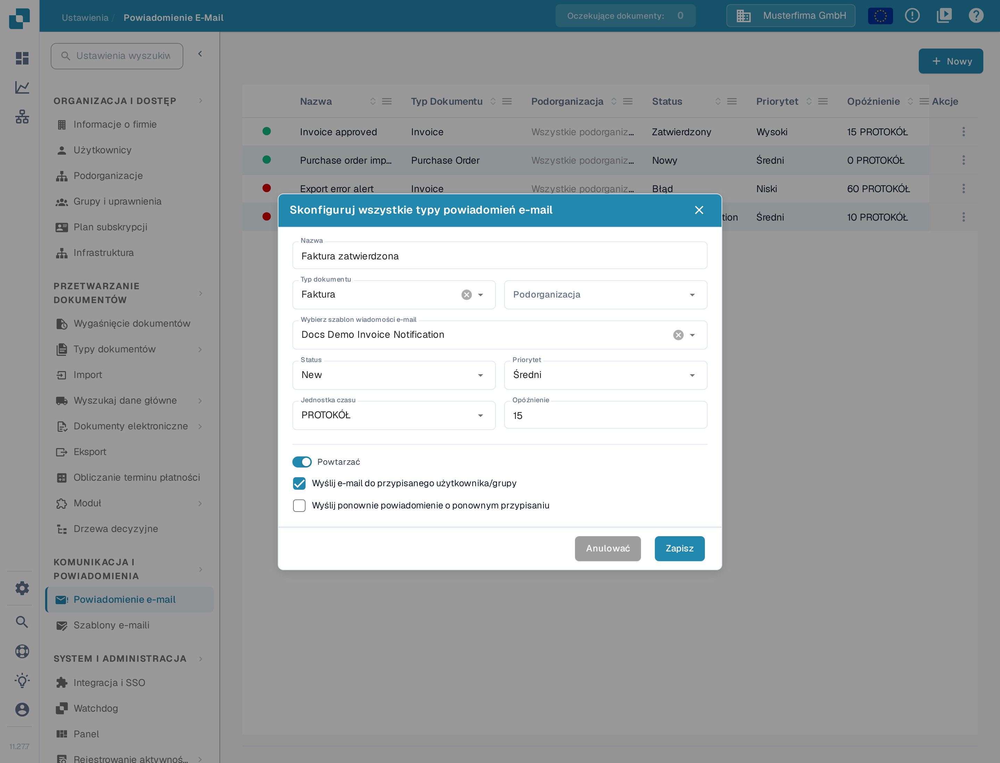

# Konfigurowanie powiadomień e-mail

Powiadomienia e-mail mogą informować odbiorców, gdy dokument osiągnie wybrany status. Przed utworzeniem powiadomienia upewnij się, że dla typu dokumentu, którego chcesz użyć, istnieje [szablon wiadomości e-mail](../e-mail-templates.md).

## Otwieranie listy powiadomień

W **Ustawienia** wybierz **KOMUNIKACJA I POWIADOMIENIA**, a następnie **Powiadomienie e-mail**. Lista pokazuje istniejące reguły wraz z nazwą, typem dokumentu, podorganizacją, statusem, priorytetem, opóźnieniem, odbiorcą i datą ostatniej zmiany. Wybierz **Nowy**, aby utworzyć regułę.

<figure><figcaption>
Wybierz Nowy, aby skonfigurować powiadomienie e-mail.
</figcaption></figure>

Aby zmienić, wyłączyć lub usunąć istniejącą regułę, otwórz menu w kolumnie **Akcje**: zawiera ono **Redagować**, **Dezaktywować**, **Dzienniki** i **Usuwać**. Opis tych działań znajdziesz w sekcji [Zarządzanie powiadomieniami](managing-notifications.md).

## Konfigurowanie reguły

Okno **Nowy** zawiera następujące pola:

| Pole | Co wpisać |
| --- | --- |
| **Nazwa** | Nazwa, którą rozpoznasz na liście powiadomień. Używaj liter, cyfr i spacji. |
| **Typ dokumentu** | Typ dokumentu, którego dotyczy ta reguła. Wybierz go przed wyborem szablonu wiadomości e-mail. |
| **Podorganizacja** | Podorganizacja, której dotyczy ta reguła. |
| **Wybierz szablon wiadomości e-mail** | Szablon dla wybranego typu dokumentu. Wybór jest niedostępny, dopóki pasujące szablony się nie wczytają. |
| **Status** | Status dokumentu, który uruchamia powiadomienie. |
| **Priorytet** | Wartość priorytetu dla tej reguły powiadomienia. |
| **Jednostka czasu** i **Opóźnienie** | Jak długo czekać przed wysłaniem. Jednostka **PROTOKÓŁ** oznacza minuty; opóźnienie w minutach musi wynosić co najmniej 5 i być liczbą całkowitą. |
| **Nie powtarzaj** / **Powtarzać** | Włącz **Powtarzać**, jeśli powiadomienie ma być wysyłane ponownie, dopóki warunek nadal obowiązuje. |
| **Wyślij e-mail do przypisanego użytkownika/grupy** | Wysyła wiadomość do odbiorcy przypisanego do dokumentu zamiast na stały adres. Ukrywa pole **Adres e-mail**. |
| **Adres e-mail** | Wpisz prawidłowy adres, gdy opcja przypisanego odbiorcy jest wyłączona. |
| **Wyślij ponownie powiadomienie o ponownym przypisaniu** | Wyślij wiadomość ponownie, gdy dokument zostanie przypisany innej osobie. |

<figure><figcaption>
Wybierz typ dokumentu i jego szablon wiadomości e-mail, a następnie określ wyzwalacz i odbiorcę.
</figcaption></figure>

Gdy opcja **Wyślij e-mail do przypisanego użytkownika/grupy** jest zaznaczona, stałe pole **Adres e-mail** znika. Przełącznik zmienia wtedy etykietę z **Nie powtarzaj** na **Powtarzać**.

<figure><figcaption>
Użyj opcji przypisanego odbiorcy, gdy wiadomość ma otrzymać osoba odpowiedzialna za dokument. Widoczne wartości to wymyślone dane przykładowe.
</figcaption></figure>

Wybierz **Zapisz**, aby dodać regułę do listy, albo **Anulować**, aby odrzucić szkic. Jeśli lista **Wybierz szablon wiadomości e-mail** nie zawiera żadnych pozycji, najpierw utwórz [szablon wiadomości e-mail](../e-mail-templates.md) dla wybranego typu dokumentu i wróć do tego okna.
