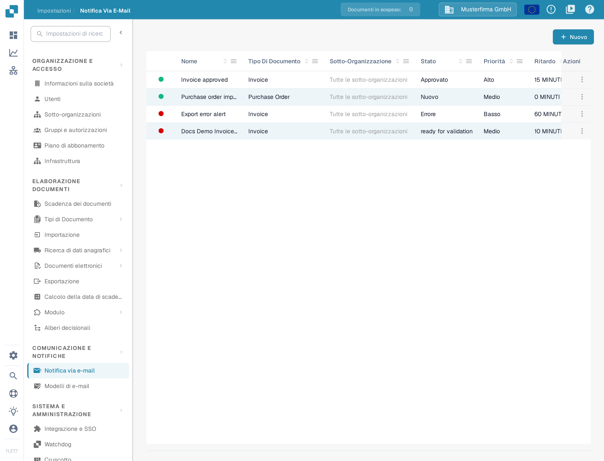
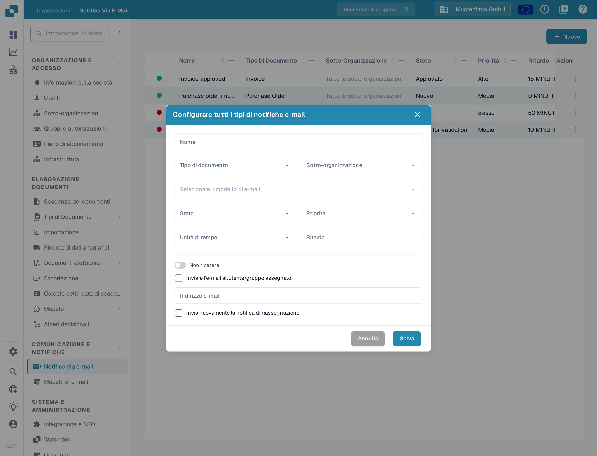
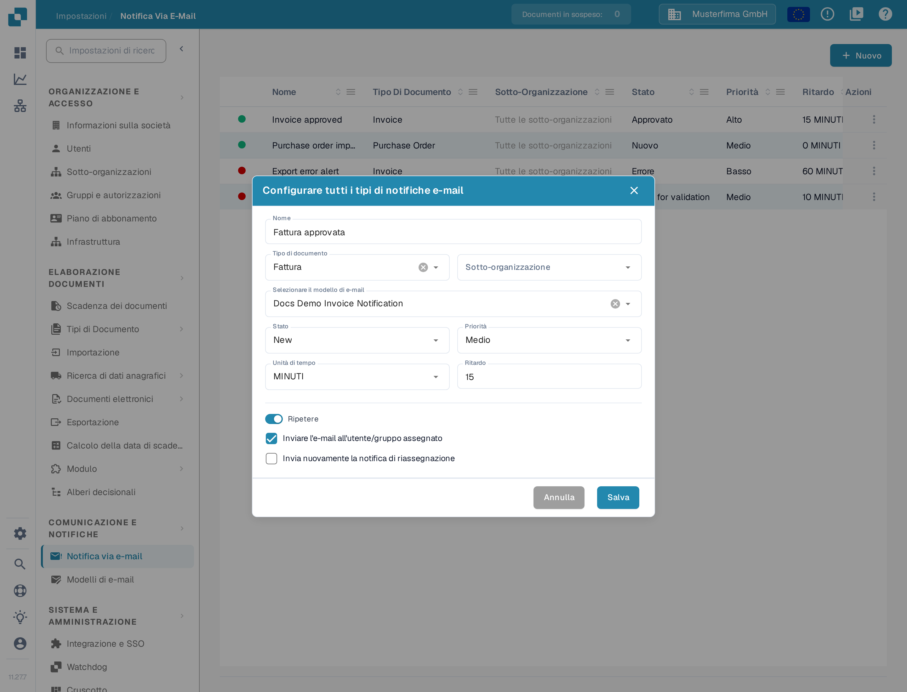

# Configurare le notifiche via e-mail

Le notifiche via e-mail possono avvisare i destinatari quando un documento raggiunge uno stato selezionato. Prima di creare una notifica, assicurarsi che esista un [modello di e-mail](../e-mail-templates.md) per il tipo di documento che si desidera utilizzare.

## Aprire l'elenco delle notifiche

In **Impostazioni**, scegliere **Comunicazione e notifiche → Notifica via e-mail**. L'elenco mostra le regole esistenti con tipo di documento, stato, priorità, ritardo, destinatario e ultima modifica. Selezionare **Nuovo** per creare una regola.

<figure><figcaption>
Selezionare Nuovo per configurare una notifica via e-mail.
</figcaption></figure>

## Configurare una regola

La finestra che si apre con **Nuovo** contiene i seguenti controlli:

| Controllo | Cosa inserire |
| --- | --- |
| **Nome** | Un nome riconoscibile nell'elenco delle notifiche. Usare lettere, numeri e spazi. |
| **Tipo di documento** | Il tipo di documento a cui si applica questa regola. Sceglierlo prima di selezionare un modello. |
| **Sotto-organizzazione** | Limita la regola a una sotto-organizzazione. Se non se ne sceglie una, l'elenco mostra **Tutte le sotto-organizzazioni**. |
| **Selezionare il modello di e-mail** | Un modello per il tipo di documento scelto. Il selettore non è disponibile finché i modelli corrispondenti non sono caricati. |
| **Stato** | Lo stato del documento che attiva la notifica. |
| **Priorità** | Il valore di priorità di questa regola di notifica. |
| **Unità di tempo** e **Ritardo** | Quanto attendere prima dell'invio. Per i minuti, il ritardo deve essere di almeno cinque; inserire un numero intero. |
| **Non ripetere / Ripetere** | Attivare **Ripetere** se la notifica deve essere inviata di nuovo finché la condizione è ancora valida. |
| **Inviare l'e-mail all'utente/gruppo assegnato** | Invia l'avviso al destinatario assegnato al documento invece che a un indirizzo fisso. Questo nasconde **Indirizzo e-mail**. |
| **Indirizzo e-mail** | Inserire un indirizzo valido quando l'opzione del destinatario assegnato è disattivata. |
| **Invia nuovamente la notifica di riassegnazione** | Invia di nuovo l'avviso se il documento viene assegnato a un'altra persona. |

<figure><figcaption>
Scegliere un tipo di documento e il relativo modello di e-mail, quindi definire l'attivazione e il destinatario.
</figcaption></figure>

Quando si seleziona **Inviare l'e-mail all'utente/gruppo assegnato**, il campo fisso **Indirizzo e-mail** scompare e l'interruttore di ripetizione cambia etichetta da **Non ripetere** a **Ripetere**.

<figure><figcaption>
Usare l'opzione del destinatario assegnato quando l'e-mail deve arrivare al proprietario del documento. Il nome Fattura approvata è un dato di esempio inventato.
</figcaption></figure>

Selezionare **Salva** per aggiungere la regola all'elenco, oppure **Annulla** per scartare la bozza. Se **Selezionare il modello di e-mail** non offre scelte, creare prima un modello per il tipo di documento selezionato e tornare poi a questa finestra.
