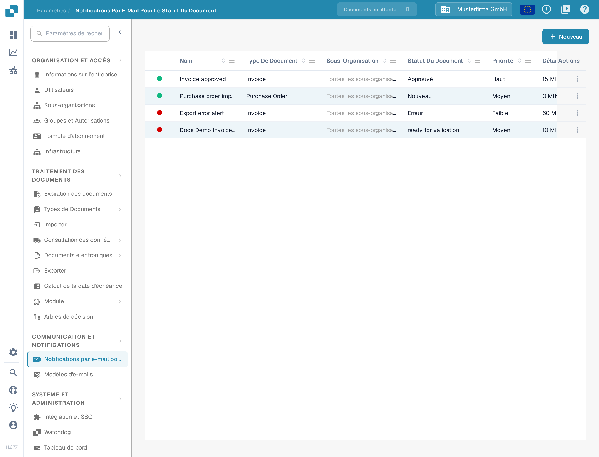
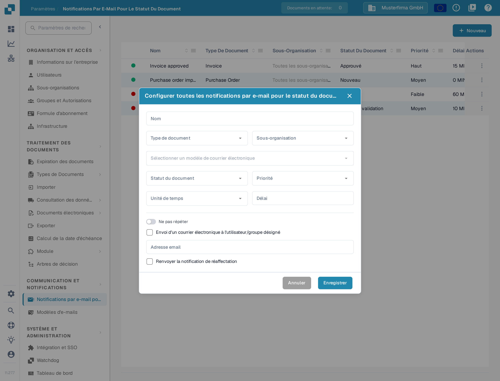
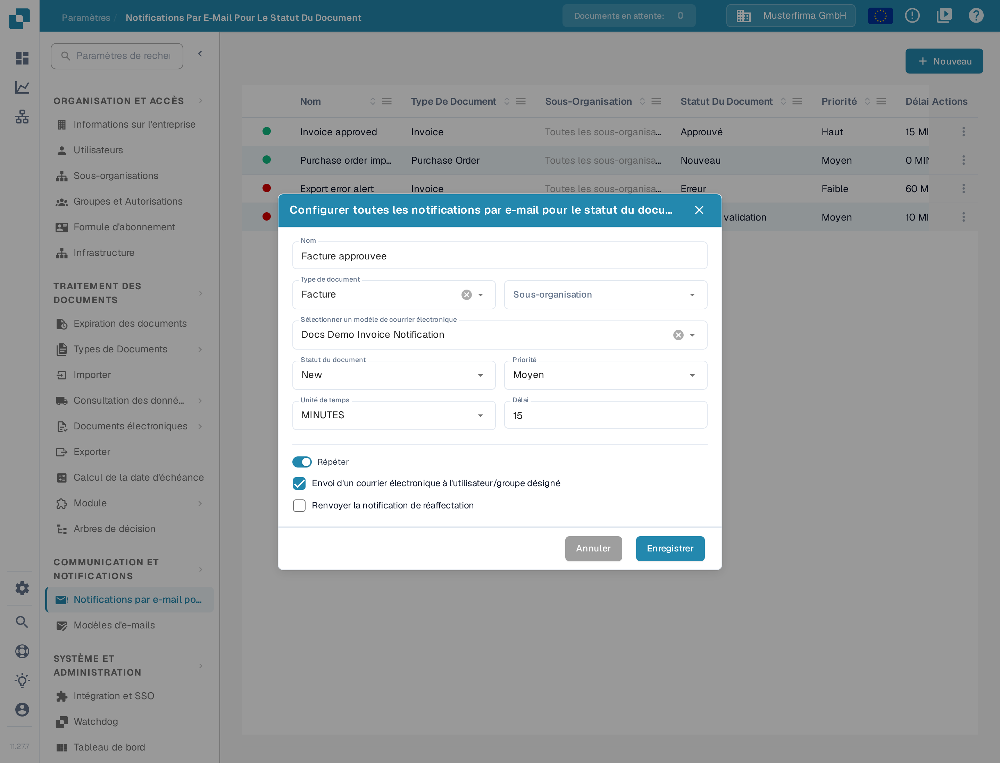

# Configurer les notifications par courriel

Les notifications par courriel peuvent avertir des destinataires lorsqu'un document atteint un statut donné. Avant de créer une notification, vérifiez qu'un [modèle de courriel](../e-mail-templates.md) existe pour le type de document que vous souhaitez utiliser.

## Ouvrir la liste des notifications

Dans **Paramètres**, choisissez **COMMUNICATION ET NOTIFICATIONS → Notifications par e-mail pour le statut du document**. La liste affiche les règles existantes avec leur type de document, leur statut, leur priorité, leur délai, leur destinataire et leur dernière modification. Sélectionnez **Nouveau** pour créer une règle.

<figure><figcaption>
Sélectionnez Nouveau pour configurer une notification par courriel.
</figcaption></figure>

## Configurer une règle

La boîte de dialogue **Nouveau** contient les contrôles suivants :

| Contrôle | Que saisir |
| --- | --- |
| **Nom** | Un nom que vous reconnaîtrez dans la liste des notifications. Utilisez des lettres, des chiffres et des espaces. |
| **Type de document** | Le type de document auquel cette règle s'applique. Choisissez-le avant de sélectionner un modèle. |
| **Sous-organisation** | Limite la règle à une sous-organisation. Si vous n'en choisissez aucune, la liste affiche **Toutes les sous-organisations**. |
| **Sélectionner un modèle de courrier électronique** | Un modèle pour le type de document choisi. Le sélecteur n'est pas disponible tant que les modèles correspondants ne sont pas chargés. |
| **Statut du document** | Le statut du document qui déclenche la notification. |
| **Priorité** | La valeur de priorité de cette règle de notification. |
| **Unité de temps** et **Délai** | Le temps d'attente avant l'envoi. Pour les minutes, le délai doit être d'au moins cinq ; saisissez un nombre entier. |
| **Ne pas répéter / Répéter** | Activez **Répéter** si la notification doit être envoyée de nouveau tant que la condition reste remplie. |
| **Envoi d'un courrier électronique à l'utilisateur/groupe désigné** | Envoie l'avis au destinataire désigné sur le document au lieu d'une adresse fixe. Cela masque **Adresse email**. |
| **Adresse email** | Saisissez une adresse valide lorsque l'option du destinataire désigné est désactivée. |
| **Renvoyer la notification de réaffectation** | Envoie de nouveau l'avis si le document est affecté à une autre personne. |

<figure><figcaption>
Choisissez un type de document et son modèle de courrier, puis définissez le déclencheur et le destinataire.
</figcaption></figure>

Lorsque **Envoi d'un courrier électronique à l'utilisateur/groupe désigné** est sélectionné, le champ **Adresse email** disparaît. L'interrupteur de répétition change alors d'intitulé, de **Ne pas répéter** à **Répéter**.

<figure><figcaption>
Utilisez l'option du destinataire désigné lorsque le titulaire du document doit recevoir le courriel. Le nom « Facture approuvee » est une donnée d'exemple inventée.
</figcaption></figure>

Sélectionnez **Enregistrer** pour ajouter la règle à la liste, ou **Annuler** pour abandonner le brouillon. Si **Sélectionner un modèle de courrier électronique** ne propose aucun choix, créez d'abord un modèle pour le type de document sélectionné, puis revenez à cette boîte de dialogue.
