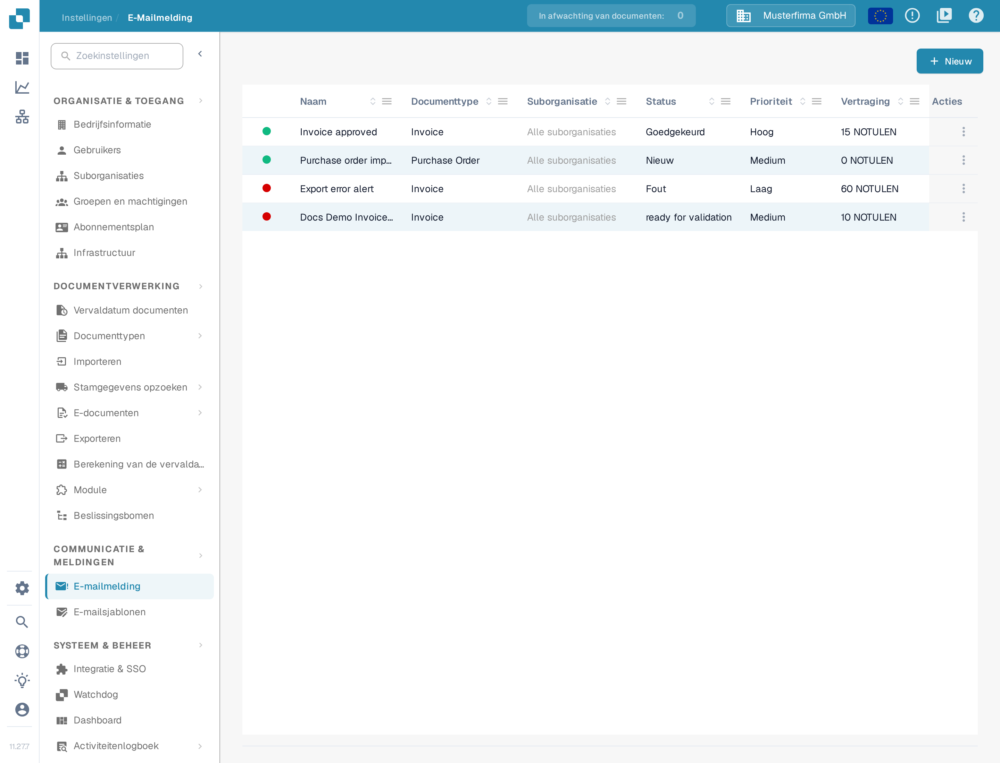
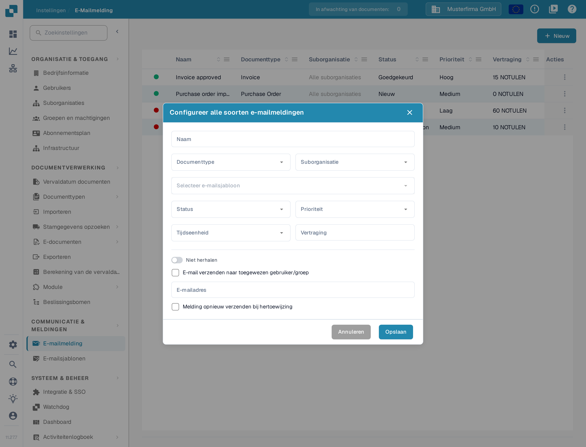
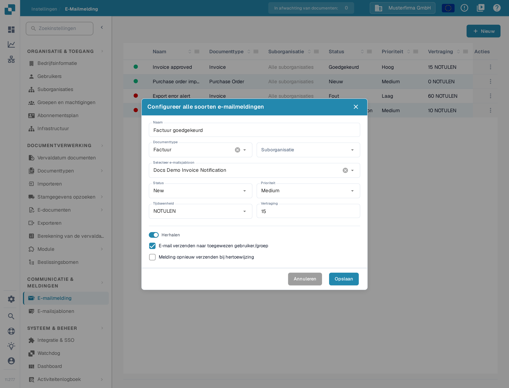

# E-mailmeldingen configureren

Met e-mailmeldingen waarschuwt u ontvangers wanneer een document een gekozen status bereikt. Controleer voordat u een melding aanmaakt of er een [e-mailsjabloon](../e-mail-templates.md) bestaat voor het documenttype dat u wilt gebruiken.

## De meldingenlijst openen

Kies in **Instellingen** voor **COMMUNICATIE & MELDINGEN → E-mailmelding**. De lijst toont bestaande regels met documenttype, status, prioriteit, vertraging, ontvanger en laatste wijziging. Selecteer **Nieuw** om een regel aan te maken.

<figure><figcaption>
Selecteer Nieuw om een e-mailmelding te configureren.
</figcaption></figure>

## Een regel instellen

Het venster **Configureer alle soorten e-mailmeldingen** bevat de volgende bedieningselementen:

| Bedieningselement | Invoer |
| --- | --- |
| **Naam** | Een naam die u in de meldingenlijst herkent. Gebruik letters, cijfers en spaties. |
| **Documenttype** | Het documenttype waarvoor deze regel geldt. Kies het voordat u een e-mailsjabloon selecteert. |
| **Suborganisatie** | De suborganisatie waarvoor deze regel geldt. |
| **Selecteer e-mailsjabloon** | Een sjabloon voor het gekozen documenttype. De keuzelijst is pas beschikbaar als passende sjablonen zijn geladen. |
| **Status** | De documentstatus die de melding activeert. |
| **Prioriteit** | De prioriteit van deze meldingsregel. |
| **Tijdseenheid** en **Vertraging** | Hoe lang er wordt gewacht voordat de melding wordt verzonden. Bij minuten moet de vertraging minstens vijf zijn; voer een heel getal in. Bij een kleinere waarde meldt het venster **De tijd mag niet korter zijn dan 5 minuten**. |
| **Niet herhalen / Herhalen** | Zet **Herhalen** aan als de melding opnieuw moet worden verzonden zolang de voorwaarde geldt. |
| **E-mail verzenden naar toegewezen gebruiker/groep** | Stuur de melding naar de toegewezen ontvanger van het document in plaats van naar een vast adres. Hierdoor verdwijnt het veld **E-mailadres**. |
| **E-mailadres** | Voer een geldig adres in als de optie voor de toegewezen ontvanger uit staat. |
| **Melding opnieuw verzenden bij hertoewijzing** | Verstuur de melding opnieuw als het document aan iemand anders wordt toegewezen. |

<figure><figcaption>
Kies een documenttype en het bijbehorende e-mailsjabloon en bepaal daarna wanneer en naar wie de melding gaat.
</figcaption></figure>

Als **E-mail verzenden naar toegewezen gebruiker/groep** is aangevinkt, verdwijnt het vaste veld **E-mailadres**. De schakelaar verandert van **Niet herhalen** in **Herhalen**.

<figure><figcaption>
Gebruik de optie voor een toegewezen ontvanger als de eigenaar van het document de e-mail moet ontvangen. De getoonde waarden zijn verzonnen voorbeelden.
</figcaption></figure>

Selecteer **Opslaan** om de regel aan de lijst toe te voegen, of **Annuleren** om het concept te verwerpen. Als **Selecteer e-mailsjabloon** geen keuzes toont, maakt u eerst een sjabloon voor het geselecteerde documenttype en komt u daarna terug in dit venster.
