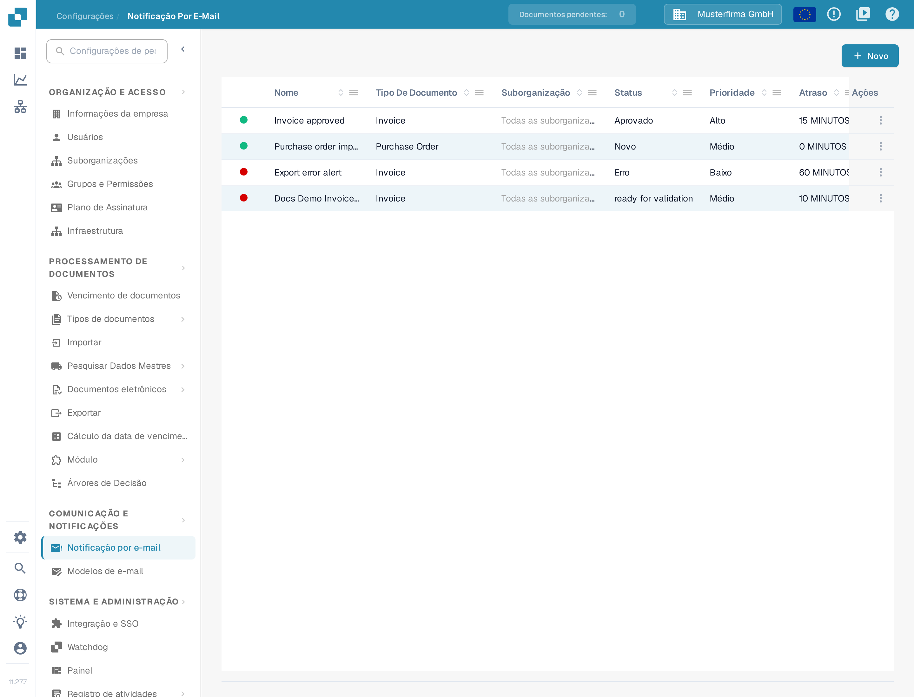
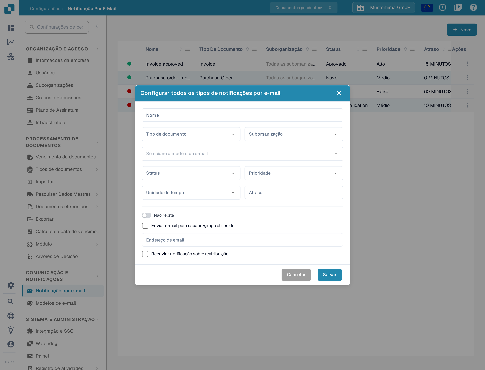
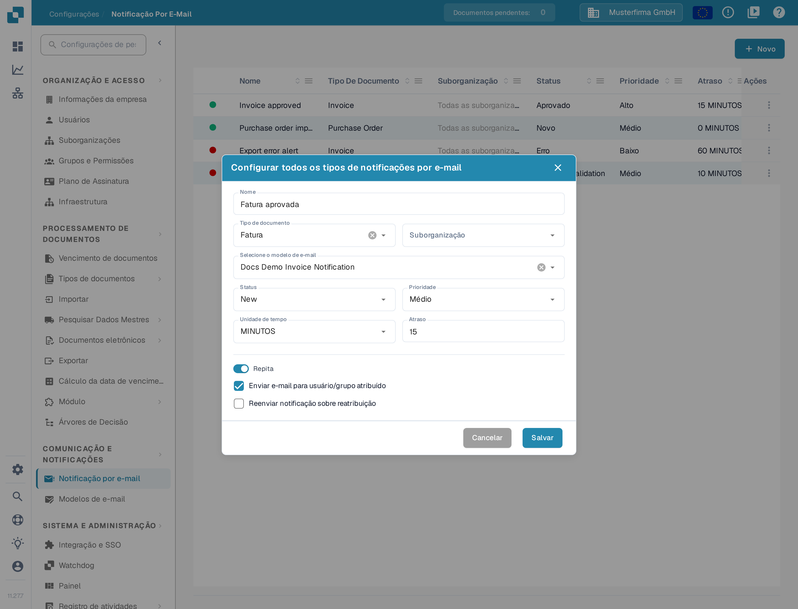

# Configurar notificações por e-mail

As notificações por e-mail podem avisar os destinatários quando um documento atinge um estado selecionado. Antes de criar uma notificação, certifique-se de que existe um [modelo de e-mail](../e-mail-templates.md) para o tipo de documento que pretende utilizar.

## Abrir a lista de notificações

Em **Configurações**, escolha **Comunicação e notificações → Notificação por e-mail**. A lista mostra as regras existentes com o tipo de documento, o estado, a prioridade, o atraso, o destinatário e a data da última alteração. Selecione **Novo** para criar uma regra.

<figure><figcaption>
Selecione Novo para configurar uma notificação por e-mail.
</figcaption></figure>

O menu da coluna **Ações** permite **Editar**, **Desativar**, **Registros** e **Excluir** uma regra existente; estes passos estão descritos em [Gerenciando notificações](managing-notifications.md).

## Configurar uma regra

A janela **Novo** contém os seguintes campos:

| Campo | O que introduzir |
| --- | --- |
| **Nome** | Um nome que reconheça na lista de notificações. Utilize letras, números e espaços. |
| **Tipo de documento** | O tipo de documento a que esta regra se aplica. Escolha-o antes de selecionar um modelo. |
| **Suborganização** | A suborganização a que esta regra se aplica. Deixe o campo vazio para todas as suborganizações. |
| **Selecione o modelo de e-mail** | Um modelo para o tipo de documento escolhido. O campo só fica disponível depois de escolher o tipo de documento e de os modelos correspondentes serem carregados. |
| **Status** | O estado do documento que desencadeia a notificação. |
| **Prioridade** | O valor de prioridade desta regra de notificação. |
| **Unidade de tempo** e **Atraso** | Quanto tempo esperar antes de enviar. Em minutos, o atraso tem de ser pelo menos cinco; introduza um número inteiro. |
| **Não repita** / **Repita** | Ative **Repita** se a notificação deve ser enviada novamente enquanto a condição se mantiver. |
| **Enviar e-mail para usuário/grupo atribuído** | Envia para o destinatário atribuído ao documento em vez de um endereço fixo. Isto oculta o campo **Endereço de email**. |
| **Endereço de email** | Introduza um endereço válido quando a opção do destinatário atribuído estiver desativada. |
| **Reenviar notificação sobre reatribuição** | Enviar novamente se o documento for atribuído a outra pessoa. |

<figure><figcaption>
Escolha o tipo de documento e o respetivo modelo de e-mail e, em seguida, defina o acionador e o destinatário.
</figcaption></figure>

Quando **Enviar e-mail para usuário/grupo atribuído** está selecionado, o campo fixo **Endereço de email** desaparece. O interruptor de repetição altera a etiqueta de **Não repita** para **Repita**.

<figure><figcaption>
Utilize a opção do destinatário atribuído quando o responsável pelo documento deve receber o e-mail. Os valores apresentados são dados de exemplo inventados: nome Fatura aprovada, tipo Fatura, modelo Docs Demo Invoice Notification, prioridade Médio, unidade MINUTOS e atraso 15.
</figcaption></figure>

Selecione **Salvar** para adicionar a regra à lista, ou **Cancelar** para descartar o rascunho. Se **Selecione o modelo de e-mail** não tiver nenhuma opção, crie primeiro um modelo para o tipo de documento escolhido e regresse a esta janela.
