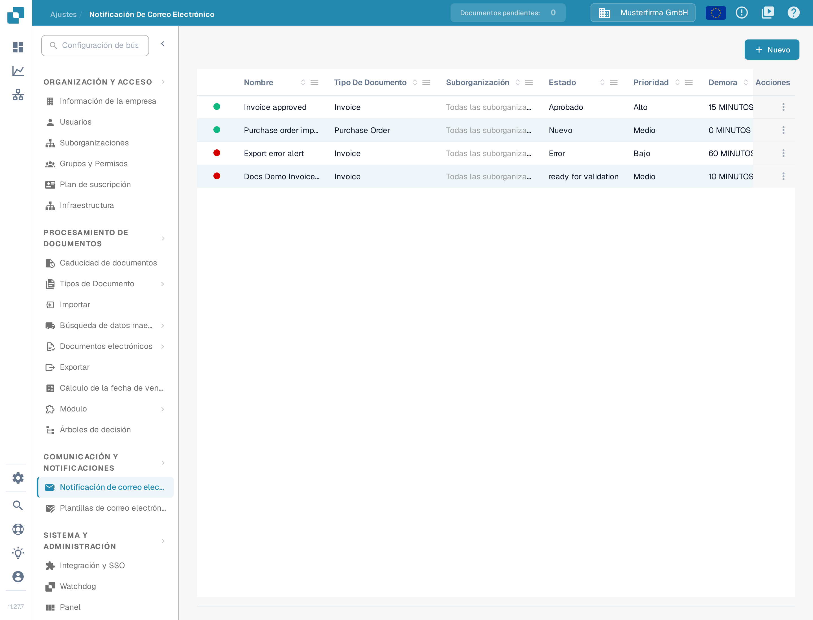
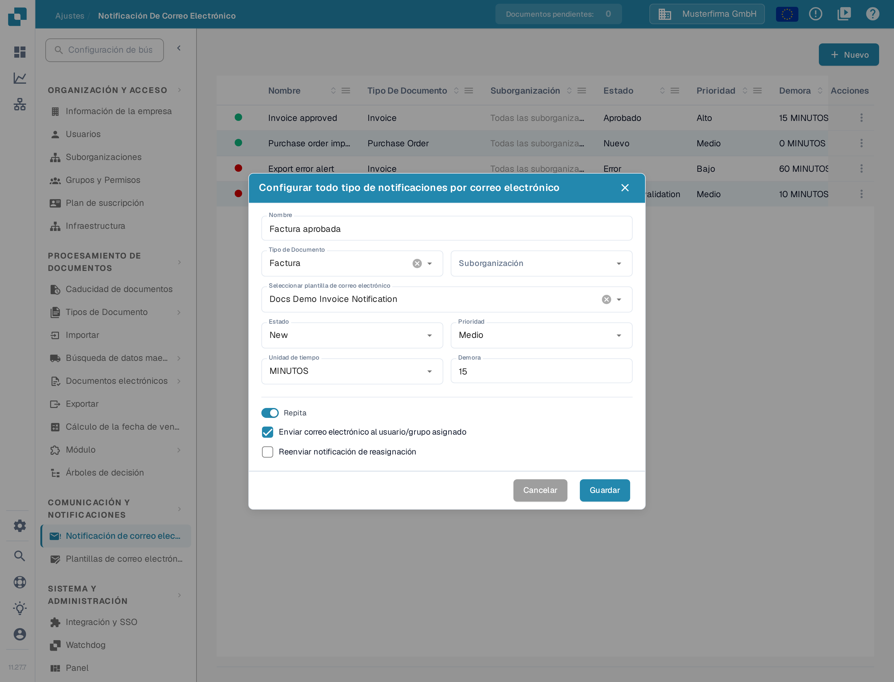

# Configurar notificaciones por correo

Las notificaciones por correo electrónico pueden avisar a los destinatarios cuando un documento alcanza un estado concreto. Antes de crear una notificación, asegúrese de que existe una [plantilla de correo electrónico](../e-mail-templates.md) para el tipo de documento que desea utilizar.

## Abrir la lista de notificaciones

En **Ajustes**, elija **Comunicación y notificaciones → Notificación de correo electrónico**. La lista muestra las reglas existentes con su tipo de documento, estado, prioridad, demora, destinatario y última modificación. Seleccione **Nuevo** para crear una regla.

<figure><figcaption>
Seleccione Nuevo para configurar una notificación por correo electrónico.
</figcaption></figure>

## Configurar una regla

El diálogo **Nuevo** contiene los siguientes controles:

| Control | Qué introducir |
| --- | --- |
| **Nombre** | Un nombre que reconozca en la lista de notificaciones. Utilice letras, números y espacios. |
| **Tipo de Documento** | El tipo de documento al que se aplica esta regla. Elíjalo antes de seleccionar una plantilla. |
| **Suborganización** | Limita la regla a una suborganización. Si no elige ninguna, la lista muestra **Todas las suborganizaciones**. |
| **Seleccionar plantilla de correo electrónico** | Una plantilla para el tipo de documento elegido. El selector no está disponible hasta que se cargan las plantillas correspondientes. |
| **Estado** | El estado del documento que activa la notificación. |
| **Prioridad** | El valor de prioridad de esta regla de notificación. |
| **Unidad de tiempo** y **Demora** | Cuánto esperar antes del envío. Para minutos, la demora debe ser al menos cinco; introduzca un número entero. |
| **No repetir / Repita** | Active **Repita** si la notificación debe enviarse de nuevo mientras siga cumpliéndose la condición. |
| **Enviar correo electrónico al usuario/grupo asignado** | Envía el aviso al destinatario asignado al documento en lugar de a una dirección fija. Esto oculta **Dirección de correo electrónico**. |
| **Dirección de correo electrónico** | Introduzca una dirección válida cuando la opción del destinatario asignado esté desactivada. |
| **Reenviar notificación de reasignación** | Envía el aviso de nuevo si el documento se asigna a otra persona. |

<figure><figcaption>
Elija un tipo de documento y su plantilla de correo, y defina después el activador y el destinatario.
</figcaption></figure>

Cuando se selecciona **Enviar correo electrónico al usuario/grupo asignado**, desaparece el campo fijo **Dirección de correo electrónico** y el interruptor de repetición cambia su etiqueta de **No repetir** a **Repita**.

<figure><figcaption>
Use la opción de destinatario asignado cuando deba recibir el correo el propietario del documento. El nombre «Factura aprobada» es un dato de ejemplo inventado.
</figcaption></figure>

Seleccione **Guardar** para añadir la regla a la lista, o **Cancelar** para descartar el borrador. Si **Seleccionar plantilla de correo electrónico** no ofrece opciones, cree primero una plantilla para el tipo de documento seleccionado y vuelva después a este diálogo.
