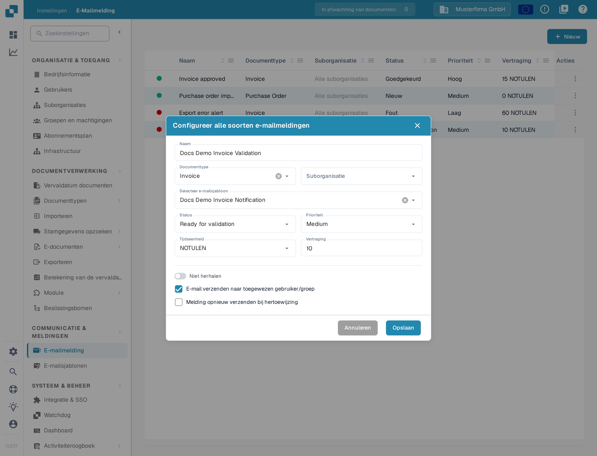
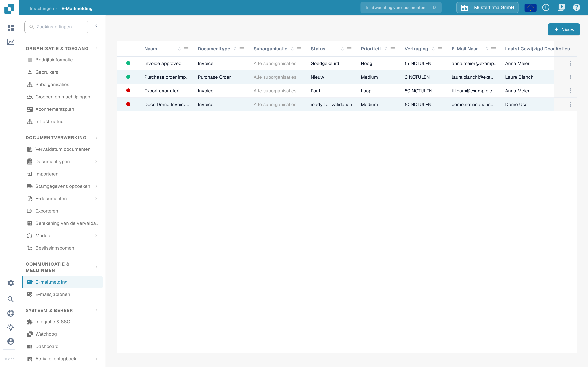
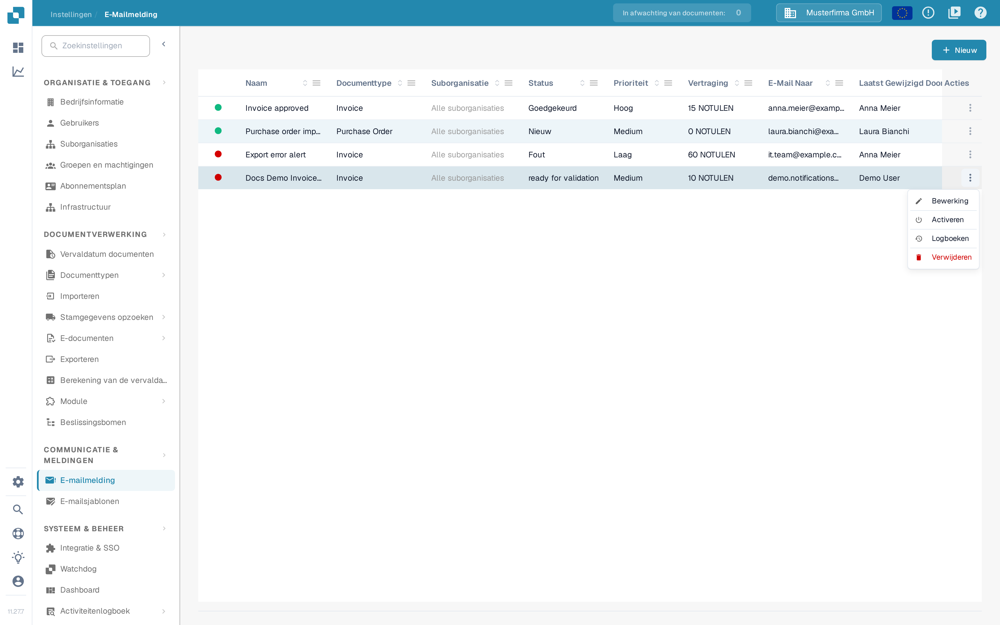

# Meldingen beheren

Open **Instellingen → E-Mailmelding** om de regels van je organisatie te bekijken. Een regel verbindt een documentstatus met een e-mailsjabloon en een ontvanger. Het onderstaande voorbeeld gebruikt een demonstratieregel voor facturen en blijft in de DocBits Sandbox **inactief**. Het groene of rode punt in de kolom **Status** toont of een regel actief is.

## Voorbeeld: een factuur is klaar voor validatie

Maak voordat je een regel aanmaakt een e-mailsjabloon voor het documenttype **Invoice** aan onder **Instellingen → E-mailsjablonen**. In dit voorbeeld heet het sjabloon **Docs Demo Invoice Notification**. Het sjabloon levert het onderwerp en de tekst van de e-mail.

1. Selecteer **+ Nieuw** op de pagina **E-Mailmelding**.
2. Voer **Docs Demo Invoice Validation** als naam in, selecteer **Invoice** als documenttype en kies het voorbereide sjabloon onder **Selecteer e-mailsjabloon**. Met **Suborganisatie** beperk je de regel tot één suborganisatie; laat het veld leeg om de regel voor de hele organisatie te laten gelden.
3. Kies **Ready for validation** als status en **Medium** als prioriteit. Zet **Tijdseenheid** op **NOTULEN** (de eenheid minuten van de app) en **Vertraging** op **10**; bij die eenheid moet de vertraging minstens vijf zijn.
4. Selecteer **E-mail verzenden naar toegewezen gebruiker/groep**. Zet **Niet herhalen** aan als het bericht maar één keer mag worden verzonden, en **Melding opnieuw verzenden bij hertoewijzing** als de ontvanger na een hertoewijzing opnieuw bericht moet krijgen. Controleer ontvanger en timing en selecteer **Opslaan**.

<figure><figcaption>
De opgeslagen voorbeeldregel, geopend om te bewerken. De waarden tonen wanneer en naar wie de melding zou worden verzonden.
</figcaption></figure>

De regel verschijnt nu in de lijst met de kolommen **Naam**, **Documenttype**, **Suborganisatie**, **Status**, **Prioriteit**, **Vertraging**, **E-Mail Naar**, **Laatst Gewijzigd Door**, **Laatst Gewijzigd Op** en **Acties**. Het documentatievoorbeeld is daarna gedeactiveerd: het rode punt bij de status en het menu **Acties** met **Activeren** tonen dat. Met het zoekveld boven de lijst en de pictogrammen in de kolomkoppen sorteer en filter je de regels. Controleer naam, documenttype, status, vertraging en ontvanger in je eigen lijst voordat je een regel activeert.

<figure><figcaption>
De lijst toont de opgeslagen regels die je kunt vinden en beheren.
</figcaption></figure>

## Regel bewerken, activeren of verwijderen

Open het menu **Acties** van de regel. **Bewerking** opent de regel met de huidige waarden. **Activeren** schakelt dit inactieve voorbeeld in; een actieve regel biedt **Deactiveren** in plaats daarvan. **Logboeken** opent de meldingsgeschiedenis van de regel. **Verwijderen** verwijdert de regel; de app vraagt dan **Weet je het zeker? Als je het record wilt verwijderen, druk dan op Delete.** en je bevestigt met **Verwijderen**. Controleer ontvanger en timing voordat je een regel activeert of wijzigt.

<figure><figcaption>
De beschikbare acties hangen ervan af of de regel actief is.
</figcaption></figure>

Als de lijst leeg is, maak dan eerst een regel aan. Als de lijst **Documenttype** of de lijst met e-mailsjablonen leeg is, configureer dan eerst een actief documenttype en een passend sjabloon voordat je naar dit formulier terugkeert.

Zie voor de eerste configuratie [Meldingen configureren](configuring-notifications.md). Als e-mails niet aankomen zoals verwacht, zie [Problemen oplossen](troubleshooting.md).