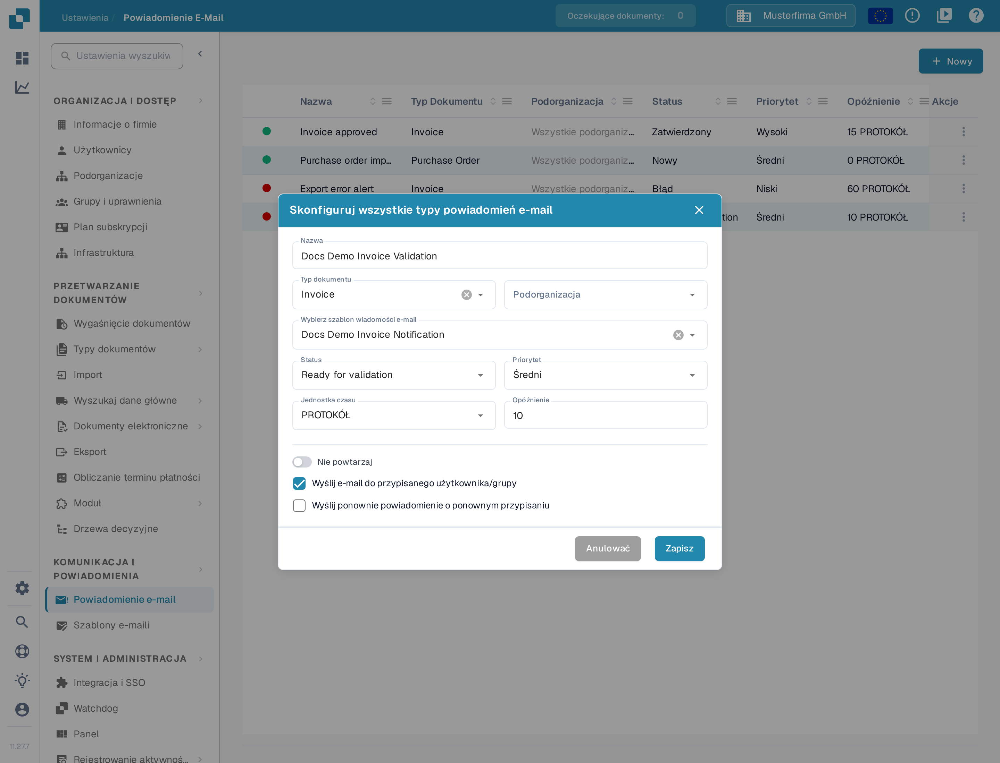
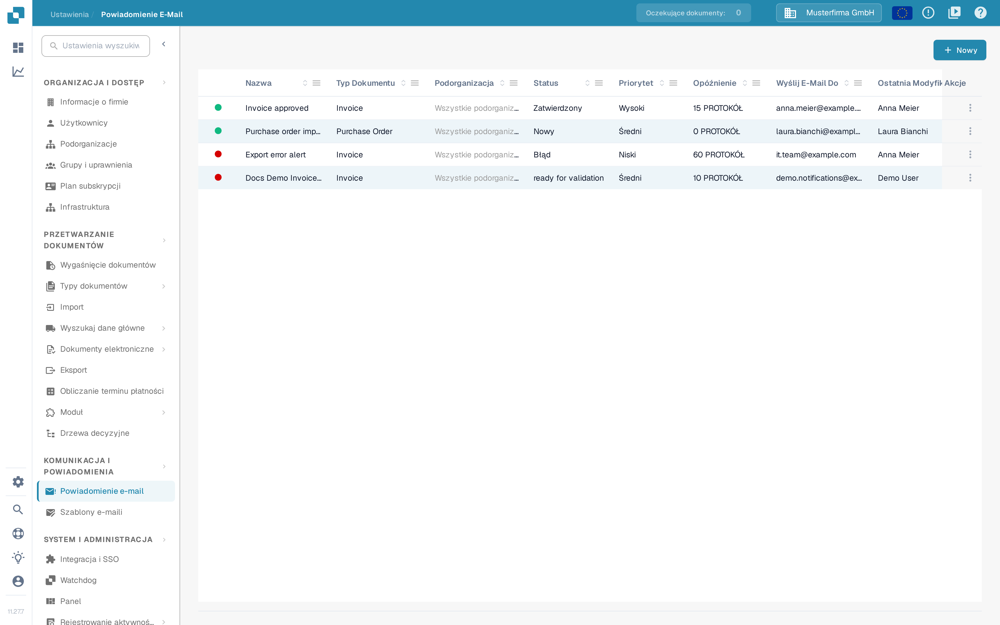
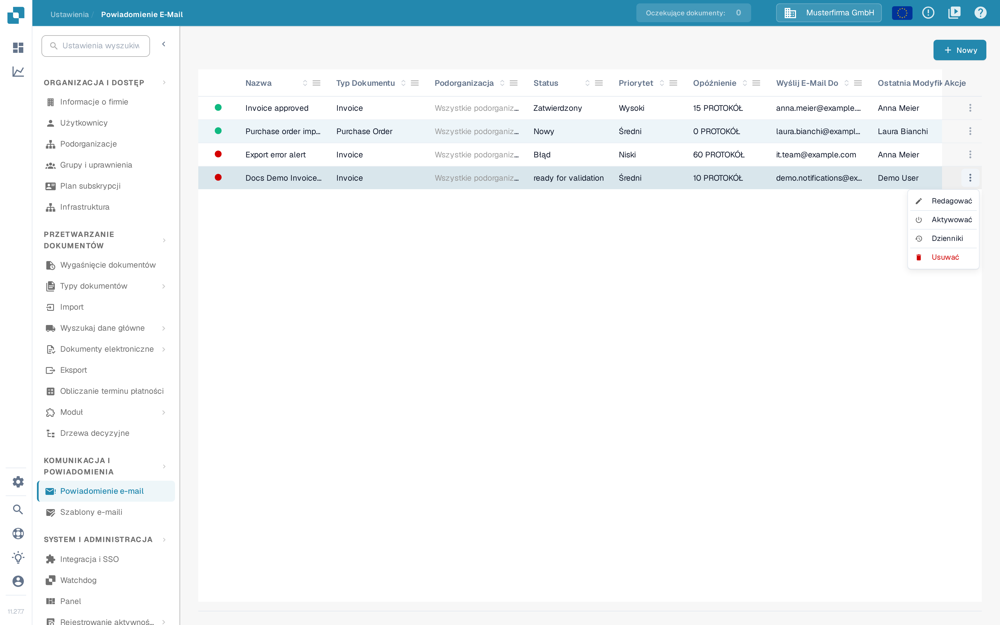

# Zarządzanie powiadomieniami

Otwórz **Ustawienia → Powiadomienie e-mail**, aby zobaczyć reguły swojej organizacji. Reguła łączy status dokumentu z szablonem e-mail i odbiorcą. Poniższy przykład używa reguły demonstracyjnej dla faktur i pozostaje **nieaktywna** w piaskownicy DocBits.

Zrzuty pokazują interfejs Sandbox z kontrolowanymi danymi demonstracyjnymi. Nie potwierdzają zapisania ani wysłania rzeczywistego powiadomienia.

## Przykład: faktura jest gotowa do walidacji

Zanim utworzysz regułę, przygotuj szablon e-mail dla typu dokumentu, na przykład **Invoice**, w **Ustawienia → Szablony e-maili**. W tym przykładzie szablon nazywa się **Docs Demo Invoice Notification**. Szablon dostarcza temat i treść wiadomości e-mail.

1. Wybierz **+ Nowy** na stronie **Powiadomienie e-mail**.
2. Wpisz **Docs Demo Invoice Validation** jako nazwę i wybierz typ dokumentu, na przykład **Invoice**. W polu **Podorganizacja** zostaw **Wszystkie podorganizacje**, aby reguła obejmowała całą organizację, albo wskaż jedną podorganizację. Następnie wskaż przygotowany szablon e-mail.
3. Wybierz **Ready for validation** jako status i **Średni** jako priorytet. Ustaw **Jednostka czasu** na **PROTOKÓŁ** i **Opóźnienie** na **10**. Minimalne opóźnienie dla minut wynosi pięć. Nazwy statusów i typów dokumentów wyświetlają się w interfejsie po angielsku.
4. Wybierz **Wyślij e-mail do przypisanego użytkownika/grupy**. Włącz **Nie powtarzaj**, jeśli wiadomość ma zostać wysłana tylko raz, i **Wyślij ponownie powiadomienie o ponownym przypisaniu**, jeśli wiadomość ma dotrzeć również do nowego właściciela dokumentu. Sprawdź odbiorcę i czas, a następnie wybierz **Zapisz**. **Anulować** zamyka okno bez zapisywania zmian.

<figure><figcaption>
Reguła demonstracyjna otwarta do edycji. Jej wartości pokazują, kiedy i do kogo powiadomienie zostałoby wysłane.
</figcaption></figure>

Reguła pojawia się teraz na liście. Przykład dokumentacyjny został następnie wyłączony, dlatego jego menu **Akcje** oferuje **Aktywować**. Przed aktywacją reguły sprawdź we własnej liście nazwę, typ dokumentu, status, opóźnienie i odbiorcę.

<figure><figcaption>
Lista pokazuje zapisaną regułę Docs Demo Invoice Validation. Zielona kropka przed nazwą oznacza regułę aktywną, czerwona — nieaktywną. Typ dokumentu, status, opóźnienie i odbiorcę odczytasz z kolumn tabeli.
</figcaption></figure>

## Edytuj, aktywuj lub usuń regułę

Otwórz menu **Akcje** wiersza. **Redagować** otwiera regułę z jej bieżącymi wartościami. **Aktywować** włącza ten nieaktywny przykład; aktywna reguła oferuje zamiast tego **Dezaktywować**. **Dzienniki** otwiera historię powiadomień reguły. **Usuwać** usuwa regułę po potwierdzeniu — w oknie dialogowym wybierz **Usuwać**, aby usunięcie było trwałe, albo **Anulować**, aby je przerwać. Przed aktywacją lub zmianą reguły sprawdź odbiorców i czas.

<figure><figcaption>
Menu <strong>Akcje</strong> tej samej nieaktywnej reguły. Dostępne działania zależą od tego, czy reguła jest aktywna.
</figcaption></figure>

Jeśli lista pokazuje **No Record Found!**, najpierw utwórz regułę. Jeśli lista **Typ Dokumentu** lub szablonów e-mail jest pusta, skonfiguruj aktywny typ dokumentu i pasujący szablon, zanim wrócisz do tego formularza.

Więcej informacji o początkowej konfiguracji znajdziesz w sekcji [Konfigurowanie powiadomień](konfigurowanie-powiadomien.md). Jeśli e-maile nie docierają zgodnie z oczekiwaniami, zobacz [Rozwiązywanie problemów](rozwiazywanie-problemow.md).
