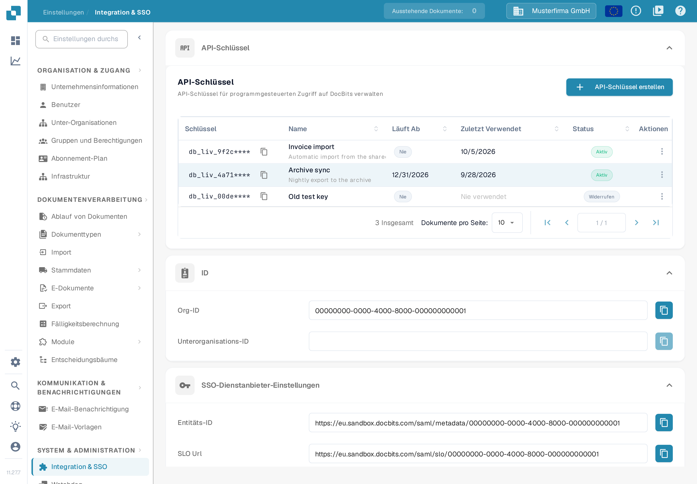
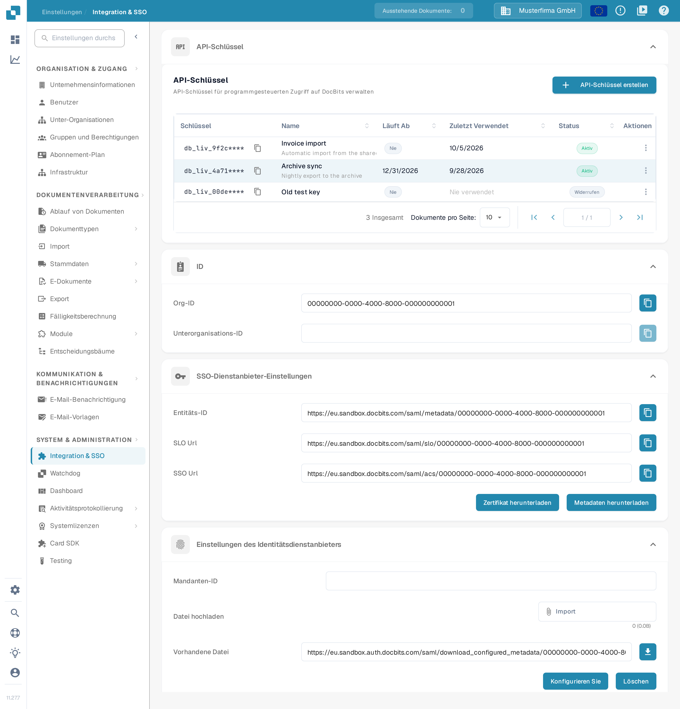

# API-Schlüssel

<figure><figcaption>
Der Abschnitt API-Schlüssel zeigt die Schaltfläche API-Schlüssel erstellen und die Spalten der Liste. Die Schlüssel sind bis auf ihr Präfix ausgeblendet.
</figcaption></figure>

Der Abschnitt **API-Schlüssel** oben auf der Seite **Integration &amp; SSO** listet alle API-Schlüssel auf, die Ihre Organisation angelegt hat. Ein API-Schlüssel erlaubt einem anderen System – Ihrem ERP, einem Skript oder einer Partneranwendung – den Zugriff auf DocBits, ohne dass sich ein Benutzer anmeldet. Die vollständige Anleitung steht unter [API-Schlüssel verwalten](api-key-management.md).

### API-Schlüsselliste

* **Schlüssel:** Die ersten Zeichen des Schlüssels, gefolgt von `****`. Der vollständige Schlüssel wird nur einmal beim Erstellen angezeigt und kann später nicht erneut eingesehen werden. Das Kopiersymbol kopiert das sichtbare Präfix in die Zwischenablage.
* **Name / Läuft Ab / Zuletzt Verwendet / Status:** Jede Zeile zeigt den Namen des Schlüssels, das Datum, an dem er aufhört zu funktionieren (**Nie**, wenn kein Ablaufdatum gesetzt ist), wann eine Anfrage den Schlüssel zuletzt verwendet hat (**Nie verwendet**) und ob er noch **Aktiv** ist.
* **API-Schlüssel erstellen:** Öffnet den Dialog für einen neuen Schlüssel einer Integration. Die Felder und die einmalige Anzeige des vollständigen Schlüssels erklärt [API-Schlüssel verwalten](api-key-management.md).
* **Aktionen (Dreipunktmenü):** Öffnet die Aktionen eines Schlüssels: Namen bearbeiten, Schlüssel widerrufen oder einen bereits widerrufenen Schlüssel löschen. Widerrufen schaltet den Schlüssel dauerhaft ab.

### SSO-Dienstanbieter-Einstellungen

Diese Werte benötigt Ihr Identitätsanbieter, damit sich Benutzer mit dem Firmenlogin bei DocBits anmelden können. Die vollständige Einrichtung steht unter [Single Sign-On (SSO) konfigurieren](configuring-single-sign-on-sso/).

<figure><figcaption>
Die Bereiche SSO-Dienstanbieter-Einstellungen und Einstellungen des Identitätsdienstanbieters mit den Werten, die Ihr Identitätsanbieter benötigt.
</figcaption></figure>

* **Entitäts-ID:** Die Kennung für DocBits als Dienstanbieter in der SSO-Konfiguration. Das Kopiersymbol kopiert den Wert in die Zwischenablage.
* **SLO Url:** Der SAML-Endpunkt von DocBits für Single Logout. Das Kopiersymbol kopiert den Wert.
* **SSO Url:** Der Assertion Consumer Service (ACS) von DocBits empfängt die SAML-Antworten des Identitätsanbieters. Verwenden Sie diese Adresse als Antwort-URL (ACS-URL) in der Konfiguration des Identitätsanbieters. Das Kopiersymbol kopiert den Wert.
* **Zertifikat herunterladen:** Lädt das Sicherheitszertifikat herunter, dem Ihr Identitätsanbieter vertrauen muss.
* **Metadaten herunterladen:** Lädt die SAML-Metadatendatei herunter, die sich in den meisten Identitätsanbietern direkt importieren lässt.

### Einstellungen des Identitätsdienstanbieters

Konfigurieren Sie DocBits so, dass die Anmeldung über Ihren externen Identitätsanbieter (IdP) läuft. Die vollständige Anleitung steht unter [Identitätsanbieter konfigurieren](identity-service-provider-configuration.md).

* **Mandanten-ID:** Die Mandantenkennung Ihres Identitätsanbieters. Sie wird benötigt, wenn DocBits in Cloud-Dienste eingebunden wird, die Daten und Zugriff je Mandant verwalten.
* **Datei hochladen:** Wählen Sie die XML-Metadatendatei Ihres Identitätsanbieters aus. Nach der Auswahl zeigt die Seite unter **Vorhandene Datei** die hinterlegte Datei mit ihrer Größe.
* **Konfigurieren Sie:** Wählen Sie zuerst die XML-Datei aus und klicken Sie anschließend auf **Konfigurieren Sie**, um sie hochzuladen und die Konfiguration des Identitätsanbieters zu speichern. Mit **Löschen** entfernen Sie die hinterlegte Datei.
