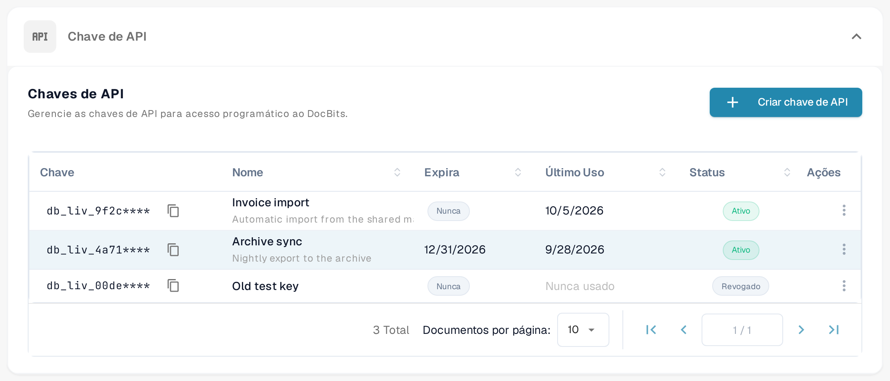

# Chave de API

<figure><figcaption>
O painel <strong>Chaves de API</strong> mostra o botão de criação, as colunas da lista e o menu de ações de cada chave. As chaves e os nomes apresentados são exemplos.
</figcaption></figure>

A secção **Chave de API**, no topo da página Integração e SSO, lista todas as chaves de API que a sua organização criou. Uma chave de API permite que outro sistema — o seu ERP, um script ou uma aplicação de um parceiro — aceda ao DocBits sem que um utilizador inicie sessão. Para instruções passo a passo, consulte [Gestão de chaves de API](api-key-management.md).

### Lista de chaves de API

* **Chave:** Os primeiros caracteres da chave, seguidos de `****`. A chave completa é apresentada apenas uma vez, no momento da criação, pelo que não pode ser consultada mais tarde. O ícone de cópia junto à chave copia o prefixo visível para a área de transferência.
* **Nome / Expira / Último Uso / Status:** Cada linha mostra o nome da chave, a data em que deixa de funcionar (`Nunca` quando a chave não expira), a última utilização e o estado da chave, **Ativo** ou **Revogado**. Uma chave que nunca foi utilizada mostra `Nunca usado` na coluna Último Uso.
* **Criar chave de API:** Abre um diálogo para criar uma nova chave para uma integração. Consulte [Gestão de chaves de API](api-key-management.md) para conhecer os campos e a apresentação única da chave.
* **Ações (menu de três pontos):** Abre as ações de uma chave, onde pode editar o nome da chave, revogá-la ou eliminar uma chave que já tenha sido revogada. A revogação desativa a chave de forma permanente.

### Configurações do provedor de serviços SSO

Estes são os valores de que o seu provedor de identidade necessita para permitir que os utilizadores iniciem sessão no DocBits com o login da sua empresa. Para o guia completo, consulte [Configurar o início de sessão único (SSO)](configuring-single-sign-on-sso/README.md).

* **ID da entidade:** O identificador do DocBits como provedor de serviços na configuração de SSO. O ícone de cópia copia o valor para a área de transferência.
* **URL SLO:** O endpoint do serviço de encerramento de sessão único (SLO) SAML do DocBits. O ícone de cópia copia o valor.
* **URL do SSO:** O endpoint do Assertion Consumer Service (ACS) do DocBits, que recebe as respostas SAML do provedor de identidade. Utilize-o como URL de resposta (URL ACS) na configuração do provedor de identidade. O ícone de cópia copia o valor.
* **Baixar Certificado:** Transfere o certificado de segurança de que o seu provedor de identidade necessita para confiar no DocBits.
* **Baixar metadados:** Transfere o ficheiro de metadados SAML, que pode ser importado diretamente na maioria dos provedores de identidade.

### Configurações do Provedor de Serviços de Identidade

Configure o DocBits para utilizar o seu provedor de identidade (IdP) externo no início de sessão. Para o guia completo, consulte [Configuração do Identity Service Provider](identity-service-provider-configuration.md).

* **ID do tenant:** O identificador de tenant do seu provedor de identidade, utilizado quando o DocBits se integra com serviços em nuvem que gerem o acesso por tenant.
* **Carregar arquivo:** Selecione o ficheiro XML de metadados fornecido pelo seu provedor de identidade.
* **Configurar:** Depois de selecionar o ficheiro XML, clique em **Configurar** para o carregar e guardar a configuração do provedor de identidade.
