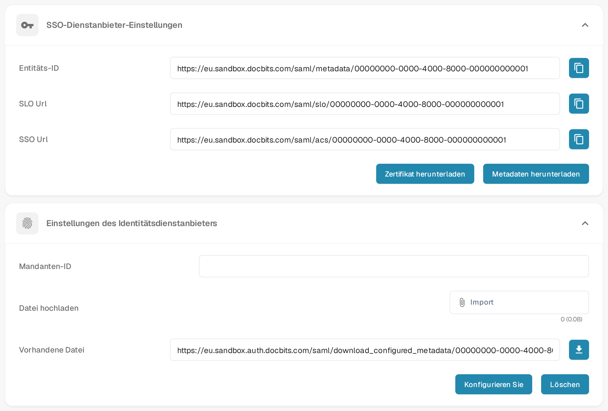

# Microsoft Entra SSO

Verwenden Sie diese Anleitung, wenn sich Benutzer Ihrer Organisation über Microsoft Entra ID bei DocBits anmelden sollen. Sie benötigen Administratorrechte sowohl in DocBits als auch im Microsoft-Entra-Mandanten. Testen Sie mit einem zugewiesenen Benutzer, bevor Sie die Anmeldung für alle ändern.

## 1. Die DocBits-Dienstanbieter-Details abrufen

Öffnen Sie in DocBits **Einstellungen → Integration & SSO**. Wählen Sie unter **SSO-Dienstanbieter-Einstellungen** die Schaltfläche **Metadaten herunterladen**, um die Metadaten-XML des Dienstanbieters zu erhalten. Sie enthält die Entitäts-ID, die Adresse des Assertion Consumer Service (ACS) und die Adresse für Single Logout, die für die Entra-Konfiguration benötigt werden. **Zertifikat herunterladen** liefert das DocBits-Zertifikat, falls Ihr Identitätsanbieter es verlangt. Verwenden Sie die Datei aus Ihrer eigenen Organisation und Umgebung; das Bild ersetzt organisationsspezifische Werte durch erfundene Beispieldaten.

Die Kopierschaltflächen neben **Entitäts-ID**, **SSO Url** und **SLO Url** kopieren die angezeigten Werte. Vergleichen Sie vor der Verwendung jede vollständige Adresse mit der heruntergeladenen XML. Weicht ein Wert ab, verwenden Sie den entsprechenden Metadatenwert und melden Sie die Abweichung. Behalten Sie das vollständige Schema, den Host und den Pfad inklusive eines eventuellen Pfadpräfixes bei.

<figure><figcaption>
Deutsche DocBits-SSO-Einstellungen in einer Sandbox-Testorganisation mit erfundenen Beispielwerten: oben die Werte des Dienstanbieters mit dem Download von Metadaten und Zertifikat, unten die Datei des Identitätsanbieters zum Konfigurieren. Organisationsspezifische Werte sind durch Beispieldaten ersetzt.
</figcaption></figure>

## 2. Die Microsoft-Entra-Anwendung erstellen

Erstellen Sie im [Microsoft Entra Admin Center](https://entra.microsoft.com/) eine Unternehmensanwendung über **New application → Create your own application** und die Option ohne Katalog (non-gallery). Öffnen Sie **Single sign-on → SAML**. Verwenden Sie in **Basic SAML Configuration** die Entitäts-ID aus den DocBits-Metadaten (`EntityDescriptor` → `entityID`) als Microsoft **Identifier (Entity ID)**. Verwenden Sie die ACS-Adresse (`AssertionConsumerService` → `Location`) als **Reply URL (ACS URL)**. Legen Sie die Abmelde-URL aus `SingleLogoutService` → `Location` fest, falls Ihre Konfiguration sie erfordert. Klären Sie zusätzliche Anmelde-URLs und Anforderungen an die Ansprüche (Claims) mit Ihrem Identitätsadministrator.

Weisen Sie unter **Users and groups** einen Testbenutzer oder eine Testgruppe zu. Die [aktuelle Anleitung von Microsoft zur SAML-Einrichtung und Benutzerzuweisung](https://learn.microsoft.com/en-us/entra/identity/enterprise-apps/add-application-portal-setup-sso) zeigt die Schritte im Entra-Portal und erklärt diese Felder. Die Portalbilder dort pflegt Microsoft; die alten Azure-AD-Aufnahmen wurden von dieser Seite entfernt.

## 3. Microsoft-Metadaten in DocBits importieren

Laden Sie in der SAML-Einrichtung der Entra-Anwendung die **Federation Metadata XML** herunter. Microsoft beschreibt diese Datei in der [Anleitung zu den Verbundmetadaten](https://learn.microsoft.com/en-us/entra/identity/enterprise-apps/add-application-portal-setup-sso-rpsts#download-metadata-and-certificates-from-microsoft-entra). Kehren Sie in DocBits zu **Einstellungen → Integration & SSO → Einstellungen des Identitätsdienstanbieters** zurück. Geben Sie die Microsoft **Mandanten-ID** ein. Wählen Sie in der Zeile **Datei hochladen** über **Import** die Datei Federation Metadata XML und danach die Schaltfläche zum Konfigurieren – sie heißt in der deutschen Oberfläche derzeit **Konfigurieren Sie** –, um die Datei hochzuladen und zu speichern. Wählen Sie die XML-Datei vor dem Konfigurieren; eine Mandanten-ID allein reicht nicht. Halten Sie eine funktionierende Administrator-Anmeldung bereit, während Sie SSO testen.

## 4. Die Anmeldung testen

Bitten Sie den zugewiesenen Testbenutzer, eine neue Browsersitzung zu starten und sich über das konfigurierte Microsoft-Konto anzumelden. Prüfen Sie, ob der Benutzer die vorgesehene DocBits-Organisation erreicht und den erwarteten Zugriff hat. Schlägt die Anmeldung fehl, vergleichen Sie Entitäts-ID, ACS-URL, Mandant, Zuweisungen, Ansprüche und Metadaten in beiden Systemen, bevor Sie die Konfiguration ändern.
