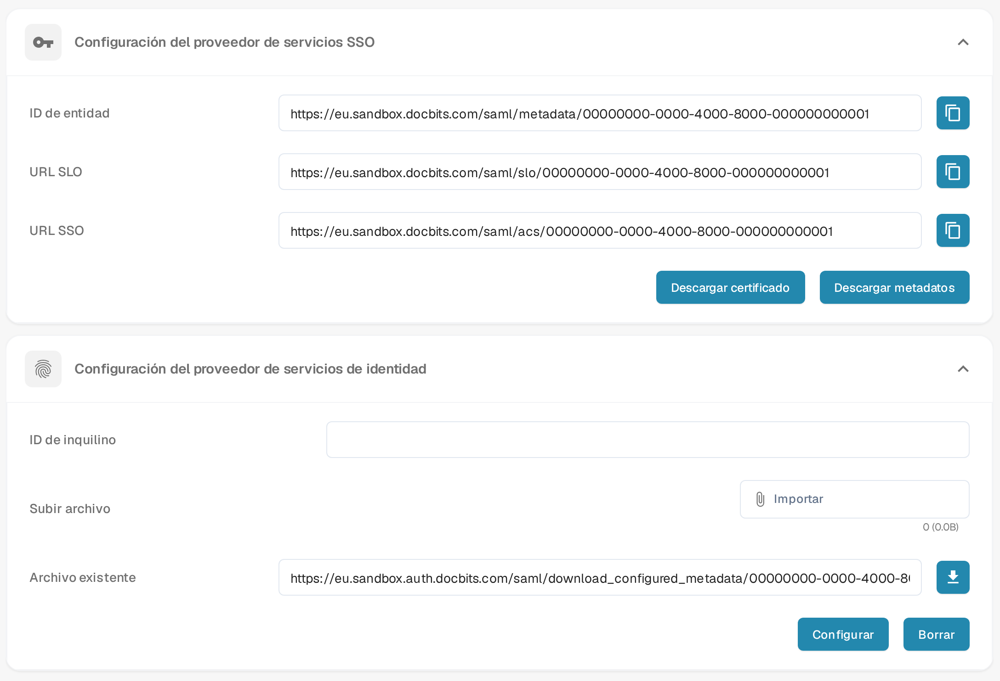

# SSO de Microsoft Entra

Usa esta guía si tu organización quiere que los usuarios inicien sesión en DocBits mediante Microsoft Entra ID. Necesitas un administrador tanto en DocBits como en el inquilino de Microsoft Entra. Prueba con un único usuario asignado antes de cambiar el inicio de sesión para todo el mundo.

## 1. Obtén los datos del proveedor de servicios de DocBits

En DocBits, abre **Ajustes → Integración y SSO**. En **Configuración del proveedor de servicios SSO**, elige **Descargar metadatos** para obtener el XML de metadatos del proveedor de servicios. Contiene el ID de entidad, la URL del servicio de consumidor de aserciones (ACS) y la URL de cierre de sesión único que necesitas para la configuración de Entra. **Descargar certificado** proporciona el certificado de DocBits si tu proveedor de identidad lo solicita. Usa el archivo de tu propia organización y entorno; en la imagen aparecen direcciones de ejemplo inventadas en lugar de los valores reales.

Los botones de copia junto a **ID de entidad**, **URL SSO** y **URL SLO** copian los valores mostrados. Antes de usarlos, compara cada dirección completa con el XML descargado. Si un valor difiere, usa el valor correspondiente de los metadatos e informa de la discrepancia. Conserva el esquema, el host y la ruta completos, incluido cualquier prefijo de ruta.

<figure><figcaption>
Ajustes SSO de DocBits en español con datos de ejemplo inventados: arriba revisas los valores del proveedor de servicios o descargas sus metadatos y su certificado; abajo seleccionas el XML del proveedor de identidad y lo configuras. La fila «Archivo existente» muestra un archivo de ejemplo ya cargado.
</figcaption></figure>

## 2. Crea la aplicación de Microsoft Entra

En el [centro de administración de Microsoft Entra](https://entra.microsoft.com/) crea una **aplicación empresarial** con **Nueva aplicación → Crear tu propia aplicación** y la opción que no procede de la galería. Abre **Inicio de sesión único → SAML**. En **Configuración básica de SAML**, usa el ID de entidad de los metadatos de DocBits (`EntityDescriptor` → `entityID`) como **Identificador (ID de entidad)** de Microsoft. Usa la dirección ACS (`AssertionConsumerService` → `Location`) como **URL de respuesta (URL de ACS)**. Define la URL de cierre de sesión desde `SingleLogoutService` → `Location` si tu configuración lo requiere. Consulta con tu administrador de identidad cualquier requisito adicional de URL de inicio de sesión y de notificaciones.

Asigna un usuario o un grupo de prueba en **Usuarios y grupos**. La [guía actual de configuración de SAML y asignación de usuarios](https://learn.microsoft.com/en-us/entra/identity/enterprise-apps/add-application-portal-setup-sso) de Microsoft muestra los pasos en el portal de Entra y explica estos campos. Sus imágenes del portal las mantiene Microsoft; las capturas antiguas de Azure AD se han retirado de esta página.

## 3. Importa los metadatos de Microsoft en DocBits

En la configuración SAML de la aplicación de Entra, descarga el **XML de metadatos de federación**. Microsoft documenta este archivo en su [guía de metadatos de federación](https://learn.microsoft.com/en-us/entra/identity/enterprise-apps/add-application-portal-setup-sso-rpsts#download-metadata-and-certificates-from-microsoft-entra). Vuelve a **Ajustes → Integración y SSO → Configuración del proveedor de servicios de identidad** en DocBits. Introduce el **ID de inquilino** de Microsoft. En la fila **Subir archivo**, usa **Importar** para seleccionar el archivo XML de metadatos de federación y, después, selecciona **Configurar** para cargarlo y guardarlo. Selecciona el archivo XML antes de elegir **Configurar**; el ID de inquilino por sí solo no es suficiente. Mantén un inicio de sesión de administrador operativo mientras pruebas el SSO.

## 4. Prueba el inicio de sesión

Pide al usuario de prueba asignado que inicie una sesión nueva del navegador y entre con la cuenta de Microsoft configurada. Comprueba que el usuario llega a la organización de DocBits prevista y tiene el acceso esperado. Si el inicio de sesión falla, compara el ID de entidad, la URL de ACS, el inquilino, las asignaciones, las notificaciones y los metadatos en ambos sistemas antes de cambiar la configuración.
