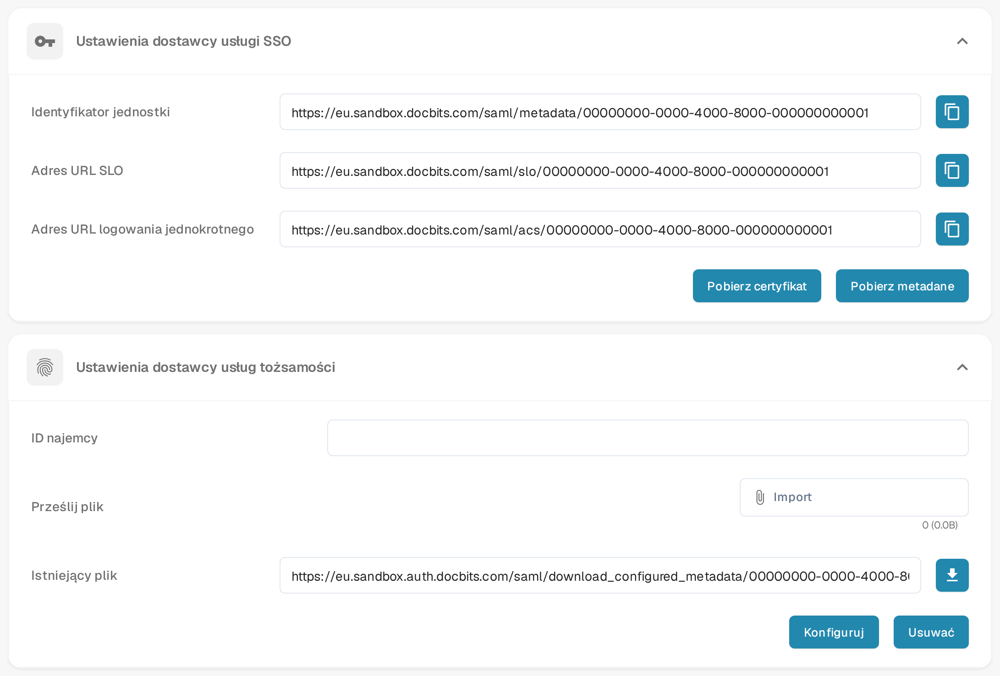

# Microsoft Entra SSO

Skorzystaj z tego przewodnika, jeśli użytkownicy Twojej organizacji mają logować się do DocBits przez Microsoft Entra ID. Potrzebujesz uprawnień administratora zarówno w DocBits, jak i w najemcy Microsoft Entra. Przed zmianą sposobu logowania dla wszystkich użytkowników przetestuj rozwiązanie na jednym przypisanym użytkowniku.

## 1. Pobierz dane dostawcy usług DocBits

W DocBits otwórz **Ustawienia → Integracja i SSO**. W sekcji **Ustawienia dostawcy usługi SSO** wybierz **Pobierz metadane**, aby pobrać plik XML z metadanymi dostawcy usług. Zawiera on identyfikator jednostki, adres Assertion Consumer Service (ACS) oraz adres wylogowania jednokrotnego, które są potrzebne do konfiguracji w Entra. **Pobierz certyfikat** udostępnia certyfikat DocBits, jeśli Twój dostawca tożsamości go wymaga. Użyj pliku z własnej organizacji i środowiska; obraz zastępuje wartości charakterystyczne dla organizacji wymyślonymi danymi przykładowymi.

Przyciski kopiowania obok pól **Identyfikator jednostki**, **Adres URL logowania jednokrotnego** i **Adres URL SLO** kopiują wyświetlane wartości. Przed użyciem porównaj każdy pełny adres z pobranym plikiem XML. Jeśli wartość się różni, użyj odpowiedniej wartości z metadanych i zgłoś rozbieżność. Zachowaj pełny schemat, host i ścieżkę, łącznie z ewentualnym prefiksem ścieżki.

<figure><figcaption>
Polskie ustawienia SSO w DocBits w testowej organizacji Sandbox z wymyślonymi danymi przykładowymi: u góry wartości dostawcy usług wraz z pobieraniem metadanych i certyfikatu, u dołu plik dostawcy tożsamości do skonfigurowania. Wartości charakterystyczne dla organizacji zastąpiono danymi przykładowymi.
</figcaption></figure>

## 2. Utwórz aplikację Microsoft Entra

W [centrum administracyjnym Microsoft Entra](https://entra.microsoft.com/) utwórz nową aplikację dla przedsiębiorstw (**Enterprise application**), wybierając **New application → Create your own application** i opcję aplikacji spoza galerii (non-gallery). Otwórz **Single sign-on → SAML**. W sekcji **Basic SAML Configuration** użyj identyfikatora jednostki z metadanych DocBits (`EntityDescriptor` → `entityID`) jako **Identifier (Entity ID)** w Microsofcie. Użyj adresu ACS (`AssertionConsumerService` → `Location`) jako **Reply URL (ACS URL)**. Ustaw adres wylogowania z `SingleLogoutService` → `Location`, jeśli Twoja konfiguracja tego wymaga. Dodatkowe adresy logowania i wymagania dotyczące oświadczeń (claims) uzgodnij z administratorem tożsamości.

W sekcji **Users and groups** przypisz użytkownika lub grupę testową. [Aktualny przewodnik Microsoftu po konfiguracji SAML i przypisywaniu użytkowników](https://learn.microsoft.com/en-us/entra/identity/enterprise-apps/add-application-portal-setup-sso) pokazuje kroki w portalu Entra i objaśnia te pola. Obrazy w portalu utrzymuje Microsoft; stare zrzuty ekranu z usługi Azure AD zostały usunięte z tej strony.

## 3. Zaimportuj metadane Microsoftu do DocBits

W konfiguracji SAML aplikacji Entra pobierz plik **Federation Metadata XML**. Microsoft opisuje ten plik w [przewodniku po metadanych federacji](https://learn.microsoft.com/en-us/entra/identity/enterprise-apps/add-application-portal-setup-sso-rpsts#download-metadata-and-certificates-from-microsoft-entra). Wróć w DocBits do **Ustawienia → Integracja i SSO → Ustawienia dostawcy usług tożsamości**. Wprowadź **ID najemcy** Microsoftu. W wierszu **Prześlij plik** wybierz przez **Import** plik Federation Metadata XML, a następnie wybierz **Konfiguruj**, aby go przesłać i zapisać. Wybierz plik XML przed wybraniem **Konfiguruj**; sam identyfikator najemcy nie wystarcza. Podczas testowania SSO zachowaj działające logowanie administratora.

Jeśli konfiguracja jest już zapisana, DocBits pokazuje ją w wierszu **Istniejący plik**. Ikona obok pobiera zapisany plik jako `configured_metadata.xml`. **Usuwać** usuwa zapisaną konfigurację i potwierdza to komunikatem; następnie pola **ID najemcy** i **Istniejący plik** są puste, więc możesz przesłać aktualny plik ponownie.

## 4. Przetestuj logowanie

Poproś przypisanego użytkownika testowego o rozpoczęcie nowej sesji przeglądarki i zalogowanie się przez skonfigurowane konto Microsoft. Sprawdź, czy użytkownik trafia do właściwej organizacji DocBits i ma oczekiwany dostęp. Jeśli logowanie się nie powiedzie, porównaj identyfikator jednostki, adres ACS, najemcę, przypisania, oświadczenia i metadane w obu systemach, zanim zmienisz konfigurację.
