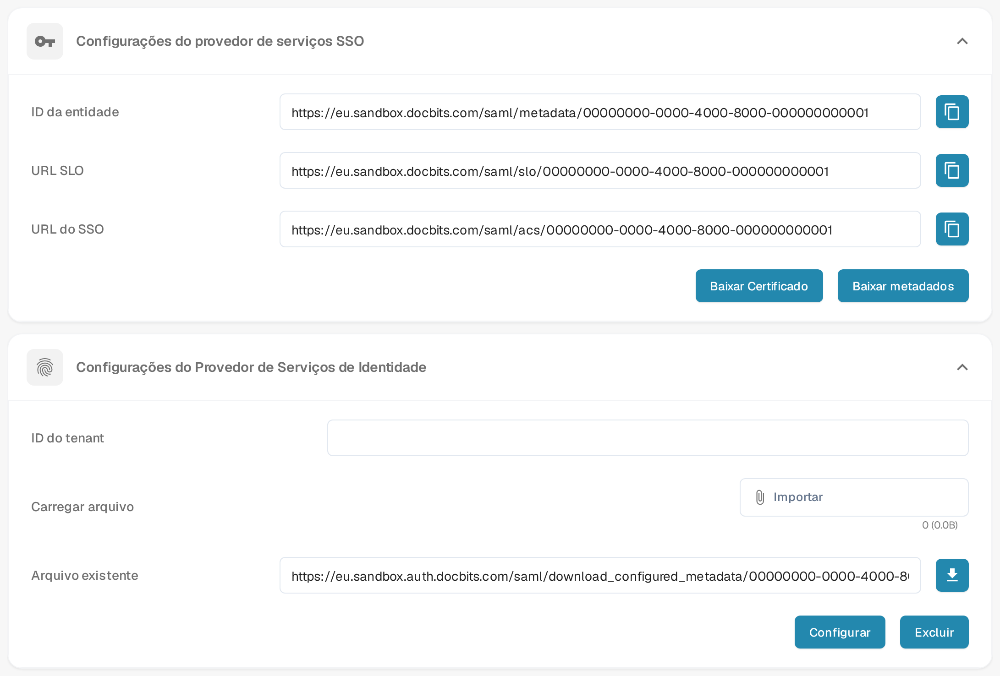

# SSO do Microsoft Entra

Utilize este guia se a sua organização pretender que os utilizadores iniciem sessão no DocBits através do Microsoft Entra ID. Necessita de um administrador tanto no DocBits como no inquilino do Microsoft Entra. Teste primeiro com um único utilizador atribuído, antes de alterar o início de sessão para todos.

## 1. Obter os dados do fornecedor de serviços do DocBits

No DocBits, abra **Configurações → Integração e SSO**. Em **Configurações do provedor de serviços SSO**, escolha **Baixar metadados** para obter o XML de metadados do fornecedor de serviços. Este ficheiro contém o ID da entidade, o endereço do Assertion Consumer Service (ACS) e o endereço de terminação de sessão única de que necessita para a configuração no Entra. **Baixar Certificado** fornece o certificado do DocBits, caso o seu fornecedor de identidade o exija. Utilize o ficheiro da sua própria organização e ambiente; na imagem, os valores específicos da organização são substituídos por endereços de exemplo inventados.

Os botões de cópia junto a **ID da entidade**, **URL do SSO** e **URL SLO** copiam os valores apresentados. Antes de os utilizar, compare cada endereço completo com o XML transferido. Se um valor for diferente, utilize o valor correspondente dos metadados e comunique a discrepância. Mantenha o esquema, o servidor e o caminho completos, incluindo qualquer prefixo de caminho.

<figure><figcaption>
Configurações de SSO do DocBits em português, com dados de exemplo inventados: em cima, consulta os valores do fornecedor de serviços ou transfere os respetivos metadados e certificado; em baixo, seleciona o XML do fornecedor de identidade e configura-o. A linha Arquivo existente mostra um ficheiro de exemplo já carregado.
</figcaption></figure>

## 2. Criar a aplicação Microsoft Entra

No [centro de administração do Microsoft Entra](https://entra.microsoft.com/), crie uma **aplicação empresarial** com **Nova aplicação → Criar a sua própria aplicação** e a opção sem galeria. Abra **Início de sessão único → SAML**. Em **Configuração SAML básica**, utilize o ID da entidade dos metadados do DocBits (`EntityDescriptor` → `entityID`) como **Identificador (ID da entidade)** da Microsoft. Utilize o endereço ACS (`AssertionConsumerService` → `Location`) como **URL de resposta (URL do ACS)**. Defina o URL de terminação de sessão a partir de `SingleLogoutService` → `Location`, se a sua configuração o exigir. Confirme com o seu administrador de identidade quaisquer requisitos adicionais de URL de início de sessão e de declarações (claims).

Atribua um utilizador ou grupo de teste em **Utilizadores e grupos**. O [guia atual da Microsoft para a configuração de SAML e a atribuição de utilizadores](https://learn.microsoft.com/en-us/entra/identity/enterprise-apps/add-application-portal-setup-sso) mostra os passos no portal do Entra e explica estes campos. As imagens do portal são mantidas pela Microsoft; as antigas capturas do Azure AD foram removidas desta página.

## 3. Importar os metadados da Microsoft para o DocBits

Na configuração SAML da aplicação Entra, transfira o **XML de metadados de federação**. A Microsoft documenta este ficheiro no seu [guia de metadados de federação](https://learn.microsoft.com/en-us/entra/identity/enterprise-apps/add-application-portal-setup-sso-rpsts#download-metadata-and-certificates-from-microsoft-entra). Regresse a **Configurações → Integração e SSO → Configurações do Provedor de Serviços de Identidade** no DocBits. Introduza o **ID do tenant** da Microsoft. Na linha **Carregar arquivo**, utilize **Importar** para selecionar o ficheiro XML de metadados de federação e, em seguida, selecione **Configurar** para o carregar e guardar. Selecione o ficheiro XML antes de escolher **Configurar**; um ID do tenant sozinho não é suficiente. Mantenha um início de sessão de administrador funcional enquanto testa o SSO.

Se já existir uma configuração guardada, o DocBits apresenta-a na linha **Arquivo existente**. O ícone ao lado transfere o ficheiro guardado como `configured_metadata.xml`. **Excluir** remove a configuração guardada e confirma a operação com uma mensagem; em seguida, os campos **ID do tenant** e **Arquivo existente** ficam vazios, para que possa carregar novamente o ficheiro atual. Só são aceites ficheiros XML e, sem um ficheiro selecionado, a configuração não é guardada.

## 4. Testar o início de sessão

Peça ao utilizador de teste atribuído que abra uma nova sessão do navegador e inicie sessão com a conta Microsoft configurada. Verifique se o utilizador chega à organização DocBits pretendida e tem o acesso esperado. Se o início de sessão falhar, compare o ID da entidade, o URL do ACS, o inquilino, as atribuições, as declarações e os metadados nos dois sistemas antes de alterar a configuração.
