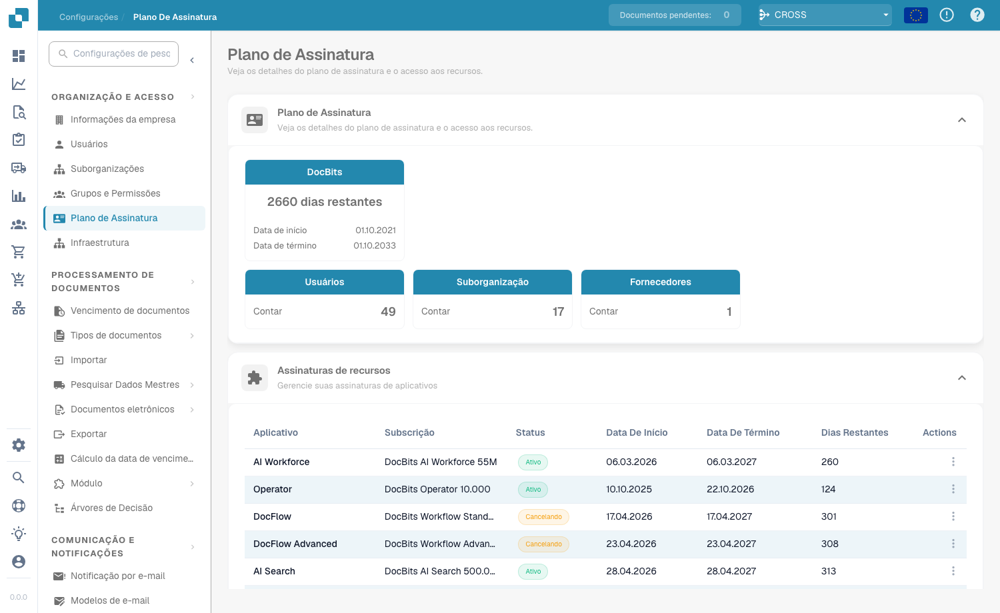
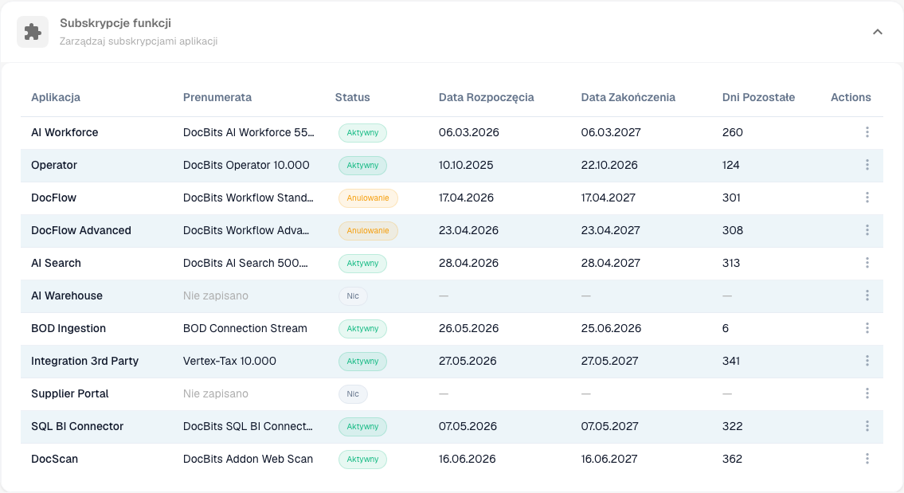
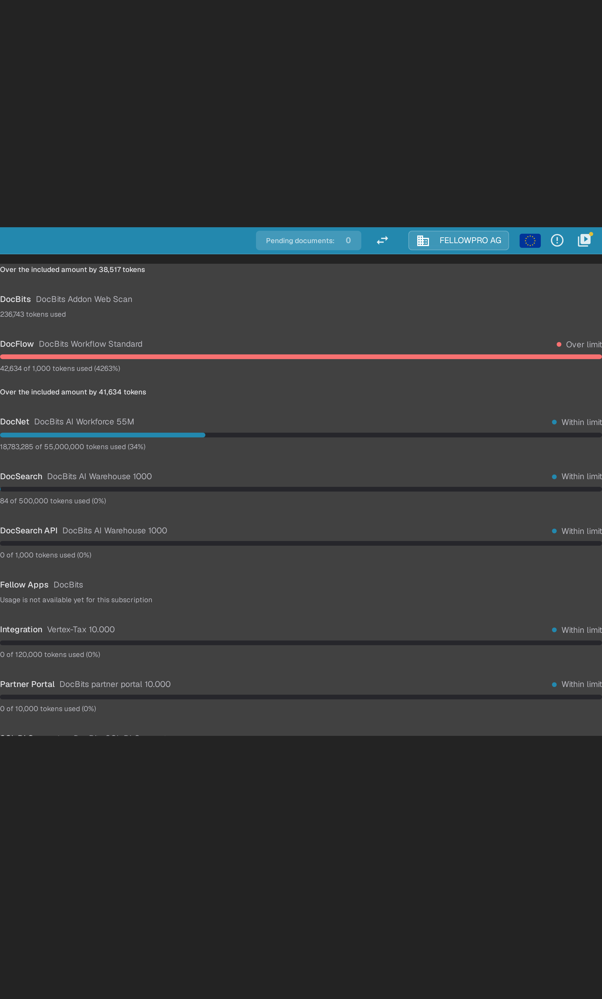

# Subscription Plan

## Video tutorial: Company, subscription and audit


Company information, subscription plan and audit logs in DocBits


The video shows the company information and preferences, the subscription plan, the login activity and the audit logs.

<figure><figcaption>
Subscription Plan page
</figcaption></figure>

The **Subscription Plan** page gives you a complete overview of your DocBits subscription in one place: the plan itself, the app and feature subscriptions enabled for your organization, and your token usage. Open it from **Settings → Organization & Access → Subscription Plan**.

## Subscription Plan

The first card shows your DocBits subscription — the number of days remaining and the start and end dates — alongside live counts for your organization:

| Card                 | Description                                                      |
| -------------------- | ---------------------------------------------------------------- |
| **DocBits**          | Remaining days plus the start and end date of your subscription. |
| **Users**            | The number of users in your organization.                        |
| **Sub Organization** | The number of sub-organizations.                                 |
| **Suppliers**        | The number of suppliers.                                         |

## Feature Subscriptions

<figure><figcaption></figcaption></figure>

This section lists every DocBits app and feature and whether it is enabled for your organization.

| Column                    | Description                                                                                                    |
| ------------------------- | -------------------------------------------------------------------------------------------------------------- |
| **App**                   | The DocBits app or feature (e.g. AI Workforce, Operator, DocFlow, AI Search, BOD Ingestion, SQL BI Connector). |
| **Subscription**          | The subscribed plan for that app.                                                                              |
| **Status**                | **Active**, **Cancelling** (active until the end date, then ends), or **None** when the app is not subscribed. |
| **Start Date / End Date** | The subscription period.                                                                                       |
| **Days Left**             | Days remaining until the end date.                                                                             |
| **Actions**               | Per-app actions menu.                                                                                          |

## Subscription Usage

<figure><figcaption>
Subscription Usage for the current billing period and the last six months
</figcaption></figure>

The **Subscription Usage** card shows token consumption for your current billing period. The billing-period dates appear above the list.

Each row shows the app and its subscription plan. Depending on the plan, the row also shows:

- The included token allowance.
- The number of tokens used and the percentage of the included allowance consumed.
- **Within limit** or **Over limit** status.

A warning starts at **80%** of the included amount. Usage is **Over limit** from **100%**. Plans without an included token allowance show only the tokens used. If usage cannot be provided, the row shows **Usage is not available yet for this subscription**.

### Usage over the last six months

Use the **App** drop-down to select an app. The chart shows its monthly token usage over the last six months.
