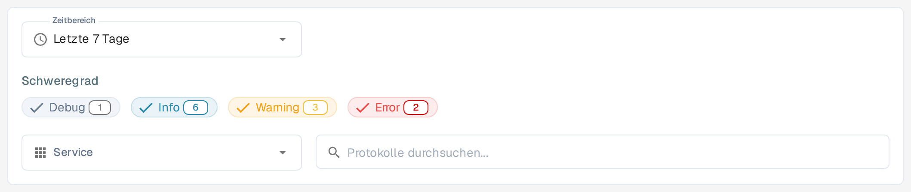
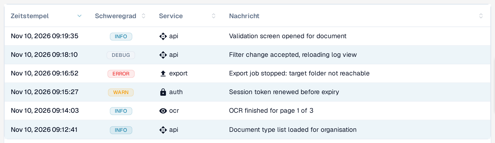

# Aktivitätsprotokollierung

<figure><figcaption>
Filter der Protokollansicht in der deutschen Oberfläche: Zeitbereich, Schweregrade, Service und Suche. Die Schweregrade Debug, Info, Warning und Error sind auch auf Deutsch englisch beschriftet.
</figcaption></figure>

<figure><figcaption>
Die Protokolltabelle zeigt die Spalte Service (nicht Component) für den Dienst, der den Eintrag erzeugt hat. Die Meldungen im Feld Nachricht stammen aus den Diensten.
</figcaption></figure>

Die Aktivitätsprotokollierung bietet eine Echtzeitsicht auf Systemereignisse über alle DocBits-Dienste hinweg. Verwenden Sie sie, um die Verarbeitungsaktivität zu überwachen, Fehler zu beheben und das Systemverhalten zu prüfen.

## Analysebanner

Oben auf der Seite führt der Link **Analyse-Dashboard anzeigen** zum Analyse-Dashboard mit Diagrammen, Kennzahlen und Echtzeit-Monitoring.

## Filter

| Filter | Beschreibung |
|--------|-------------|
| **Zeitbereich** | Wählen Sie ein Zeitfenster: **Letzte Stunde**, **Heute**, **Letzte 7 Tage**, **Letzte 30 Tage** oder **Benutzerdefiniert**. |
| **Schweregrad** | Schalten Sie Schweregrade ein oder aus: **Debug**, **Info**, **Warning**, **Error**. Jeder Chip zeigt die aktuelle Anzahl der Einträge. Diese vier Bezeichnungen bleiben auch in der deutschen Oberfläche englisch. |
| **Service** | Filtern Sie Protokolle nach Dienst: **API**, **AUTH**, **OCR**, **EXPORT**. |
| **Protokolle durchsuchen** | Freitextsuche in den Protokollmeldungen. |

## Protokolltabelle

| Spalte | Beschreibung |
|--------|-------------|
| **Zeitstempel** | Datum und Uhrzeit des Ereignisses. |
| **Schweregrad** | Farbig codiertes Badge: Info (blau), Warning (gelb), Error (rot), Debug (grau). |
| **Service** | Der Dienst, der das Protokoll erzeugt hat (z. B. api, auth, ocr, export). |
| **Nachricht** | Die vollständige Protokollmeldung mit Ereignisdetails. |

Alle vier Spalten lassen sich durch Klick auf den Spaltenkopf sortieren.

Die Ergebnisse sind seitenweise aufgeteilt — navigieren Sie mit den Steuerelementen am unteren Rand durch die Seiten. Die Schaltflächen **Previous** und **Next** sind auch in der deutschen Oberfläche englisch beschriftet.

## Protokolldetails

Wählen Sie eine Protokollzeile aus, um die Detailansicht zu öffnen. Die Zusammenfassung zeigt Schweregrad, Zeitstempel, Service und Protokoll-ID, darunter die Ereignismeldung.

Der Bereich **Protokolldetails** enthält das vollständige Ereignis als formatiertes JSON. Je nach Ereignis können Metadaten wie Quelle, Umgebung, Benutzer, Ressource, Aktion sowie Netzwerk- oder Clientinformationen enthalten sein. Felder ohne Wert können als `null` erscheinen.

Wählen Sie das Kopiersymbol unten rechts in **Protokolldetails**, um den vollständigen JSON-Datensatz in die Zwischenablage zu kopieren. Über den Zurück-Pfeil neben **Aktivitätsprotokollierung** kehren Sie zur Liste zurück.

## Aktionen in der Fußzeile

Diese Schaltflächen sind auch in der deutschen Oberfläche englisch beschriftet.

| Aktion | Beschreibung |
|--------|-------------|
| **Auto-refresh** | Schalter, um die Protokollansicht in regelmäßigen Abständen automatisch zu aktualisieren. |
| **Refresh Now** | Die Protokolldaten manuell aktualisieren. |
| **Export JSON** | Die aktuell gefilterten Protokolle als JSON-Datei exportieren. |
| **Download Logs** | Die vollständigen Protokolldaten herunterladen. |
