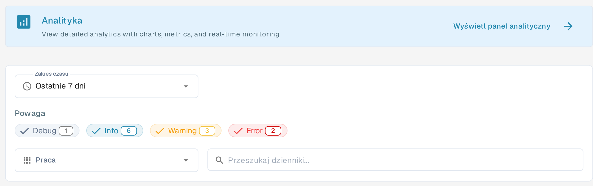
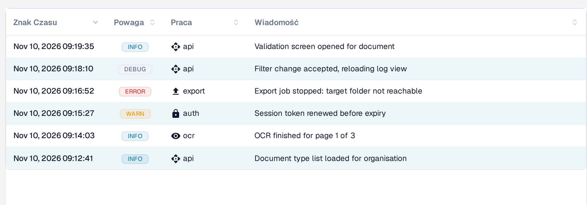

# Rejestrowanie aktywności

<figure><figcaption>
Filtry rejestrowania aktywności w polskim interfejsie: zakres czasu, powaga, praca i wyszukiwanie. Cztery etykiety Debug, Info, Warning i Error pozostają po angielsku również w polskim interfejsie.
</figcaption></figure>

Rejestrowanie aktywności (menu **SYSTEM I ADMINISTRACJA**) pokazuje zdarzenia systemowe ze wszystkich usług DocBits w czasie rzeczywistym. Używaj go do monitorowania przetwarzania, diagnozowania błędów i audytu zachowania systemu.

## Baner analityczny

U góry strony baner **Analityka** zawiera link **Wyświetl panel analityczny**, który otwiera [panel analityczny](analytics.md) z wykresami, metrykami i monitorowaniem w czasie rzeczywistym. Podtytuł banera pozostaje w polskim interfejsie po angielsku.

## Filtry

| Filtr | Opis |
|--------|-------------|
| **Zakres czasu** | Wybierz okno czasowe: **Ostatnia godzina**, **Dzisiaj**, **Ostatnie 7 dni**, **Ostatnie 30 dni** lub **Niestandardowy**. |
| **Powaga** | Włączaj lub wyłączaj poziomy: **Debug**, **Info**, **Warning** i **Error**. Każdy znacznik pokazuje bieżącą liczbę zdarzeń. Te cztery etykiety pozostają po angielsku również w polskim interfejsie. |
| **Praca** | Filtruj logi według usługi: **API**, **AUTH**, **OCR** i **EXPORT**. Etykieta **Praca** to tłumaczenie pola Service w interfejsie. |
| **Przeszukaj dzienniki...** | Wyszukiwanie pełnotekstowe w komunikatach logów. |

## Tabela logów

<figure><figcaption>
Tabela logów pokazuje w kolumnie Praca usługę, która utworzyła wpis: api, auth, ocr lub export. Każdy nagłówek można posortować kliknięciem.
</figcaption></figure>

| Kolumna | Opis |
|--------|-------------|
| **Znak Czasu** | Data i godzina wystąpienia zdarzenia. |
| **Powaga** | Kolorowa plakietka z tekstem pisanym wielkimi literami: INFO (niebieska), WARN (żółta), ERROR (czerwona) i DEBUG (szara). |
| **Praca** | Usługa, która utworzyła wpis (np. api, auth, ocr, export). Etykieta **Praca** to tłumaczenie pola Service w interfejsie. |
| **Wiadomość** | Pełny komunikat logu ze szczegółami zdarzenia. |

Wszystkie cztery kolumny można sortować, klikając nagłówek.

Wyniki są podzielone na strony — użyj elementów sterujących na dole, aby przechodzić między stronami. Wskaźnik stron, np. **Page 1 (6 total logs)**, oraz przyciski **Previous** i **Next** pozostają w polskim interfejsie po angielsku. Znaczniki czasu są wyświetlane w formacie angielskim, np. **Nov 10, 2026 09:19:35**.

## Szczegóły dziennika

Wybierz wiersz dziennika, aby otworzyć jego widok szczegółów. Nagłówek pokazuje plakietkę powagi, znacznik czasu, usługę i identyfikator logu, a poniżej komunikat zdarzenia.

Sekcja **Log Details** zawiera kompletne zdarzenie w formacie JSON; jej nazwa pozostaje po angielsku. W zależności od zdarzenia może ono obejmować metadane, takie jak źródło, środowisko, użytkownik, zasób, akcja oraz informacje o sieci lub kliencie. Pola bez wartości mogą być wyświetlane jako `null`.

Wybierz ikonę kopiowania w prawym górnym rogu sekcji **Log Details**, aby skopiować kompletny rekord JSON do schowka. Użyj linku **BACK TO LOGS** u góry strony, aby wrócić do listy.

## Akcje w stopce

Te cztery akcje pozostają w polskim interfejsie po angielsku.

| Akcja | Opis |
|--------|-------------|
| **Auto-refresh** | Przełącznik automatycznego odświeżania widoku logów w regularnych odstępach. |
| **Refresh Now** | Ręczne odświeżenie danych logów. |
| **Export JSON** | Eksportuje bieżące przefiltrowane logi jako plik JSON. |
| **Download Logs** | Pobiera kompletne dane logów. |
