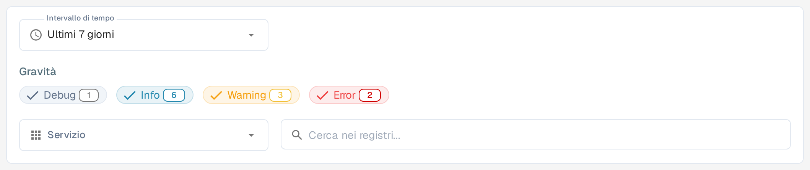
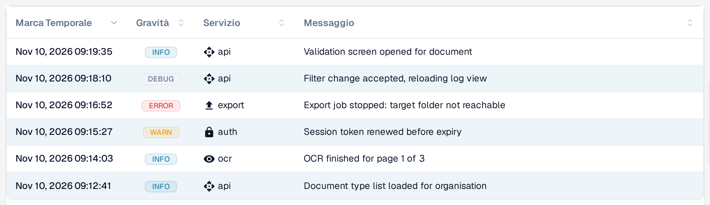

# Registro attività

<figure><figcaption>
Filtri del registro attività nell’interfaccia italiana: intervallo di tempo, gravità, servizio e ricerca. Le quattro gravità Debug, Info, Warning ed Error restano in inglese anche nell’interfaccia italiana.
</figcaption></figure>

Activity Logging offre una vista in tempo reale degli eventi di sistema di tutti i servizi DocBits. Usalo per monitorare l'attività di elaborazione, risolvere gli errori e verificare il comportamento del sistema.

## Banner di analisi

In cima alla pagina, il link **Visualizza la dashboard di analisi** apre la Dashboard di analisi con grafici, metriche e monitoraggio in tempo reale.

## Filtri

| Filtro | Descrizione |
|--------|-------------|
| **Intervallo di tempo** | Seleziona un intervallo di tempo: **Ultima ora**, **Oggi**, **Ultimi 7 giorni**, **Ultimi 30 giorni** o **Personalizzato**. |
| **Gravità** | Attiva o disattiva i livelli di gravità: **Debug**, **Info**, **Warning** ed **Error**. Ogni chip mostra il conteggio attuale degli eventi. Queste quattro etichette restano in inglese anche nell'interfaccia italiana. |
| **Servizio** | Filtra i log per servizio: **API**, **AUTH**, **OCR** ed **EXPORT**. |
| **Cerca nei registri...** | Ricerca a testo libero nei messaggi di log. |

## Tabella dei log

<figure><figcaption>
La tabella del registro mostra la colonna Servizio con il servizio che ha generato la voce: api, auth, ocr od export. Ogni intestazione si può ordinare con un clic.
</figcaption></figure>

| Colonna | Descrizione |
|--------|-------------|
| **Marca Temporale** | Data e ora in cui si è verificato l'evento. |
| **Gravità** | Badge colorato, con testo abbreviato: Info (blu), Warning (giallo), Error (rosso) e Debug (grigio). |
| **Servizio** | Il servizio che ha generato il log (ad es. api, auth, ocr, export). |
| **Messaggio** | Il messaggio di log completo con i dettagli dell'evento. |

Le quattro colonne si possono ordinare facendo clic sull'intestazione.

I risultati sono paginati — usa i controlli in basso per scorrere le pagine. I pulsanti **Previous** e **Next** restano in inglese anche nell'interfaccia italiana.

## Dettagli del registro

Seleziona una riga del registro per aprire la vista di dettaglio. Il riepilogo mostra gravità, marca temporale, servizio e ID del log, con il messaggio dell'evento sotto.

La sezione **Dettagli del registro** contiene l'evento completo in formato JSON. A seconda dell'evento, possono essere inclusi metadati come origine, ambiente, utente, risorsa, azione e informazioni di rete o sul client. I campi senza valore possono apparire come `null`.

Seleziona l'icona di copia in basso a destra in **Dettagli del registro** per copiare il record JSON completo negli appunti. Usa la freccia indietro accanto a **Registro attività** per tornare all'elenco.

## Azioni a piè di pagina

Anche questi pulsanti restano in inglese nell'interfaccia italiana.

| Azione | Descrizione |
|--------|-------------|
| **Auto-refresh** | Attiva per aggiornare automaticamente la vista dei log a intervalli regolari. |
| **Refresh Now** | Aggiorna manualmente i dati dei log. |
| **Export JSON** | Esporta i log filtrati correnti come file JSON. |
| **Download Logs** | Scarica i dati completi dei log. |
