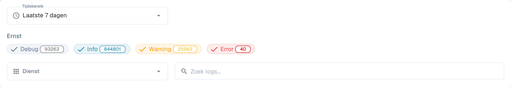
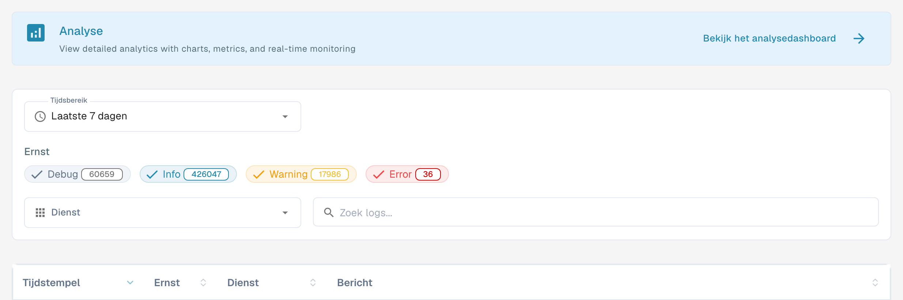
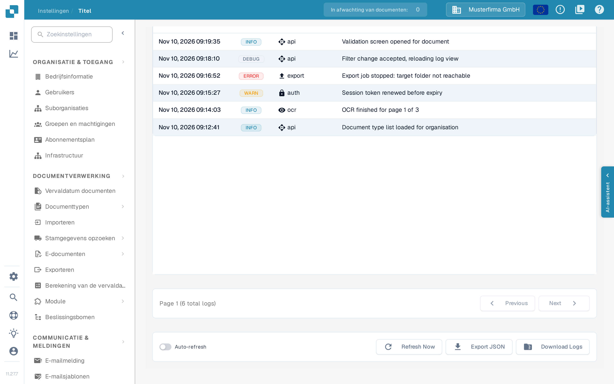

# Activiteitenlogboek

<figure><figcaption>
Filters van het activiteitenlogboek; vermeldingen zijn afgeschermd.
</figcaption></figure>

Activity Logging biedt een realtime overzicht van systeemgebeurtenissen in alle DocBits-services. Gebruik het om verwerkingsactiviteit te bewaken, fouten op te sporen en systeemgedrag te auditen.

## Analytics-banner

Bovenaan de pagina verwijst een banner met de knop **Bekijk het analysedashboard** naar het analysedashboard met grafieken, statistieken en realtime monitoring.

## Filters

| Filter | Beschrijving |
|--------|-------------|
| **Tijdsbereik** | Selecteer een tijdvenster: **Laatste uur**, **Vandaag**, **Laatste 7 dagen**, **Laatste 30 dagen** of **Aangepast**. |
| **Ernst** | Schakel ernstniveaus in of uit om ze op te nemen of uit te sluiten: **Debug**, **Info**, **Warning** en **Error**. Deze vier chipnamen blijven ook in de Nederlandse interface Engels. Elke chip toont het huidige aantal. |
| **Dienst** | Filter logboeken op dienst: **API**, **AUTH**, **OCR** of **EXPORT**. |
| **Zoek logs** | Vrije tekst zoeken in logberichten. Het zoekveld toont de plaatsaanduiding **Zoek logs...**. |

## Logtabel

<figure><figcaption>
Werkelijke Nederlandstalige logweergave: de kolom Dienst geeft de service aan die het logbericht heeft gegenereerd en komt overeen met het filter Dienst. Logregels en exportmetadata vallen buiten deze weergave.
</figcaption></figure>

| Kolom | Beschrijving |
|--------|-------------|
| **Tijdstempel** | Datum en tijdstip waarop de gebeurtenis plaatsvond. |
| **Ernst** | Kleurgecodeerde badge: Info (blauw), Warning (geel), Error (rood), Debug (grijs). |
| **Dienst** | De dienst die het logbericht heeft gegenereerd (bijv. api, auth, ocr, export). |
| **Bericht** | Het volledige logbericht met details van de gebeurtenis. |

Alle vier kolommen zijn sorteerbaar via de pijltjes in de kolomkop.

De resultaten zijn gepagineerd — gebruik de bedieningselementen onderaan om door de pagina's te navigeren. De paginering toont het totale aantal logboeken, bijvoorbeeld **Page 1 (6 total logs)**, met de knoppen **Previous** en **Next**; deze twee aanduidingen blijven ook in de Nederlandse interface Engels.

## Logboekdetails

Selecteer een logregel om de detailweergave te openen. De samenvatting toont de ernst, het tijdstip, de dienst en het log-ID, met daaronder het bericht van de gebeurtenis.

De sectie **Logboekdetails** bevat de volledige gebeurtenis als opgemaakte JSON. Afhankelijk van de gebeurtenis kan dit metadata bevatten, zoals de bron, omgeving, gebruiker, resource, actie en netwerk- of clientinformatie. Velden zonder waarde kunnen als `null` worden weergegeven.

Selecteer het kopieerpictogram rechtsonder in **Logboekdetails** om het volledige JSON-record naar het klembord te kopiëren. Gebruik de terugpijl naast **Activiteitenlogboek** om naar de lijst terug te keren.

## Acties in de voettekst

<figure><figcaption>
Onderkant van het activiteitenlogboek: logregels met de kolom Dienst, de paginering met <strong>Previous</strong> en <strong>Next</strong>, de schakelaar <strong>Auto-refresh</strong> en de knoppen <strong>Refresh Now</strong>, <strong>Export JSON</strong> en <strong>Download Logs</strong>. De logregels zijn voorbeeldgegevens.
</figcaption></figure>

| Actie | Beschrijving |
|--------|-------------|
| **Auto-refresh** | Schakelaar om de logweergave met regelmatige tussenpozen automatisch te vernieuwen. |
| **Refresh Now** | Ververs de loggegevens handmatig. |
| **Export JSON** | Exporteer de huidige gefilterde logboeken als JSON-bestand. |
| **Download Logs** | Download de volledige loggegevens. |
