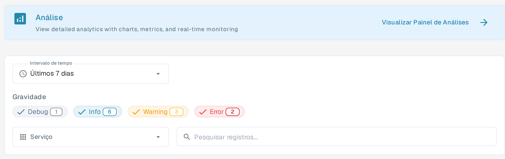
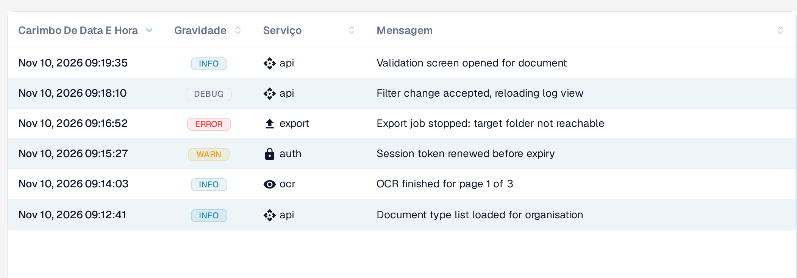

# Registro de atividades

<figure><figcaption>
Filtros do Registro de atividades na interface portuguesa: intervalo de tempo, gravidade, serviço e pesquisa. Os quatro chips Debug, Info, Warning e Error permanecem em inglês também na interface portuguesa.
</figcaption></figure>

O Registro de atividades (menu **SISTEMA E ADMINISTRAÇÃO**) mostra os eventos do sistema de todos os serviços do DocBits em tempo real. Use-o para monitorar a atividade de processamento, solucionar erros e auditar o comportamento do sistema.

## Banner de Análise

No topo da página, o banner **Análise** contém o link **Visualizar Painel de Análises**, que abre o [painel de análise](analytics.md) com gráficos, métricas e monitoramento em tempo real. O subtítulo do banner permanece em inglês na interface portuguesa.

## Filtros

| Filtro | Descrição |
|--------|-------------|
| **Intervalo de tempo** | Selecione uma janela de tempo: **Última hora**, **Hoje**, **Últimos 7 dias**, **Últimos 30 dias** ou **Personalizado**. |
| **Gravidade** | Ative ou desative os níveis: **Debug**, **Info**, **Warning** e **Error**. Cada chip mostra a contagem atual de registros. Esses quatro rótulos permanecem em inglês também na interface portuguesa. |
| **Serviço** | Filtre os registros por serviço: **API**, **AUTH**, **OCR** e **EXPORT**. |
| **Pesquisar registros...** | Pesquisa de texto livre nas mensagens de registro. |

## Tabela de Logs

<figure><figcaption>
A tabela mostra na coluna Serviço qual serviço gerou o registro: api, auth, ocr ou export. As quatro colunas podem ser ordenadas clicando no cabeçalho.
</figcaption></figure>

| Coluna | Descrição |
|--------|-------------|
| **Carimbo De Data E Hora** | Data e hora em que o evento ocorreu. |
| **Gravidade** | Selo colorido com o texto em maiúsculas: INFO (azul), WARN (amarelo), ERROR (vermelho) e DEBUG (cinza). |
| **Serviço** | O serviço que gerou o registro (por exemplo, api, auth, ocr, export). |
| **Mensagem** | A mensagem de registro completa com os detalhes do evento. |

Todas as quatro colunas podem ser ordenadas clicando no cabeçalho.

Os resultados são paginados — use os controles na parte inferior para navegar entre as páginas. O indicador de páginas, por exemplo **Page 1 (6 total logs)**, e os botões **Previous** e **Next** permanecem em inglês na interface portuguesa. Os carimbos de data e hora são exibidos no formato inglês, por exemplo **Nov 10, 2026 09:19:35**.

## Detalhes do registro

Selecione uma linha de registro para abrir a vista de detalhes. O cabeçalho mostra o selo de gravidade, o carimbo de data e hora, o serviço e o ID do registro, com a mensagem do evento por baixo.

A seção **Log Details** contém o evento completo formatado em JSON; o nome da seção permanece em inglês. Dependendo do evento, ela pode incluir metadados como a origem, o ambiente, o usuário, o recurso, a ação e informações de rede ou do cliente. Campos sem valor podem aparecer como `null`.

Selecione o ícone de cópia no canto superior direito da seção **Log Details** para copiar o registro JSON completo para a área de transferência. Use o link **BACK TO LOGS** no topo da página para voltar à lista.

## Ações do Rodapé

Estas quatro ações permanecem em inglês na interface portuguesa.

| Ação | Descrição |
|--------|-------------|
| **Auto-refresh** | Ative para atualizar automaticamente a visualização dos registros em intervalos regulares. |
| **Refresh Now** | Atualize manualmente os dados de registro. |
| **Export JSON** | Exporte os registros filtrados atuais como um arquivo JSON. |
| **Download Logs** | Baixe os dados de registro completos. |
