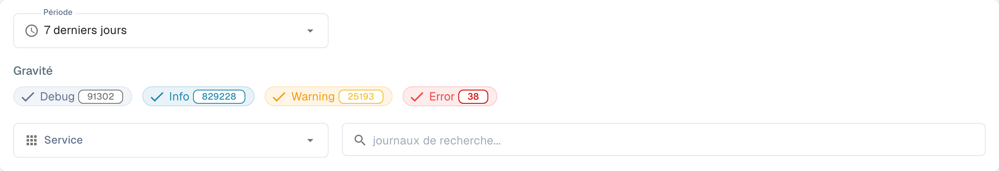
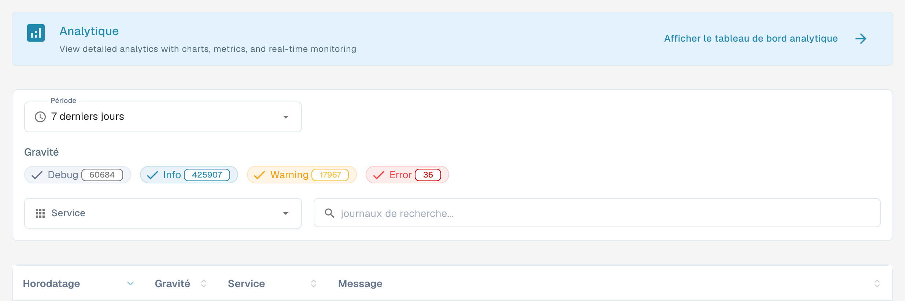

# Journal d’activité

<figure><figcaption>
Filtres du journal d’activité ; les entrées sont masquées.
</figcaption></figure>

Activity Logging offre une vue en temps réel des événements système de tous les services DocBits. Utilisez-le pour surveiller l'activité de traitement, diagnostiquer les erreurs et auditer le comportement du système.

## Bannière d’analyse

En haut de la page, une bannière renvoie vers l'**Tableau de bord analytique** pour les graphiques, les indicateurs et la surveillance en temps réel.

## Filtres

| Filtre | Description |
|--------|-------------|
| **Période** | Sélectionnez une période (par exemple Aujourd'hui, 7 derniers jours, Les 30 derniers jours). |
| **Gravité** | Activez ou désactivez les niveaux de gravité à inclure ou à exclure : **Debug**, **Info**, **Warning**, **Error**. Chaque pastille indique le nombre actuel. |
| **Service** | Filtrez les journaux par service (par exemple api, auth, ocr, export). |
| **journaux de recherche** | Recherche en texte libre dans les messages de journal. |

## Tableau des journaux

<figure><figcaption>
Vue réelle du journal d’activité en français : la colonne « Service » identifie le service à l’origine du journal et correspond au filtre Service. Les entrées et les métadonnées d’exportation sont hors cadre.
</figcaption></figure>

| Colonne | Description |
|--------|-------------|
| **Horodatage** | Date et heure de l'événement. Triable. |
| **Gravité** | Badge de couleur : Info (bleu), Warning (jaune), Error (rouge), Debug (gris). |
| **Service** | Le service qui a généré le journal (par exemple api, auth, ocr, export). |
| **Message** | Le message de journal complet avec les détails de l'événement. |

Les résultats sont paginés — utilisez les commandes en bas de page pour naviguer entre les pages.

## Détails du journal

Sélectionnez une ligne de journal pour ouvrir sa vue détaillée. Le résumé affiche la gravité, l'horodatage, le service et l'ID du journal, avec le message de l'événement juste en dessous.

La section **Log Details** contient l'événement complet au format JSON. Selon l'événement, elle peut inclure des métadonnées telles que la source, l'environnement, l'utilisateur, la ressource, l'action et les informations réseau ou client. Les champs sans valeur peuvent apparaître sous la forme `null`.

Sélectionnez l'icône de copie en bas à droite de **Log Details** pour copier l'enregistrement JSON complet dans le presse-papiers. Utilisez la flèche de retour **BACK TO LOGS** en haut de la page pour revenir à la liste.

## Actions du pied de page

| Action | Description |
|--------|-------------|
| **Auto-refresh** | Activez cette option pour actualiser automatiquement l'affichage des journaux à intervalles réguliers. |
| **Refresh Now** | Actualise manuellement les données des journaux. |
| **Export JSON** | Exporte les journaux actuellement filtrés sous forme de fichier JSON. |
| **Download Logs** | Télécharge l'ensemble des données de journal. |
