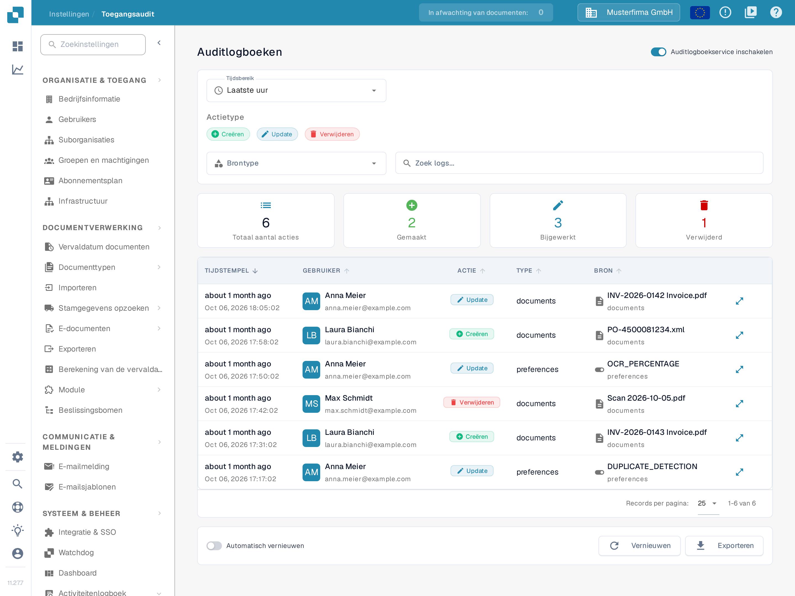
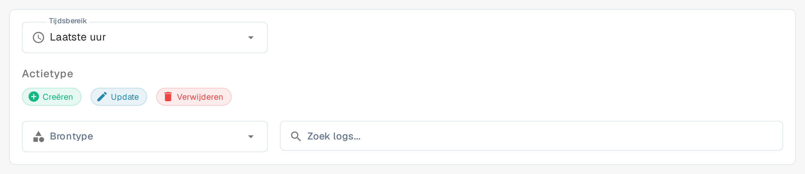

# Toegangsaudit

## Videotutorial: Bedrijf, abonnement en audit


Bedrijfsinformatie, abonnementsplan en auditlogboeken in DocBits


De video toont de bedrijfsinformatie en bedrijfsvoorkeuren, het abonnementsplan, de aanmeldingsactiviteit en de auditlogboeken.

<figure><figcaption>
In dit voorbeeld is de auditlogboekservice al ingeschakeld. De samenvattingskaarten gelden voor het gekozen tijdsbereik.
</figcaption></figure>

Toegangsaudit registreert wie een bron heeft aangemaakt, gewijzigd of verwijderd, en wanneer. Open **Instellingen → Activiteitenlogboek → Toegangsaudit**; de pagina zelf heet **Auditlogboeken**. Schakel de dienst voor een organisatie alleen in wanneer u auditgebeurtenissen wilt verzamelen.

## Wanneer auditregistratie uit staat

Het eerste bezoek binnen een browsersessie kan het venster **Audit Trail is Disabled** tonen. **Dichtbij** sluit het venster en laat auditregistratie uitgeschakeld. **Enable Audit Trail** schakelt de dienst voor de huidige organisatie in. Op de pagina achter het venster doen de knop **Nu inschakelen** en de schakelaar **Auditlogboekservice inschakelen** hetzelfde. Deze bedieningselementen wijzigen de instelling van de organisatie; ze tonen de functie niet alleen als voorbeeld. De titel, de uitleg en de knop **Enable Audit Trail** zijn in de toepassing Engels; alleen **Dichtbij** is vertaald.

Zolang de dienst uit staat, tonen de filters en de logtabel geen gebeurtenissen. De lege status **Auditlogboek is uitgeschakeld** legt uit hoe u registratie inschakelt. Gebruik na het inschakelen de schakelaar om de dienst indien nodig weer uit te schakelen. Gebeurtenissen zijn alleen beschikbaar wanneer de dienst is ingeschakeld en gegevens heeft verzameld.

## Een gebeurtenis vinden

<figure><figcaption>
Filters voor tijdsbereik, actietype, brontype en het doorzoeken van de logboeken.
</figcaption></figure>

| Bediening | Wat deze doet |
|---|---|
| **Tijdsbereik** | Beperkt de lijst tot een periode: **Laatste uur**, **Vandaag**, **Laatste 7 dagen**, **Laatste 30 dagen** of **Aangepast**. |
| **Actietype** met **Creëren**, **Update** en **Verwijderen** | Neemt die soorten acties op of sluit ze uit. |
| **Brontype** | Beperkt de resultaten tot **Documenten** of **Modulewijzigingen**. |
| **Zoek logs...** | Doorzoekt de zichtbare auditregels op tekst. |
| **Records per pagina:** | Stelt in hoeveel regels per pagina worden getoond; standaard 25. De voettekst toont daarnaast het zichtbare bereik, bijvoorbeeld 1-6 van 6. Het woord "Records" is in de toepassing niet vertaald. |
| **Automatisch vernieuwen** | Houdt de lijst automatisch bijgewerkt zolang de pagina open is. |
| **Vernieuwen** | Laadt de nieuwste overeenkomende regels eenmalig. |
| **Exporteren** | Downloadt de zichtbare auditgegevens als JSON-bestand. |

De samenvattingskaarten tonen **Totaal aantal acties**, **Gemaakt**, **Bijgewerkt** en **Verwijderd** voor de gekozen filters. In de tabel toont **TIJDSTEMPEL** wanneer een gebeurtenis plaatsvond, identificeert **GEBRUIKER** de actor, benoemt **ACTIE** de wijziging, toont **TYPE** bij welke tabel de gebeurtenis hoort en identificeert **BRON** het betrokken item. Met de knop aan het einde van een regel (**Bekijk gedetailleerde wijzigingen in het pop-upvenster.**) opent u de vastgelegde wijziging. Met de pijlen in de kolomkoppen sorteert u de lijst op die kolom. Relatieve tijd, datumnotatie en de waarden in de kolom **TYPE** (zoals documents of preferences) blijven in de toepassing Engels. Als er geen gebeurtenissen verschijnen, controleer dan of de dienst is ingeschakeld en verruim het tijdsbereik voordat u de andere filters wijzigt.
